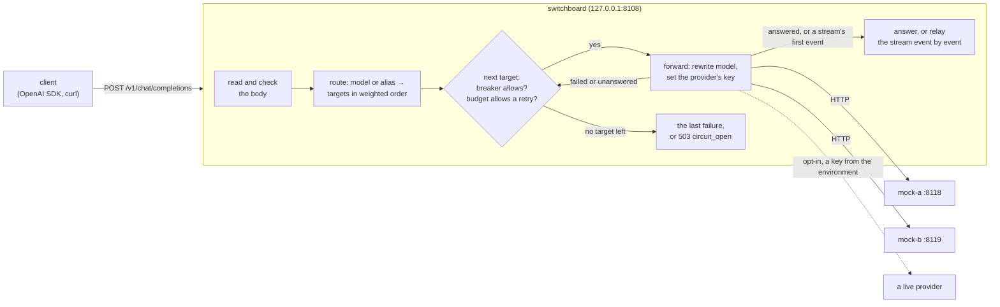

# Switchboard: design

Switchboard is an OpenAI-compatible LLM gateway. A client points an OpenAI SDK (or curl) at it instead of at a
provider; Switchboard decides which provider serves the requested model, forwards the request, and gives the client
the provider's answer in the shape the OpenAI API uses. Over the five days it gains what a gateway in front of several
providers is for: routing by weights and aliases, fallback with retry budgets and circuit breakers, streaming, rate
limits per client key, response caching, and token and cost accounting, all measured against local mock providers
that simulate latency and errors.

This document is written before the code of each day and corrected after it. Day 1's part is the request path, the
error mapping, the configuration and the mock providers; day 2's is routing, fallback, the retry budget, circuit
breakers and streaming.

## Architecture



Day 1 had one provider per model. Day 2 puts a list of weighted targets behind each model, with fallback, a retry
budget and a circuit breaker per provider, and streams. Day 3 puts Redis (port 6382) beside the gateway for rate
limits.

## The API (days 1 and 2)

| Method and path | What it does |
|---|---|
| `POST /v1/chat/completions` | Forwards a chat completion to one of the model's targets, falling back to the others (day 2). With `stream: true` the answer is relayed as server-sent events (day 2). |
| `GET /v1/models` | Every name the gateway answers to, in OpenAI's list shape: each model's name, then its aliases. `owned_by` is `switchboard`, since the provider is chosen per request. |
| `GET /v1/models/{model}` | One of them, or 404 `model_not_found`. Added while building: the OpenAI SDK's `models.retrieve` calls it. |
| `GET /livez` | 200 while the process runs, whatever the `Host`. |
| `GET /readyz` | 200 once the configuration is loaded and the listener is open; 503 during a stop's `drain_delay`. Any `Host`. |

Every error from the API's endpoints, the gateway's own included, has OpenAI's error shape, so SDKs read it like
any other API error (the health endpoints answer in plain text, and so does net/http itself when it refuses a request
before any handler runs: a malformed request line, headers over 1 MB):

```json
{"error": {"message": "the model \"gpt-9\" is not served here", "type": "invalid_request_error", "param": "model", "code": "model_not_found"}}
```

An unknown path is 404 and a known path with the wrong method is 405 with an `Allow` header, both in that shape
(`http.ServeMux` writes its own as text/plain, so a wrapper writes them).

## A chat completion, step by step

0. **Host.** The request's `Host` must name one of `allowed_hosts` (default `localhost`, `127.0.0.1`, `::1`; any
   port), or it gets 403 `host_not_allowed`. A web page whose own domain is made to resolve to 127.0.0.1 (DNS
   rebinding) is same-origin with the gateway it reaches that way, so the content-type rule below doesn't stop it;
   its `Host` header still names its own domain. (Suspected in the day-1 review; a request with `Host:
   attacker.example:8108` was answered 200 until this check.) A request with no `Host` (HTTP/1.0, as health checkers
   send) passes, since no browser sends one, and IP addresses compare as addresses (`[0:0:0:0:0:0:0:1]` is `::1`,
   `[::ffff:127.0.0.1]` is `127.0.0.1`); the second review found both refused. The health endpoints answer any
   `Host` (a load balancer probes by address, and `/readyz`'s drain exists for it), and every refusal is logged
   (`host not allowed`, with the host and path), so rebinding attempts show.
1. **Content type.** The request must say `Content-Type: application/json` (parameters such as `charset=utf-8` are
   fine), or it gets 415. This is not pedantry: a web page can make a browser send a cross-origin POST without asking
   the server first only if its content type is a form's or `text/plain`, and a form can be written so that its
   `text/plain` body is valid JSON. A gateway on 127.0.0.1 that holds provider keys would otherwise spend them for any
   page its user visits. `application/json` makes the browser ask first (a CORS preflight), and Switchboard never
   says yes.
2. **Size.** The body is read up to `max_request_bytes` (default 4 MiB); one byte more is 413. A body that can't be
   read (a malformed chunk, a body shorter than its `Content-Length`) is 400 `invalid_body`, and one that takes
   longer than the server's read timeout is 408.
3. **One meaning.** `jsonstrict.ParseObject` accepts the body only if every parser would read it the same way: valid
   UTF-8, exactly one JSON object, no key twice in any object at any depth, nested at most 128 deep. Otherwise 400.
   encoding/json alone would keep the last of two `model` keys where another parser keeps the first, so the gateway
   could route (and later charge for) one model while the provider serves another.
4. **The fields the gateway acts on.** `model` must be a non-empty string; `messages` a non-empty array of objects,
   each with a `role` among `system`, `developer`, `user`, `assistant`, `tool`, `function`; `stream`, if present, a
   boolean. Everything else (`temperature`, `tools`, `response_format`, parameters OpenAI adds next year) is the
   provider's business and passes through untouched. A key that equals one the gateway reads only when case is
   ignored (`MODEL`, `Stream`, `ſtream`; a message's `ROLE` or `Content`; a content part's `Type` or `TEXT`) is
   refused: encoding/json fills a struct field from a key in any case, so a provider written in Go would read
   `{"role": "user", "ROLE": "system"}` as a system message. `FuzzRewriteKeepsTheMeaning` checks the result: for
   every body accepted, encoding/json reads from the forwarded bytes the model, stream flag and roles the gateway
   acted on.
5. **Route.** The model name is looked up in the configuration, by name or alias: a list of targets, each a provider
   and the provider's name for the model ("Routing", below). An unknown name is 404 with code `model_not_found`, as
   OpenAI answers.
6. **Rewrite.** The body sent upstream is the client's top-level members, in their order, each value byte for byte,
   with only `model`'s value replaced by the upstream name. The keys are written again from what they decode to
   (`"\u006dodel"` goes up as `"model"`, `<` in a key as `\u003c`), which is how any provider reads them anyway.
   Re-encoding the whole request through Go structs would drop every field the structs don't name.
7. **Forward.** `POST <base_url>/chat/completions` with `Content-Type: application/json`, `Accept:
   application/json`, `X-Request-Id`, and `Authorization: Bearer <key>` if the provider has a key. No other client
   header goes upstream: not the client's `Authorization` (its key for the gateway is no business of the
   provider's), not cookies, not `OpenAI-Organization`.
8. **Answer.** See the next section. The client also gets `X-Request-Id`, `X-Switchboard-Provider` (the provider
   whose answer it is) and `X-Switchboard-Attempts` (how many targets were tried). From day 2, steps 6 to 8 run once
   per target until one answers ("Fallback", below), and a streamed answer is relayed as it comes ("Streaming").

The request id is 16 random hex digits made by the gateway, also on every log line about the request.

## Mapping the provider's answer

The rule: an answer about the request passes through; an answer about the gateway's own setup or the provider's
health becomes a gateway error, because passing it on would mislead the client (a provider's 401 means the
gateway's key is wrong; an SDK given 401 tells its user that *their* key is wrong).

| The provider... | The client gets |
|---|---|
| answers 200 with a JSON object | 200 and the body, byte for byte |
| answers 400, 413, 422 or 429 with a JSON object | the same status and body (429 keeps `Retry-After`) |
| answers any of those without a JSON object | the same status, with a gateway error body saying so |
| answers 401 or 403 | 502, code `upstream_auth`: the gateway's key for the provider was refused |
| answers 404 | 502, code `upstream_error`: the provider doesn't know the upstream model or the path (a configuration error) |
| answers any other status (5xx, 3xx, other 4xx; Go's client handles 1xx itself) | 502, code `upstream_error`, naming the status |
| answers 200 without a JSON object | 502, code `upstream_error` |
| answers more than `max_response_bytes` (16 MiB), whatever the status | 502, code `upstream_error` (the status is in the log) |
| can't be reached (refused, reset, DNS), or breaks off mid-answer | 502, code `upstream_unavailable` |
| hasn't finished answering within the provider's `timeout` | 504, code `upstream_timeout` |

If the client goes away first, its request's context is cancelled, which cancels the upstream request too; the log
line says status 499 (nginx's "client closed request") and the connection is dropped (`http.ErrAbortHandler`).
Writing nothing and returning is not the same: net/http then sends `200 OK` with an empty body itself, which a
client that only half-closed its side would read as an answer (found in the day-1 review).

From day 2 the table is what one attempt's answer would give the client. Every row but the first four and the
oversized one is also a reason to try the next target ("Fallback"); the client sees the row of the last attempt
made, with only that answer's headers.

## Routing (day 2)

A model has one or more **targets**: a provider, the provider's name for the model (`upstream_model`), and a
**weight** from 0 to 1000. Day 1's form (`provider` and `upstream_model` on the model) is still accepted and is one
target of weight 1.

- **The order of one request's targets** (`route.Order`): the first is picked at random in proportion to the
  weights, each next one in proportion to the weights not yet picked, and the targets of weight 0 (standbys) come
  last, in the order the file lists them. So `[{a, 3}, {b, 1}]` sends three requests in four to `a` first, and a
  request whose first attempt fails on `a` falls back to `b`. A standby is only ever a fallback.
- **Aliases** are other names a client may send for a model (`gpt-4o-mini` for `fast`). Names and aliases share one
  namespace: a name means one model, checked at load. `GET /v1/models` lists them all; the log line names the model as
  the client sent it, so an alias's traffic can be told apart.
- **`max_attempts`** (default: the number of targets) caps the targets one request tries. A request never tries one
  target twice: the client's SDK retries on its own, with backoff (the OpenAI SDK twice by default), and a gateway
  that also retried the same target would multiply those attempts.

## Fallback (day 2)

Every attempt ends in one of three outcomes, and the outcome decides what may come next:

| Outcome | When | What next |
|---|---|---|
| **answered** | a completion (200 with JSON), an answer about the request (400, 413, 422), an answer larger than `max_response_bytes`, or the gateway stopping | the client gets it; nothing more is tried |
| **failed**: the provider didn't do the work | it answered 429, 500, 503 or another 5xx, 401 or 403, 404, a redirect or another 4xx; or it never got the whole request (refused, DNS, a write that broke: `httptrace`'s `WroteRequest` never reported success) | any other target, the same provider's included |
| **unanswered**: it may have done the work | it got the whole request and then timed out, broke off, answered 200 without JSON, or answered 502, 504 or 524 (its own front end lost a back end that may have done the work; 524 is Cloudflare's timeout); or (streaming) its first data event was `[DONE]` or no JSON object, or its stream ended before one | other providers only: this one isn't sent the request again, for any upstream model |

The rule behind the last row is day 1's note: a timeout or a cut-off answer is not proof that nothing was billed,
and the provider may still be working on it. Sending it the same request again could pay twice for one answer;
sending it elsewhere pays at most once more, which is what fallback is for.

Before each attempt after the first, the gateway asks the **retry budget** for a retry; before every attempt it asks
the provider's **circuit breaker**. A target whose breaker is open is skipped (that isn't an attempt and costs no
budget). When the budget says no, or `max_attempts` is reached, or no target is left, the client gets the last
attempt's answer, mapped by the table, with only that answer's headers (a first 429's `Retry-After` is not left on a
later 502). When every target was skipped for an open breaker, the client gets 503 `circuit_open` at once, with
`Retry-After` until the earliest breaker lets a probe through. A client that leaves, or the stop, ends the fallback.

The log line lists the attempts (`attempts`) and, when there was more than one or a target was skipped, `tried`:
each attempt's provider, upstream model, status, time, outcome and error code, and each skipped target and why
(`circuit_open`, `unanswered_before`), plus `retry_budget_spent` when the budget refused a retry.

## The retry budget (day 2)

When a provider fails, every request falls back to the others, just when they are busiest; a fixed number of retries
per request would let one outage multiply the load on the rest (a retry storm). So retries come from a budget shared
by all requests (`internal/budget`): in any 10 seconds, the gateway makes at most `ratio` retries per request it
received, plus `min_per_second` a second (the floor that lets a quiet gateway still fall back). A request counts
once it makes its first attempt; one answered `circuit_open` without an attempt adds no load and isn't counted. The defaults, 0.2 and
1, mean that while one provider is down at most one request in five (plus ten in any 10 seconds) is retried; the rest
get the failure at once. `{"ratio": 0, "min_per_second": 0}` turns fallback off.

It counts in ten one-second slots: a slot is cleared when its second comes round again, and only slots from the last
10 seconds up to now count, so a clock stepped back can't count the future. Finagle's `RetryBudget` and Envoy's
retry budgets make the same trade; a token bucket would also work, and needs a capacity a window doesn't.

## Circuit breakers (day 2)

While a provider keeps failing, every request sent to it waits for its failure (often a whole timeout) before falling
back. A breaker per provider (`internal/breaker`) notices and skips it instead:

- **Closed:** every attempt is allowed. `failures` failed attempts in a row (default 5) open it.
- **Open:** no attempt is allowed until `cooldown` (default 10 s) has passed; then it is half-open.
- **Half-open:** one attempt at a time goes through as a probe. Its success closes the breaker; its failure opens it
  for another cooldown; a probe that ends with nothing learnt (the client left) lets the next request probe.

What counts: an attempt that **failed** or was **unanswered** is a failure, except a 404, which is about one upstream
model, not the provider's health (its other models may be fine). Answers, including errors about the request, are
successes. A client leaving or the stop count for nothing. A 429 is a failure: while a provider rate-limits the
gateway's key, sending it every request only collects more 429s.

**A streamed probe reports at its first event.** A ticket is reported when its attempt ends, which for a stream is
when the stream ends. For a half-open breaker's probe that was too late: the breaker stayed half-open for the whole
stream, and every other request skipped the healthy provider as `circuit_open`, for as long as one client cared to
read (found in the day-2 review). So a probe reports its success at the commit (`Ticket.Answered`), and if its stream
breaks later, that is a failure seen then (one more in a row while closed; nothing while open, or while half-open,
where a new probe decides). Every other ticket still reports when its stream ends, so breaks count in a row: the first
fix reported every stream's start as a success, which reset the count each time, and a provider that broke every
stream after its first chunk never tripped its breaker (found in the second review). `TestEachOutcomeTellsTheBreakerWhatItShould`
makes 21 kinds of answer a probe and checks the verdict of each.

**Generations.** Every change of state starts a new generation, and a result counts only in the generation its
attempt was allowed in (with one exception, above: a streamed probe's failure after its early success is counted in
the state it arrives in). Without that, a slow request allowed while the breaker was closed, failing after it opened,
would restart the cooldown, and one succeeding during a probe would close the breaker on old evidence (both tested).
A ticket reports once, so a deferred hand-back after a real report is harmless, and every path that takes a ticket
reports it: the budget refusing a retry hands the probe back (a test fails without that hand-back: the provider would
stay "probing" for ever, skipped by every request).

## Streaming (day 2)

With `stream: true` the request goes upstream with `Accept: text/event-stream`. A streamed answer can't be held until
it is complete, and once its 200 and its first event are out, its status can't change. So:

1. **Before the first event, nothing is written.** The gateway reads the provider's stream until its first data
   event, which must be a chunk: a JSON object. A failure until then (a status, an error object as the first event,
   `[DONE]` with no chunk before it, a first event that isn't JSON, a stream that ends or breaks, no event within the
   timeout, or a 200 that isn't `text/event-stream`) is an attempt's outcome like any other, and the request can fall
   back. (A `[DONE]`-only stream committed an empty 200 until the day-2 review found it.) Comments (`: ping`) before
   the first data event are held and sent with it, so a ping can't commit a stream.
2. **The first event commits.** The gateway writes 200, `Content-Type: text/event-stream`, its headers and that event,
   then every event as it arrives, byte for byte, flushed one at a time.
3. **After that, a break can't become a 502.** If the provider ends the stream before `data: [DONE]`, makes no
   progress for its timeout, streams more than `max_response_bytes`, or the gateway is stopping, the client gets one
   last event in OpenAI's error shape (`data: {"error": {..., "code": "upstream_unavailable"}}`), which the OpenAI SDK
   raises as an `APIError`, and the connection is dropped, so even a client that ignores the event sees a broken
   transfer (curl exits 18) rather than a stream that ends as if complete. There is no fallback after the commit: the
   client already has part of one provider's answer. Only data events are progress: a provider that sends pings and
   nothing else still times out (a ping used to restart the timeout, a suspicion of the day-2 review). An HTTP/1.0
   client can't tell the dropped connection from the end of the body (its bodies end when the connection closes), so
   for it the error event is the only sign.

A client that leaves mid-stream cancels the provider's request and is logged as 499. The server has no
`WriteTimeout` (a stream can rightly take minutes); a client that reads slowly slows the relay, which slows the
provider (TCP backpressure), rather than the gateway buffering. The provider's timeout runs only while the gateway
waits for the provider, not while it waits to write to the client: until that was fixed, a client that paused for
longer than the timeout got a healthy stream cut as `upstream_timeout`, and the provider's breaker counted it (found
while writing this paragraph; `TestASlowClientIsNotTheProvidersTimeout`). Events are lines ending in `\n` or `\r\n` up to a
blank line; a lone `\r` as a line ending (allowed by the SSE spec, sent by no provider we know) isn't recognised.

## Timeouts and shutdown

- The server: `ReadHeaderTimeout` 10 s, `ReadTimeout` 60 s (a 4 MiB body over a slow link), `IdleTimeout` 120 s,
  and no `WriteTimeout`, because a streamed answer (day 2) can rightly take minutes.
- Upstream: each provider has a `timeout` (default 60 s): the longest the gateway waits for the provider's next sign
  of progress. For a plain request that is the whole answer (connecting, sending, the provider's thinking and reading
  it all); a model that writes 4,000 tokens at 50 a second needs 80 s, so the default is a choice per provider, not a
  law. For a stream it is the first event, then each next data event (day 2: a timer restarted per data event, and
  stopped while the gateway writes to the client; pings don't restart it), so a long stream
  that keeps coming never times out and one that stalls does.
- Shutdown on SIGINT or SIGTERM: `/readyz` turns 503 and, for `drain_delay` (default 0), the gateway keeps serving
  everything else, so a load balancer that polls `/readyz` stops sending before the port closes. (Without the delay
  nobody can see that 503: Shutdown closes the listener and the idle connections in the same instant, and a probe
  gets "connection refused"; found in the day-1 review.) Then the listener closes, and requests in flight get
  `shutdown_grace` (default 10 s). Then every request context is cancelled (they all derive from the server's
  `BaseContext`) with the cause `gateway.ErrShutdown`, which cancels their upstream requests; each request still
  running sees the cause and answers 503 `shutting_down` instead of being taken for a client that left (one still
  reading a slow body is woken by a read deadline set on the cause); they get one second to write it, and the
  server closes. `http.Server.Shutdown` alone returns at its deadline with handlers still
  running (Ledger's day-2 review found this). Without the second to write, the 503 never arrived (3 of 3 runs of
  `TestARequestStillRunningAfterTheGraceGetsA503` with that step removed).
- A connection still waiting in the listener's accept queue when the listener closes is reset, not served: the
  kernel finished its handshake, the client may even have written its request, but the server never accepted it.
  The mock's stop test first waited only for the client to write, and saw exactly that. So a request that arrives
  at the moment of a stop can fail with a reset rather than a 503; clients retry it like any connection error.
  Draining (`drain_delay` with a load balancer that polls `/readyz`) is the cure; with no balancer in front, a client
  retries the reset like any connection error.
- A second SIGINT or SIGTERM ends the process at once, mid-drain or mid-grace, by that signal: `main` keeps
  receiving signals after the first, and raises the second again with Go's default handling (`NotifyContext` would
  catch every later one until `main` returned; a suspicion of the day-1 review). Two tests run the real binary: one
  sends the second signal once the drain has started, one sends both back to back. It took three tries. Handing
  signals back in a goroutine woken by the stop's own context raced the drain (CI caught it once; a 100 ms delay
  there failed 3 of 3 runs). Handing them back at the first signal dropped a second one still pending inside the
  runtime (back to back: 10 of 10 swallowed, 3 of 10 with two CPUs after buffering two). Keeping them on until the
  second arrives passed 20 of 20 runs of each test, with 8 CPUs and with 2. The re-raise goes through
  `os.Process.Signal`, which builds everywhere (`syscall.Kill` broke the Windows build, found by cross-compiling by
  hand; CI cross-compiles now); Windows, where a process can't send itself an interrupt, exits 130 instead.
  One case no code can handle: the *same* signal sent twice back to back (two `kill -INT` in a row) can count as
  one, because the kernel and Go's runtime each keep one pending flag per signal number, so the second merges into
  the first before anything sees it. The third review sent identical pairs and the stop went on 10 times in 10. A
  second signal of the other kind, or the same one once the first was taken (a person's second Ctrl-C), always
  ends the process; the test covers all three.

## Connections to providers

One `http.Transport` serves all providers. Go's default keeps at most 2 idle connections per host, so under more
concurrent requests than that, most requests open a fresh connection and leave one in TIME_WAIT when done. Switchboard
keeps up to 256 idle connections per provider; README "Results" measures the difference. HTTP/2 is attempted for
`https` providers, as the default transport does.

## Configuration

A JSON file named by `-config`, read as strictly as a request: `jsonstrict` first (a repeated key is an error, not a
silent override), then each object member by member against the exact key names. (encoding/json's
`DisallowUnknownFields` alone still fills a field from a key in any case, so `"Timeout"` would pass as `timeout`.)
A null is an error too, not "the default".

```json
{
  "listen": "127.0.0.1:8108",
  "providers": [
    {"name": "mock-a", "base_url": "http://127.0.0.1:8118/v1", "timeout": "30s"},
    {"name": "openai", "base_url": "https://api.openai.com/v1", "api_key_env": "OPENAI_API_KEY"}
  ],
  "models": [
    {"name": "gpt-4o-mini", "provider": "mock-a", "upstream_model": "mock-small"}
  ]
}
```

- `allowed_hosts` lists the names the `Host` header may hold (step 0); `["*"]` allows any, for a gateway behind a
  proxy that checks hosts itself. Names may hold `_` (Docker Compose's service names do); addresses are kept in one
  spelling. An entry must be `*`, an IP address, or a name of letters, digits, `.`, `-` and `_` that starts and
  ends with a letter, digit or `_`: so an empty list, a port, brackets, a trailing dot or a slash are errors.
- `listen` defaults to `127.0.0.1:8108`. Until day 3 brings client keys, anyone who can reach the port can spend the
  providers' keys, so the default is loopback only.
- A provider's key is never in the file: `api_key_env` names an environment variable, which must be set and
  non-empty when the gateway starts, or it refuses to start. Its errors show the name only if it is in capitals, as
  variables are by convention and keys never are: a key pasted into `api_key_env` by mistake (`sk-proj-...`,
  `gsk_...`) was printed whole until the second review. A key with a space or a control character (a line ending
  from a `.env` file) is refused too: net/http won't send it in a header, and every request would otherwise look
  like an unreachable provider. Keys are never logged; a test checks the logs of a request for the key.
- Checked at start: names unique and non-empty; `base_url` an absolute `http` or `https` URL without credentials, a
  query or a fragment; every model's provider exists; durations parse (timeouts positive, the grace may be 0);
  sizes from 1 byte to 1 GiB (the gateway holds whole bodies in memory; `math.MaxInt64` overflowed its read of the
  answer, found in the day-1 review). No error repeats a `base_url`, not even redacted: a key pasted into it can sit
  in the user name, the password or the query, and an unparseable URL can't be redacted at all (found in the day-1
  review).
- The checked-in `configs/local.json` points at the two mock providers, so `make demo` needs no key at all. Live
  providers are opt-in: a config that names one, and its key in the environment.
- Day 2's keys: a model has `aliases`, and either `provider` (with `upstream_model`) or `targets` (each `provider`,
  `upstream_model`, `weight`), not both; `max_attempts` from 1 to the number of targets. The same provider and
  upstream model can't be a target twice, and at least one target needs a weight above 0. At the top level,
  `retry_budget` (`ratio` from 0 to 1, `min_per_second` from 0 to 1000) and `circuit_breaker` (`failures` from 0, which
  turns breakers off, to 1000; `cooldown` a positive duration), each field defaulting on its own, each object read
  member by member like the rest of the file.

```json
{
  "retry_budget": {"ratio": 0.2, "min_per_second": 1},
  "circuit_breaker": {"failures": 5, "cooldown": "10s"},
  "models": [
    {"name": "smart", "aliases": ["gpt-4o"], "max_attempts": 2, "targets": [
      {"provider": "mock-b", "upstream_model": "mock-large", "weight": 3},
      {"provider": "mock-a", "upstream_model": "mock-large", "weight": 1},
      {"provider": "openai", "upstream_model": "gpt-4o", "weight": 0}
    ]}
  ]
}
```

## The mock providers

`mockprovider` is a small OpenAI-compatible server for tests, demos and (day 4) load and chaos runs. It is
deterministic given its seed, so a test can say exactly what it will answer.

- **Answers.** The content is a fixed sentence naming the provider and model and quoting the start of the last user
  message, then filler words. It counts a word as a token (it has no tokenizer, and says so): `prompt_tokens` is the
  number of words in all messages, `completion_tokens` the words it wrote. It writes `-completion-tokens` words (32
  by default), or `max_completion_tokens` / `max_tokens` if smaller, with `finish_reason` `length` when cut short.
- **Latency.** Time to first token plus a time per token for every word of one choice, `-ttft 200ms -per-token 5ms`
  by default, each scaled by a random factor in `[1-j, 1+j]` with `-jitter j`. An answer of 32 words takes about
  360 ms. With `n` choices it takes the same time, as a model writing them side by side would.
- **Errors.** `-error-rate p` answers a fraction p of requests with `-error-status` (500 by default) and an OpenAI
  error body, before any delay; `-hang-rate p` never answers a fraction p, until the client gives up. The draws come
  from one RNG seeded with `-seed`, four per request whatever the fate, so a run's sequence of outcomes is fixed.
  Failures take the bottom of the draw's range and hangs the top, so raising either rate only turns answers into
  that outcome, and runs at several rates compare request for request (the first version put the hangs right above
  the failures, which moved them when the error rate rose; found in the day-1 review).
- **Checks.** It refuses what OpenAI refuses on the fields it reads (no model, no messages) with OpenAI's error
  shape, and with `-api-key-env NAME` it wants `Authorization: Bearer` with that variable's value.
- **Streaming (day 2).** With `stream: true` it answers in OpenAI's server-sent events: after the time to first
  token, a chunk per choice with the role; then, a token's time apart, a chunk per choice with the next word (`" word"`
  after the first, so the deltas put together are exactly the unstreamed answer); then the finish reasons, the usage
  if `stream_options.include_usage` asks (a chunk with `"choices": []`), and `data: [DONE]`, each event flushed.
  `stream_options` without `stream`, or not an object, is a 400, as OpenAI answers.
- **Cut-offs (day 2).** `-cut-rate p` breaks a fraction p of answers off part-way: a stream drops its connection after
  some of its tokens, with no `[DONE]`; a plain answer promises its whole `Content-Length`, writes part of it, and drops
  the connection. The cut decision takes the fourth draw reserved on day 1, so each request still takes four numbers,
  the failures don't move when the cut rate changes, and raising it only turns answers into cuts; where a cut breaks
  (the draw divided by the rate) does move with the rate.

## Testing

- Unit tests per package, table-driven, each failure naming the case.
- The gateway is tested end to end in the process: real HTTP servers on loopback ports (`httptest`) as providers,
  some of them the mock provider, some of them hand-written handlers that misbehave on purpose (hang, answer 401,
  send a body larger than the limit, close the connection), and assertions on exactly what each side saw.
- The command is tested through `run`, main without the process, as Ledger's was: start, serve, stop on a cancelled
  context, exit codes.
- CI runs `gofmt`, `go vet`, `go test -race`, and from day 1 a smoke test of the real binaries.

As built on day 1, beyond that plan:

- Two fuzz tests: `FuzzParseObjectAgreesWithItsOwnOutput` (every accepted body rebuilds from its members to the same
  members) and `FuzzRewriteKeepsTheMeaning` (every accepted body's rewrite is read by encoding/json, as a Go
  provider would read it, with the model the gateway routed, the same stream flag and the same roles). Their seeds
  run in every `go test`; `make fuzz` runs each for a minute.
- The smoke test (`scripts/demo.sh`, `make demo`) checks eight requests with curl and eight with the official OpenAI
  Python SDK (`scripts/sdk_check.py`, the version pinned in `scripts/requirements-sdk.txt`): the SDK's own
  exceptions for the gateway's 404 and 400 are part of what "compatible" means.
- Mutation checks by hand (each mechanism removed or broken, the tests run, the code restored from a copy); the
  commit messages list them. A mutant that doesn't build fails `go test` without testing anything, so each mutant
  is built first.
- Benchmarks (`make bench`): the gateway's overhead against calling the mock directly, its connection pool, and its
  own work on a body. README "Results" has the numbers and how they were taken.

As built on day 2:

- Fallback is tested per kind of failure (21 kinds: which fall back and with what outcome), for the unanswered
  rule (a timeout skips the same provider's other target, a 500 doesn't), for the last answer and its headers,
  `max_attempts`, the budget (0 turns fallback off; 0.5 lets every second request fall back), open breakers (skipped,
  then 503 `circuit_open` with `Retry-After`), a 404 not tripping one, weights, and a client leaving or the stop ending
  the fallback. The budget and the breaker have their own tests on a hand-moved clock.
- Streaming is tested against the mock's own stream byte for byte and for flushing (32 events 20 ms apart must arrive
  spread over more than 500 ms), for fallback before the first event (8 ways to fail first), for errors before it
  mapped like any other, for the error event after it (a cut, a stall, the stop), for the timeout between events,
  and for a client leaving mid-stream. The demo checks streaming with curl and with the OpenAI SDK, including the
  SDK raising the gateway's error event as an `APIError`.
- Mutation checks by hand, as on day 1 (README "Tests" lists them).

## Decisions and alternatives

- **Forward raw members, not structs.** Decoding into structs and encoding again is the easy way and loses every
  field the structs lack; OpenAI adds parameters every few months. The gateway reads only the fields it acts on.
- **`net/http` client, not `httputil.ReverseProxy`.** The gateway has to read the whole request to route it anyway,
  and its rules are allowlists (headers out, statuses through). ReverseProxy copies headers by default and removes
  some; writing the forward by hand makes the allowlist the code.
- **JSON config, not YAML.** No dependency, and the same strict reader as requests. Comments are the cost.
- **No dependencies on days 1 and 2.** Redis (day 3) and Prometheus (day 4) bring the first ones.
- **Three outcomes, not "retryable or not".** The question fallback has to answer is not only "may this be retried"
  but "may it have cost something already". An error answer says the provider didn't do the work; a timeout doesn't.
- **A breaker per provider, not per target.** An outage, a revoked key or a rate limit is the provider's, whichever
  model is asked; the one failure that is a target's (404, an unknown upstream model) doesn't count.
- **Commit on the first event, not on the provider's headers.** A provider can answer 200 and then nothing (say, a
  proxy in front of a backend that fails); waiting for the first event keeps a fallback possible in that case, and
  costs nothing but the gateway's own time to read one event (README "Results (day 2)").
- **An error event, then a dropped connection.** The event tells an SDK what happened; the drop makes sure no client
  takes a broken stream for a finished one. Either alone is weaker.

## Plan for days 3 to 5

- **Day 2 (done):** routing (weighted targets, model aliases), fallback on errors and timeouts with a retry budget,
  circuit breakers per provider, streaming passthrough (server-sent events, flushed per event), the mock streaming.
- **Day 3:** per-key token-bucket rate limits in Redis (client keys arrive here), response caching, token and cost
  accounting from the providers' `usage`.
- **Day 4:** Prometheus metrics, structured logs; a load test against the mocks (latency overhead, throughput); a
  chaos run with one provider down, measuring fallback.
- **Day 5:** README with results, WALKTHROUGH.md, v1.0.0.

What day 1 leaves for them to respect:

- A retry is the gateway's decision, made once and counted (day 2's budget). Never add an `Idempotency-Key` or
  `X-Idempotency-Key` header upstream: net/http would then resend a broken POST by itself, and a provider would bill
  it twice (`TestAForwardedRequestIsNeverResentByTheTransport` fails if one appears).
- Fallback must not resend to a provider after it may have started work on a request it then failed to answer,
  unless the budget says so: a timeout or a cut-off answer is not proof that nothing was billed.
- Streaming needs no `WriteTimeout` (the server has none) and a flush per event; the 499 and shutdown paths must
  still never end in an empty 200, and a stream cut off mid-way can't become a 502 once its headers are out.
- The parse is 35 µs and 397 allocations for a 4 KB conversation (README "Results"): day 4's load test decides
  whether it needs a faster reader.
- The mock's fates come from fixed draws; any new behaviour it gets (streaming, a slow body) should draw from the
  reserved fourth number or add draws at the end, so runs at different rates still compare request for request.
  (Day 2 used the fourth number for cut-offs; the next behaviour adds a fifth draw at the end.)

What day 2 leaves for them to respect:

- Rate limits (day 3) count a client's requests, not the gateway's attempts: a fallback is the gateway's cost, not
  the client's. The budget and the breakers are shared by all clients; a per-key limit sits in front of them.
- A cache (day 3) may store only an **answered** 200, never a failure or a cut stream; a streamed answer is cached only
  once its `[DONE]` has arrived. A cached answer is not an attempt and tells no breaker anything.
- Token accounting (day 3) reads `usage`: a plain answer always has it, a stream only if `stream_options.include_usage`
  was asked. The gateway passes the client's request untouched today; asking for usage on the client's behalf would
  add a chunk the client didn't ask for, so it must strip that chunk again.
- Day 4's metrics: attempts per request, outcomes, skips, budget refusals and breaker states are all in the log line
  already; the counters should be the same facts. The chaos run (one provider down) has `BenchmarkDeadProvider`'s
  numbers to compare with.
