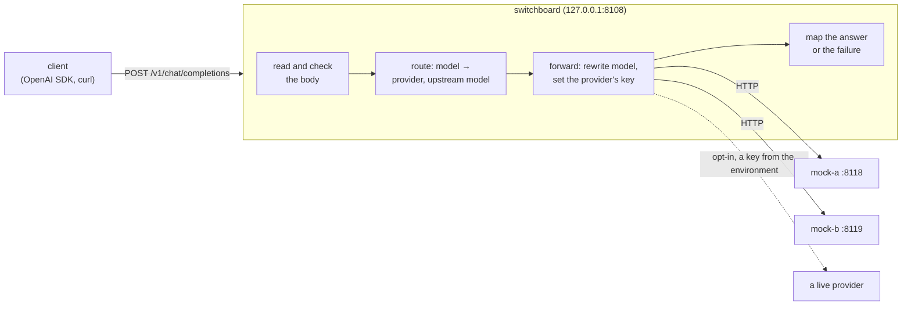

# Switchboard: design

Switchboard is an OpenAI-compatible LLM gateway. A client points an OpenAI SDK (or curl) at it instead of at a
provider; Switchboard decides which provider serves the requested model, forwards the request, and gives the client
the provider's answer in the shape the OpenAI API uses. Over the five days it gains what a gateway in front of several
providers is for: routing by weights and aliases, fallback with retry budgets and circuit breakers, streaming, rate
limits per client key, response caching, and token and cost accounting, all measured against local mock providers
that simulate latency and errors.

This document is written before the code of each day and corrected after it. Day 1's part is the request path, the
error mapping, the configuration and the mock providers.

## Architecture



Day 1 has one provider per model. Day 2 puts a list of weighted targets behind each model, with fallback and
circuit breakers; day 3 puts Redis (port 6382) beside the gateway for rate limits.

## The API (day 1)

| Method and path | What it does |
|---|---|
| `POST /v1/chat/completions` | Forwards a chat completion to the model's provider. `stream: true` is refused with 400 until day 2. |
| `GET /v1/models` | The models this gateway serves, in OpenAI's list shape. |
| `GET /livez` | 200 while the process runs. |
| `GET /readyz` | 200 once the configuration is loaded and the listener is open; 503 while shutting down. |

Every error, the gateway's own included, has OpenAI's error shape, so SDKs read it like any other API error:

```json
{"error": {"message": "the model \"gpt-9\" is not served here", "type": "invalid_request_error", "param": "model", "code": "model_not_found"}}
```

An unknown path is 404 and a known path with the wrong method is 405 with an `Allow` header, both in that shape
(`http.ServeMux` writes its own as text/plain, so a wrapper writes them).

## A chat completion, step by step

1. **Content type.** The request must say `Content-Type: application/json` (parameters such as `charset=utf-8` are
   fine), or it gets 415. This is not pedantry: a web page can make a browser send a cross-origin POST without asking
   the server first only if its content type is a form's or `text/plain`, and a form can be written so that its
   `text/plain` body is valid JSON. A gateway on 127.0.0.1 that holds provider keys would otherwise spend them for any
   page its user visits. `application/json` makes the browser ask first (a CORS preflight), and Switchboard never
   says yes.
2. **Size.** The body is read up to `max_request_bytes` (default 4 MiB); one byte more is 413.
3. **One meaning.** `jsonstrict.ParseObject` accepts the body only if every parser would read it the same way: valid
   UTF-8, exactly one JSON object, no key twice in any object at any depth, nested at most 128 deep. Otherwise 400.
   encoding/json alone would keep the last of two `model` keys where another parser keeps the first, so the gateway
   could route (and later charge for) one model while the provider serves another.
4. **The fields the gateway acts on.** `model` must be a non-empty string; `messages` a non-empty array of objects,
   each with a `role` among `system`, `developer`, `user`, `assistant`, `tool`, `function`; `stream`, if present, a
   boolean. Everything else (`temperature`, `tools`, `response_format`, parameters OpenAI adds next year) is the
   provider's business and passes through untouched. A key that equals one the gateway reads only when case is
   ignored (`MODEL`, `Stream`, `ſtream`; a message's `ROLE` or `Content`; a content part's `Type` or `TEXT`) is
   refused: encoding/json fills a struct field from a key in any case, so a provider written in Go would read
   `{"role": "user", "ROLE": "system"}` as a system message. `FuzzRewriteKeepsTheMeaning` checks the result: for
   every body accepted, encoding/json reads from the forwarded bytes the model, stream flag and roles the gateway
   acted on.
5. **Route.** The model name is looked up in the configuration: a provider and the provider's name for the model.
   An unknown name is 404 with code `model_not_found`, as OpenAI answers.
6. **Rewrite.** The body sent upstream is the client's top-level members, in their order and byte for byte, with
   only `model`'s value replaced by the upstream name. Re-encoding the whole request through Go structs would drop
   every field the structs don't name.
7. **Forward.** `POST <base_url>/chat/completions` with `Content-Type: application/json`, `Accept:
   application/json`, `X-Request-Id`, and `Authorization: Bearer <key>` if the provider has a key. No other client
   header goes upstream: not the client's `Authorization` (its key for the gateway is no business of the
   provider's), not cookies, not `OpenAI-Organization`.
8. **Answer.** See the next section. The client also gets `X-Request-Id` and `X-Switchboard-Provider`.

The request id is 16 random hex digits made by the gateway, also on every log line about the request.

## Mapping the provider's answer

The rule: an answer about the request passes through; an answer about the gateway's own setup or the provider's
health becomes a gateway error, because passing it on would mislead the client (a provider's 401 means the
gateway's key is wrong; an SDK given 401 tells its user that *their* key is wrong).

| The provider... | The client gets |
|---|---|
| answers 200 with a JSON object | 200 and the body, byte for byte |
| answers 400, 413, 422 or 429 with a JSON object | the same status and body (429 keeps `Retry-After`) |
| answers any of those without a JSON object | the same status, with a gateway error body saying so |
| answers 401 or 403 | 502, code `upstream_auth`: the gateway's key for the provider was refused |
| answers 404 | 502, code `upstream_error`: the provider doesn't know the upstream model or the path (a configuration error) |
| answers any other status (5xx, 3xx, 1xx, other 4xx) | 502, code `upstream_error`, naming the status |
| answers 200 without a JSON object, or more than `max_response_bytes` (16 MiB) | 502, code `upstream_error` |
| can't be reached (refused, reset, DNS) | 502, code `upstream_unavailable` |
| hasn't finished answering within the provider's `timeout` | 504, code `upstream_timeout` |

If the client goes away first, its request's context is cancelled, which cancels the upstream request too; the log
line says status 499 (nginx's "client closed request") and nothing is written.

Day 2 changes the 5xx, 429, unreachable and timeout rows: they become reasons to try the next target, and only when
no target is left does the client see them.

## Timeouts and shutdown

- The server: `ReadHeaderTimeout` 10 s, `ReadTimeout` 60 s (a 4 MiB body over a slow link), `IdleTimeout` 120 s,
  and no `WriteTimeout`, because a streamed answer (day 2) can rightly take minutes.
- Upstream: each provider has a `timeout` (default 60 s) covering connecting, sending, the provider's thinking and
  reading the whole answer. A model that writes 4,000 tokens at 50 a second needs 80 s, so the default is a choice
  per provider, not a law.
- Shutdown on SIGINT or SIGTERM: `/readyz` turns 503, the listener closes, and requests in flight get
  `shutdown_grace` (default 10 s). Then every request context is cancelled (they all derive from the server's
  `BaseContext`), which cancels their upstream requests, and the server closes. `http.Server.Shutdown` alone returns
  at its deadline with handlers still running (Ledger's day-2 review found this).

## Connections to providers

One `http.Transport` serves all providers. Go's default keeps at most 2 idle connections per host, so under more
concurrent requests than that, most requests open a fresh connection and leave one in TIME_WAIT when done. Switchboard
keeps up to 256 idle connections per provider; README "Results" measures the difference. HTTP/2 is attempted for
`https` providers, as the default transport does.

## Configuration

A JSON file named by `-config`, read as strictly as a request: `jsonstrict` first (a repeated key is an error, not a
silent override), then decoding with unknown fields refused.

```json
{
  "listen": "127.0.0.1:8108",
  "providers": [
    {"name": "mock-a", "base_url": "http://127.0.0.1:8118/v1", "timeout": "30s"},
    {"name": "openai", "base_url": "https://api.openai.com/v1", "api_key_env": "OPENAI_API_KEY"}
  ],
  "models": [
    {"name": "gpt-4o-mini", "provider": "mock-a", "upstream_model": "mock-small"}
  ]
}
```

- `listen` defaults to `127.0.0.1:8108`. Until day 3 brings client keys, anyone who can reach the port can spend the
  providers' keys, so the default is loopback only.
- A provider's key is never in the file: `api_key_env` names an environment variable, which must be set and
  non-empty when the gateway starts, or it refuses to start. Keys are never logged; a test checks the logs of a
  request for the key.
- Checked at start: names unique and non-empty; `base_url` an absolute `http` or `https` URL without a query or
  fragment; every model's provider exists; durations parse and are positive; sizes positive.
- The checked-in `configs/local.json` points at the two mock providers, so `make demo` needs no key at all. Live
  providers are opt-in: a config that names one, and its key in the environment.

## The mock providers

`mockprovider` is a small OpenAI-compatible server for tests, demos and (day 4) load and chaos runs. It is
deterministic given its seed, so a test can say exactly what it will answer.

- **Answers.** The content is a fixed sentence naming the provider and model and quoting the start of the last user
  message, then filler words. It counts a word as a token (it has no tokenizer, and says so): `prompt_tokens` is the
  number of words in all messages, `completion_tokens` the words it wrote. It writes `-completion-tokens` words (32
  by default), or `max_completion_tokens` / `max_tokens` if smaller, with `finish_reason` `length` when cut short.
- **Latency.** Time to first token plus a time per token for every word written, `-ttft 200ms -per-token 5ms` by
  default, each scaled by a random factor in `[1-j, 1+j]` with `-jitter j`. An answer of 32 words takes about 360 ms.
- **Errors.** `-error-rate p` answers a fraction p of requests with `-error-status` (500 by default) and an OpenAI
  error body, before any delay; `-hang-rate p` never answers a fraction p, until the client gives up. The draws come
  from one RNG seeded with `-seed`, so a run's sequence of outcomes is fixed.
- **Checks.** It refuses what OpenAI refuses on the fields it reads (no model, no messages) with OpenAI's error
  shape, and with `-api-key-env NAME` it wants `Authorization: Bearer` with that variable's value.

## Testing

- Unit tests per package, table-driven, each failure naming the case.
- The gateway is tested end to end in the process: real HTTP servers on loopback ports (`httptest`) as providers,
  some of them the mock provider, some of them hand-written handlers that misbehave on purpose (hang, answer 401,
  send a body larger than the limit, close the connection), and assertions on exactly what each side saw.
- The command is tested through `run`, main without the process, as Ledger's was: start, serve, stop on a cancelled
  context, exit codes.
- CI runs `gofmt`, `go vet`, `go test -race`, and from day 1 a smoke test of the real binaries.

## Decisions and alternatives

- **Forward raw members, not structs.** Decoding into structs and encoding again is the easy way and loses every
  field the structs lack; OpenAI adds parameters every few months. The gateway reads only the fields it acts on.
- **`net/http` client, not `httputil.ReverseProxy`.** The gateway has to read the whole request to route it anyway,
  and its rules are allowlists (headers out, statuses through). ReverseProxy copies headers by default and removes
  some; writing the forward by hand makes the allowlist the code.
- **JSON config, not YAML.** No dependency, and the same strict reader as requests. Comments are the cost.
- **No dependencies on day 1.** Redis (day 3) and Prometheus (day 4) bring the first ones.

## Plan for days 2 to 5

- **Day 2:** routing (weighted targets, model aliases), fallback on errors and timeouts with a retry budget,
  circuit breakers per provider, streaming passthrough (server-sent events, flushed per event), the mock streaming.
- **Day 3:** per-key token-bucket rate limits in Redis (client keys arrive here), response caching, token and cost
  accounting from the providers' `usage`.
- **Day 4:** Prometheus metrics, structured logs; a load test against the mocks (latency overhead, throughput); a
  chaos run with one provider down, measuring fallback.
- **Day 5:** README with results, WALKTHROUGH.md, v1.0.0.
