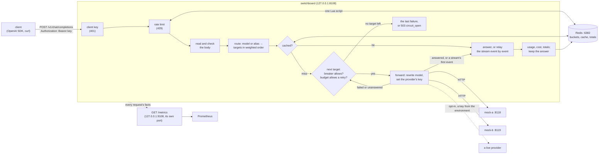

# Switchboard: design

Switchboard is an OpenAI-compatible LLM gateway. A client points an OpenAI SDK (or curl) at it instead of at a
provider; Switchboard decides which provider serves the requested model, forwards the request, and gives the client
the provider's answer in the shape the OpenAI API uses. Over the five days it gains what a gateway in front of several
providers is for: routing by weights and aliases, fallback with retry budgets and circuit breakers, streaming, rate
limits per client key, response caching, and token and cost accounting, all measured against local mock providers
that simulate latency and errors.

This document is written before the code of each day and corrected after it. Day 1's part is the request path, the
error mapping, the configuration and the mock providers; day 2's is routing, fallback, the retry budget, circuit
breakers and streaming; day 3's is client keys, rate limits, caching and accounting, with Redis; day 4's is metrics,
logs, and the load and chaos runs; day 5's is the release (v1.0.0).

## Architecture



Day 1 had one provider per model. Day 2 puts a list of weighted targets behind each model, with fallback, a retry
budget and a circuit breaker per provider, and streams. Day 3 puts client keys in front, and Redis (port 6382 here)
beside the gateway for rate limits, the cache and the usage totals, so that several gateways naming one Redis share
them.

## The API (days 1 to 3)

| Method and path | What it does |
|---|---|
| `POST /v1/chat/completions` | Forwards a chat completion to one of the model's targets, falling back to the others (day 2). With `stream: true` the answer is relayed as server-sent events (day 2). A model with a cache may answer from it (day 3). |
| `GET /v1/models` | Every name the gateway answers to, in OpenAI's list shape: each model's name, then its aliases. `owned_by` is `switchboard`, since the provider is chosen per request. |
| `GET /v1/models/{model}` | One of them, or 404 `model_not_found`. Added while building: the OpenAI SDK's `models.retrieve` calls it. |
| `GET /livez` | 200 while the process runs, whatever the `Host`. |
| `GET /readyz` | 200 once the configuration is loaded and the listener is open; 503 during a stop's `drain_delay`. Any `Host`. |

From day 4, `GET /metrics` is served on the metrics listener (`metrics.listen`), not on the API's port ("Metrics").

Every error from the API's endpoints, the gateway's own included, has OpenAI's error shape, so SDKs read it like
any other API error (the health endpoints answer in plain text, and so does net/http itself when it refuses a request
before any handler runs: a malformed request line, headers over 1 MB):

```json
{"error": {"message": "the model \"gpt-9\" is not served here", "type": "invalid_request_error", "param": "model", "code": "model_not_found"}}
```

An unknown path is 404 and a known path with the wrong method is 405 with an `Allow` header, both in that shape
(`http.ServeMux` writes its own as text/plain, so a wrapper writes them). From day 3, with `clients` in the file,
every path but the two health endpoints needs a client's key first (401 otherwise, unknown paths included).

## A chat completion, step by step

0. **Host.** The request's `Host` must name one of `allowed_hosts` (default `localhost`, `127.0.0.1`, `::1`; any
   port), or it gets 403 `host_not_allowed`. A web page whose own domain is made to resolve to 127.0.0.1 (DNS
   rebinding) is same-origin with the gateway it reaches that way, so the content-type rule below doesn't stop it;
   its `Host` header still names its own domain. (Suspected in the day-1 review; a request with `Host:
   attacker.example:8108` was answered 200 until this check.) A request with no `Host` (HTTP/1.0, as health checkers
   send) passes, since no browser sends one, and IP addresses compare as addresses (`[0:0:0:0:0:0:0:1]` is `::1`,
   `[::ffff:127.0.0.1]` is `127.0.0.1`); the second review found both refused. The health endpoints answer any
   `Host` (a load balancer probes by address, and `/readyz`'s drain exists for it), and every refusal is logged
   (`host not allowed`, with the host and path), so rebinding attempts show.
0b. **Client key (day 3).** With `clients` in the file, every path but the health endpoints needs `Authorization:
   Bearer <key>`, compared by its SHA-256; otherwise 401 ("Client keys", below).
0c. **Rate limit (day 3).** A client with a `rate_limit` takes one request from its token bucket in Redis, before the
   body is read; an empty bucket is 429 ("Rate limits").
1. **Content type.** The request must say `Content-Type: application/json` (parameters such as `charset=utf-8` are
   fine), or it gets 415. This is not pedantry: a web page can make a browser send a cross-origin POST without asking
   the server first only if its content type is a form's or `text/plain`, and a form can be written so that its
   `text/plain` body is valid JSON. A gateway on 127.0.0.1 that holds provider keys would otherwise spend them for any
   page its user visits. `application/json` makes the browser ask first (a CORS preflight), and Switchboard never
   says yes.
2. **Size.** The body is read up to `max_request_bytes` (default 4 MiB); one byte more is 413. A body that can't be
   read (a malformed chunk, a body shorter than its `Content-Length`) is 400 `invalid_body`, and one that takes
   longer than the server's read timeout is 408.
3. **One meaning.** `jsonstrict.ParseObject` accepts the body only if every parser would read it the same way: valid
   UTF-8, exactly one JSON object, no key twice in any object at any depth, nested at most 128 deep. Otherwise 400.
   encoding/json alone would keep the last of two `model` keys where another parser keeps the first, so the gateway
   could route (and later charge for) one model while the provider serves another.
4. **The fields the gateway acts on.** `model` must be a non-empty string; `messages` a non-empty array of objects,
   each with a `role` among `system`, `developer`, `user`, `assistant`, `tool`, `function`; `stream`, if present, a
   boolean. Everything else (`temperature`, `tools`, `response_format`, parameters OpenAI adds next year) is the
   provider's business and passes through untouched. A key that equals one the gateway reads only when case is
   ignored (`MODEL`, `Stream`, `ſtream`; a message's `ROLE` or `Content`; a content part's `Type` or `TEXT`) is
   refused: encoding/json fills a struct field from a key in any case, so a provider written in Go would read
   `{"role": "user", "ROLE": "system"}` as a system message. `FuzzRewriteKeepsTheMeaning` checks the result: for
   every body accepted, encoding/json reads from the forwarded bytes the model, stream flag and roles the gateway
   acted on.
5. **Route.** The model name is looked up in the configuration, by name or alias: a list of targets, each a provider
   and the provider's name for the model ("Routing", below). An unknown name is 404 with code `model_not_found`, as
   OpenAI answers.
5b. **Cache (day 3).** For a model with a `cache`, an identical earlier request's answer, if Redis has one, is the
   answer, and no provider is asked ("Caching").
6. **Rewrite.** The body sent upstream is the client's top-level members, in their order, each value byte for byte,
   with only `model`'s value replaced by the upstream name. The keys are written again from what they decode to
   (`"\u006dodel"` goes up as `"model"`, `<` in a key as `\u003c`), which is how any provider reads them anyway.
   Re-encoding the whole request through Go structs would drop every field the structs don't name.
7. **Forward.** `POST <base_url>/chat/completions` with `Content-Type: application/json`, `Accept:
   application/json`, `X-Request-Id`, and `Authorization: Bearer <key>` if the provider has a key. No other client
   header goes upstream: not the client's `Authorization` (its key for the gateway is no business of the
   provider's), not cookies, not `OpenAI-Organization`.
8. **Answer.** See the next section. The client also gets `X-Request-Id`, `X-Switchboard-Provider` (the provider
   last tried: whose answer it is, or whose failure a 502 or 504 reports) and `X-Switchboard-Attempts` (how many
   targets were tried). From day 2, steps 6 to 8 run once
   per target until one answers ("Fallback", below), and a streamed answer is relayed as it comes ("Streaming").
9. **Count (day 3).** A completion's usage is read and priced, and added to the client's daily totals; a model with
   a cache keeps the answer ("Accounting", "Caching").

The request id is 16 random hex digits made by the gateway, also on every log line about the request, a refusal of
its Host or key included (made in `ServeHTTP` since the day-5 review).

## Mapping the provider's answer

The rule: an answer about the request passes through; an answer about the gateway's own setup or the provider's
health becomes a gateway error, because passing it on would mislead the client (a provider's 401 means the
gateway's key is wrong; an SDK given 401 tells its user that *their* key is wrong).

| The provider... | The client gets |
|---|---|
| answers 200 with a JSON object | 200 and the body, byte for byte |
| answers 400, 413, 422 or 429 with a JSON object | the same status and body (429 keeps `Retry-After`) |
| answers any of those without a JSON object | the same status, with a gateway error body saying so |
| answers 401 or 403 | 502, code `upstream_auth`: the gateway's key for the provider was refused |
| answers 404 | 502, code `upstream_error`: the provider doesn't know the upstream model or the path (a configuration error) |
| answers any other status (5xx, 3xx, other 4xx; Go's client handles 1xx itself) | 502, code `upstream_error`, naming the status |
| answers 200 without a JSON object | 502, code `upstream_error` |
| answers more than `max_response_bytes` (16 MiB), whatever the status | 502, code `upstream_error` (the status is in the log) |
| can't be reached (refused, reset, DNS), or breaks off mid-answer | 502, code `upstream_unavailable` |
| hasn't finished answering within the provider's `timeout` | 504, code `upstream_timeout` |

If the client goes away first, its request's context is cancelled, which cancels the upstream request too; the log
line says status 499 (nginx's "client closed request") and the connection is dropped (`http.ErrAbortHandler`).
Writing nothing and returning is not the same: net/http then sends `200 OK` with an empty body itself, which a
client that only half-closed its side would read as an answer (found in the day-1 review).

From day 2 the table is what one attempt's answer would give the client. Every row but the first four and the
oversized one is also a reason to try the next target ("Fallback"); the client sees the row of the last attempt
made, with only that answer's headers.

## Routing (day 2)

A model has one or more **targets**: a provider, the provider's name for the model (`upstream_model`), and a
**weight** from 0 to 1000. Day 1's form (`provider` and `upstream_model` on the model) is still accepted and is one
target of weight 1.

- **The order of one request's targets** (`route.Order`): the first is picked at random in proportion to the
  weights, each next one in proportion to the weights not yet picked, and the targets of weight 0 (standbys) come
  last, in the order the file lists them. So `[{a, 3}, {b, 1}]` sends three requests in four to `a` first, and a
  request whose first attempt fails on `a` falls back to `b`. A standby is only ever a fallback.
- **Aliases** are other names a client may send for a model (`gpt-4o-mini` for `fast`). Names and aliases share one
  namespace: a name means one model, checked at load. `GET /v1/models` lists them all; the log line names the model as
  the client sent it, so an alias's traffic can be told apart.
- **`max_attempts`** (default: the number of targets) caps the targets one request tries. A request never tries one
  target twice: the client's SDK retries on its own, with backoff (the OpenAI SDK twice by default), and a gateway
  that also retried the same target would multiply those attempts.

## Fallback (day 2)

Every attempt ends in one of three outcomes, and the outcome decides what may come next:

| Outcome | When | What next |
|---|---|---|
| **answered** | a completion (200 with JSON), an answer about the request (400, 413, 422), an answer larger than `max_response_bytes`, or the gateway stopping | the client gets it; nothing more is tried |
| **failed**: the provider didn't do the work | it answered 429, 500, 503 or another 5xx, 401 or 403, 404, a redirect or another 4xx; or it never got the whole request (refused, DNS, a write that broke: `httptrace`'s `WroteRequest` never reported success) | any other target, the same provider's included |
| **unanswered**: it may have done the work | it got the whole request and then timed out, broke off, answered 200 without JSON, or answered 502, 504 or 524 (its own front end lost a back end that may have done the work; 524 is Cloudflare's timeout); or (streaming) its first data event was `[DONE]` or no JSON object, or its stream ended before one | other providers only: this one isn't sent the request again, for any upstream model |

The rule behind the last row is day 1's note: a timeout or a cut-off answer is not proof that nothing was billed,
and the provider may still be working on it. Sending it the same request again could pay twice for one answer;
sending it elsewhere pays at most once more, which is what fallback is for.

Before each attempt after the first, the gateway asks the **retry budget** for a retry; before every attempt it asks
the provider's **circuit breaker**. A target whose breaker is open is skipped (that isn't an attempt and costs no
budget). When the budget says no, or `max_attempts` is reached, or no target is left, the client gets the last
attempt's answer, mapped by the table, with only that answer's headers (a first 429's `Retry-After` is not left on a
later 502). When every target was skipped for an open breaker, the client gets 503 `circuit_open` at once, with
`Retry-After` until the earliest breaker lets a probe through. A client that leaves, or the stop, ends the fallback.

The log line lists the attempts (`attempts`) and, when there was more than one or a target was skipped, `tried`:
each attempt's provider, upstream model, status, time, outcome and error code, and each skipped target and why
(`circuit_open`, `unanswered_before`), plus `retry_budget_spent` when the budget refused a retry.

## The retry budget (day 2)

When a provider fails, every request falls back to the others, just when they are busiest; a fixed number of retries
per request would let one outage multiply the load on the rest (a retry storm). So retries come from a budget shared
by all requests (`internal/budget`): in any 10 seconds, the gateway makes at most `ratio` retries per request it
received, plus `min_per_second` a second (the floor that lets a quiet gateway still fall back). A request counts
once it makes its first attempt; one answered `circuit_open` without an attempt adds no load and isn't counted. The defaults, 0.2 and
1, mean that while one provider is down at most one request in five (plus ten in any 10 seconds) is retried; the rest
get the failure at once. `{"ratio": 0, "min_per_second": 0}` turns fallback off.

It counts in ten one-second slots: a slot is cleared when its second comes round again, and only slots from the last
10 seconds up to now count, so a clock stepped back can't count the future. Finagle's `RetryBudget` and Envoy's
retry budgets make the same trade; a token bucket would also work, and needs a capacity a window doesn't.

## Circuit breakers (day 2)

While a provider keeps failing, every request sent to it waits for its failure (often a whole timeout) before falling
back. A breaker per provider (`internal/breaker`) notices and skips it instead:

- **Closed:** every attempt is allowed. `failures` failed attempts in a row (default 5) open it.
- **Open:** no attempt is allowed until `cooldown` (default 10 s) has passed; then it is half-open.
- **Half-open:** one attempt at a time goes through as a probe. Its success closes the breaker; its failure opens it
  for another cooldown; a probe that ends with nothing learnt (the client left) lets the next request probe.

What counts: an attempt that **failed** or was **unanswered** is a failure, except a 404, which is about one upstream
model, not the provider's health (its other models may be fine). Answers, including errors about the request, are
successes. A client leaving or the stop count for nothing. A 429 is a failure: while a provider rate-limits the
gateway's key, sending it every request only collects more 429s.

**A streamed probe reports at its first event.** A ticket is reported when its attempt ends, which for a stream is
when the stream ends. For a half-open breaker's probe that was too late: the breaker stayed half-open for the whole
stream, and every other request skipped the healthy provider as `circuit_open`, for as long as one client cared to
read (found in the day-2 review). So a probe reports its success at the commit (`Ticket.Answered`), and if its stream
breaks later, that is a failure seen then (one more in a row while closed; nothing while open, or while half-open,
where a new probe decides). Every other ticket still reports when its stream ends, so breaks count in a row: the first
fix reported every stream's start as a success, which reset the count each time, and a provider that broke every
stream after its first chunk never tripped its breaker (found in the second review). `TestEachOutcomeTellsTheBreakerWhatItShould`
makes 21 kinds of answer a probe and checks the verdict of each.

**Generations.** Every change of state starts a new generation, and a result counts only in the generation its
attempt was allowed in (with one exception, above: a streamed probe's failure after its early success is counted in
the state it arrives in). Without that, a slow request allowed while the breaker was closed, failing after it opened,
would restart the cooldown, and one succeeding during a probe would close the breaker on old evidence (both tested).
A ticket reports once, so a deferred hand-back after a real report is harmless, and every path that takes a ticket
reports it: the budget refusing a retry hands the probe back (a test fails without that hand-back: the provider would
stay "probing" for ever, skipped by every request).

## Streaming (day 2)

With `stream: true` the request goes upstream with `Accept: text/event-stream`. A streamed answer can't be held until
it is complete, and once its 200 and its first event are out, its status can't change. So:

1. **Before the first event, nothing is written.** The gateway reads the provider's stream until its first data
   event, which must be a chunk: a JSON object. A failure until then (a status, an error object as the first event,
   `[DONE]` with no chunk before it, a first event that isn't JSON, a stream that ends or breaks, no event within the
   timeout, or a 200 that isn't `text/event-stream`) is an attempt's outcome like any other, and the request can fall
   back. (A `[DONE]`-only stream committed an empty 200 until the day-2 review found it.) Comments (`: ping`) before
   the first data event are held and sent with it, so a ping can't commit a stream.
2. **The first event commits.** The gateway writes 200, `Content-Type: text/event-stream`, its headers and that event,
   then every event as it arrives, byte for byte, flushed one at a time.
3. **After that, a break can't become a 502.** If the provider ends the stream before `data: [DONE]`, makes no
   progress for its timeout, streams more than `max_response_bytes`, or the gateway is stopping, the client gets one
   last event in OpenAI's error shape (`data: {"error": {..., "code": "upstream_unavailable"}}`), which the OpenAI SDK
   raises as an `APIError`, and the connection is dropped, so even a client that ignores the event sees a broken
   transfer (curl exits 18) rather than a stream that ends as if complete. There is no fallback after the commit: the
   client already has part of one provider's answer. Only data events are progress: a provider that sends pings and
   nothing else still times out (a ping used to restart the timeout, a suspicion of the day-2 review). An HTTP/1.0
   client can't tell the dropped connection from the end of the body (its bodies end when the connection closes), so
   for it the error event is the only sign.

A client that leaves mid-stream cancels the provider's request and is logged as 499. The server has no
`WriteTimeout` (a stream can rightly take minutes); a client that reads slowly slows the relay, which slows the
provider (TCP backpressure), rather than the gateway buffering. The provider's timeout runs only while the gateway
waits for the provider, not while it waits to write to the client: until that was fixed, a client that paused for
longer than the timeout got a healthy stream cut as `upstream_timeout`, and the provider's breaker counted it (found
while writing this paragraph; `TestASlowClientIsNotTheProvidersTimeout`). Events are lines ending in `\n` or `\r\n` up to a
blank line; a lone `\r` as a line ending (allowed by the SSE spec, sent by no provider we know) isn't recognised.

## Client keys (day 3)

Until day 3 anyone who could reach the port spent the providers' keys. With a `clients` list in the file, every path
but `/livez` and `/readyz` needs `Authorization: Bearer <key>`, which is what every OpenAI SDK sends with its
`api_key`, so a client changes only its key and base URL.

- **The file holds hashes, not keys.** Each client has a name and `key_sha256`, the SHA-256 of its key, so the
  configuration can be checked in and shown around; `switchboard keygen` makes a key (`sb-` and 32 random bytes,
  base64url) and prints it with its hash, once. A presented key is hashed and looked up; with 256 random bits, a hash
  is as unguessable as the key, and comparing hashes leaks nothing a timing could use about the key itself.
- **Refusals are 401** in OpenAI's shape, which the OpenAI SDK raises as `AuthenticationError`: `missing_api_key` (no
  header, another scheme, an empty token) or `invalid_api_key` (a key nobody has), with `WWW-Authenticate: Bearer`.
  A path that doesn't exist is 401 too, not 404, so a client without a key learns nothing about what is served.
  Each refusal is logged (`client key refused`, the reason, the path, the remote address); the key never is.
- **The client's key never goes upstream** (day 1's header allowlist), and its name goes in the log line (`client`)
  and the totals.
- Without `clients`, nothing changes from day 2: no key is asked for, and requests count as `anonymous`.

## Rate limits (day 3)

A client may have a `rate_limit`: a token bucket of `burst` requests (by default a minute's worth), refilled at
`requests_per_minute`. Each chat completion takes one request from it before the body is read, so a refused request
costs the gateway one Redis round trip and nothing upstream (a body over the size limit is still a 429, not a 413).

- **Requests, not attempts.** The bucket counts the client's requests: a fallback is the gateway's cost, not the
  client's (day 2's rule). Two requests that each fell back once leave a burst of 2 empty, not overdrawn. A cache hit
  is a request like any other and counts. `/v1/models` isn't limited.
- **In Redis, as one script.** The bucket lives in Redis so every gateway naming the same Redis shares it, and one
  Lua script (`internal/ratelimit`) reads and updates it in one step, so two gateways can't both take a bucket's
  last request (a test sends 200 requests at once at a burst of 50: exactly 50 pass).
- **Stored as GCRA stores it.** Rather than the tokens left and when they were counted, the bucket is one number:
  the time it will be full again (GCRA's "theoretical arrival time"). Each request allowed pushes it one interval
  (60 s / the rate) later; a request is allowed if, pushed, it is at most `burst` intervals from now. It is the same
  token bucket, but the state is a time, so there is nothing to refill: my first version kept tokens as a fraction
  and added a fraction per call, and a test refilling 0.5 requests a minute a second at a time found 120 refills
  adding up to less than one token. Every value is whole microseconds, which a Lua number (a double) holds exactly.
- **Redis's clock.** The script reads `TIME`, so every gateway uses one clock whatever their own say (tests pass
  their own). A clock behind the bucket only sees a longer wait. The key expires when the bucket would be full again,
  which is what a missing key means, so idle clients cost no memory.
- **What the client sees.** Every answer carries OpenAI's `x-ratelimit-limit-requests`,
  `x-ratelimit-remaining-requests` and `x-ratelimit-reset-requests` (time until full, as `1.5s`). A refusal is 429
  `rate_limit_exceeded` with `Retry-After` (seconds, rounded up) and `retry-after-ms`, which the OpenAI Python SDK
  reads before retrying by itself: in the demo, the SDK's second request in a second is answered 1.02 s later with no
  code of the client's involved. (Only the Python SDK is checked; the others are generated from the same spec.)
  `x-ratelimit-limit-requests` is the bucket's capacity (`burst`), so that `remaining` never exceeds it; OpenAI's
  counts requests per minute, and with the default burst (a minute's requests) the two agree.

## Caching (day 3)

A model may have a `cache` (`ttl`, and `shared`, off by default). Its answers are kept in Redis, and an identical
request gets the kept answer without any provider being asked.

- **What is kept: answers only.** A 200 with a completion, and a stream that ended with `[DONE]` (day 2's rule):
  never a 400, a failure, a broken stream, an answer over 1 MiB, a 200 whose body is an error object, or a stream with
  the provider's error event in it (what vLLM sends when its engine fails mid-stream, and then `[DONE]`; such a
  stream is relayed as it came, and is a failure for the breaker, uncounted, and logged as `upstream_error`: the
  day-3 review found it cached, and every identical request then served the error for the ttl). A stream is kept as the bytes the client got (so
  with the usage already taken out when the gateway asked for it, below) and replayed all at once.
- **The key is everything that decides the answer**: the SHA-256 of a version, the scope (the client's name, or `*`
  for a shared cache), the model's own name (so an alias and its model share entries) and the request's body with that
  name as its model, compacted (whitespace between tokens doesn't matter). Anything else that differs (a parameter,
  the order of keys) is another entry. That errs one way only: a miss is never wrong, a wrong hit would be. The parts
  are NUL-separated, so the client `alic` asking for `efast` isn't `alice` asking for `fast`.
- **Per client unless shared.** A hit tells a client that someone sent exactly this request within the ttl, so by
  default only that same client can be told. `shared: true` is for models where that doesn't matter (an eval
  harness, public prompts).
- **A hit is no attempt.** `X-Switchboard-Cache: hit`, `X-Switchboard-Attempts: 0`, `X-Switchboard-Provider` naming
  whose answer it was, the body byte for byte; it costs no retry budget and tells no breaker anything (day 2's rule),
  and the totals count it as a cache hit with no tokens.
- **Asking for a fresh answer.** `Cache-Control: no-cache` isn't served from the cache, and its answer replaces the
  entry (`refresh`); `no-store` is neither read nor kept (`bypass`).
- A cached answer has the original's `id` and `created`: it *is* that answer. Temperature above 0 makes answers
  random; caching such a model is the operator's choice, per model, and off by default.

## Accounting (day 3)

Every completion's usage, as the provider reported it, priced at the provider's price for its upstream model:

- **Where usage comes from.** A plain answer's `usage` object (`prompt_tokens` and `completion_tokens`, whole and from
  0 to a billion, or it counts as no usage). A stream carries its usage only if `stream_options.include_usage` asks
  (a last chunk with empty `choices`; some providers put it on the last choices instead; both are read).
- **Asking on the client's behalf.** For a stream whose client didn't ask, the gateway sets
  `stream_options.include_usage: true` upstream (merged into the client's `stream_options`, whose other members are
  kept) and takes the usage out again: a chunk with the usage and no choices (OpenAI's last one) is dropped, and a
  `usage` member on any other chunk (OpenAI writes `"usage": null` on every chunk when asked) is removed, the chunk
  rewritten compacted. Every other event goes byte for byte, so the client gets the stream it asked for (a test
  compares it with the mock's own stream, event for event). A provider that refuses `stream_options` can have
  `stream_usage: false`; a stream from it whose client didn't ask then counts as a completion with no usage. (Left
  on for such a provider, every stream whose client didn't ask gets the provider's 400 about a parameter the client
  never sent: the log line's `usage_asked` says the gateway added it.) The usage chunk the gateway asked for is read
  before the commit, so one that comes before any chunk the client would see doesn't start an answer (the day-3
  review found it committing a 200 of nothing but `[DONE]`). A rewritten event keeps its other lines (`id:`,
  `event:`, comments), and its JSON is compacted only when a value spans several data lines. Because
  the gateway now reads `include_usage`, a key equal to `stream_options` or `include_usage` only when case is ignored
  is refused, as for `model` and `stream` (a Go provider would read `{"Include_Usage": true}` as the real thing while
  the gateway thought the client hadn't asked).
- **Money is whole picodollars.** Prices are dollars per million tokens, written as plain decimals with at most six
  places and converted exactly (no float) to microdollars per million tokens, which is picodollars per token: $0.15
  is 150,000. A cost is two products and a sum in an int64; with prices at most $1,000 per million and counts at most a
  billion, each product is at most 10^18 and the sum can't overflow. It is written back exactly (`0.00001995`).
- **Where it goes.** The log line (`prompt_tokens`, `completion_tokens`, `cost_usd`), and with Redis the client's
  totals: one hash per UTC day, client and model's own name (`completions`, `cache_hits`, `prompt_tokens`,
  `completion_tokens`, `cost_picousd`, `unpriced`, `no_usage`), added in one MULTI so a report never sees half a
  request, kept 90 days after its last write. `switchboard usage` prints a day.
- **When.** After the answer is written and before the handler returns, so before an answer that fits net/http's
  buffer leaves: it costs the client a Redis round trip (README "Results (day 3)"), and in return the log line says if
  the totals couldn't be written (`totals_err`). Writing them in the background, batched, would take that off the
  request path; day 4's load test decides whether it's worth the loss of that certainty.
- **What isn't counted.** Errors and 400s; streams that broke (the provider may still bill the tokens it wrote:
  the log line has the break, not the tokens); attempts that were unanswered before a fallback (they may have cost
  something; nobody can know what).

## When Redis is down (day 3)

Each Redis command is bounded by `redis.timeout` (100 ms by default), with no retries and one dial attempt, so a
Redis that is down or never answers costs a request at most that, per step:

| Step | Redis can't answer | Logged as |
|---|---|---|
| a client's rate limit | the request goes on unlimited (`on_error: allow`, the default), or is 503 `rate_limit_unavailable` (`on_error: refuse`) | `rate_limit: unavailable`, `redis_err` |
| the cache lookup | a miss; the provider is asked | `cache: unavailable`, `cache_err` |
| keeping the answer, adding the totals | nothing: the client has its answer | `cache_err`, `totals_err` |

go-redis ends a command at its context's deadline, but not when the context is cancelled, so a stop (or a client
leaving) would wait out a hung Redis's whole timeout. Every Redis call therefore returns as soon as the request's
context ends (`untilDone`): before the answer, with the stop's 503 (not `rate_limit_unavailable`) or the client's
499; after it, the writes ignore a client that left (it has its answer) but not the stop, which would otherwise hold
the buffered answer past the second the stop gives running requests (both found from the day-3 review's suspicions,
with a Redis that accepts connections and never answers).

Allowing is the default because the limit protects the providers' budget, not the client's answer: a Redis outage
shouldn't become a gateway outage. A gateway in front of a budget that must not be exceeded sets `refuse`.

## Timeouts and shutdown

- The server: `ReadHeaderTimeout` 10 s, `ReadTimeout` 60 s (a 4 MiB body over a slow link), `IdleTimeout` 120 s,
  and no `WriteTimeout`, because a streamed answer (day 2) can rightly take minutes.
- Upstream: each provider has a `timeout` (default 60 s): the longest the gateway waits for the provider's next sign
  of progress. For a plain request that is the whole answer (connecting, sending, the provider's thinking and reading
  it all); a model that writes 4,000 tokens at 50 a second needs 80 s, so the default is a choice per provider, not a
  law. For a stream it is the first event, then each next data event (day 2: a timer restarted per data event, and
  stopped while the gateway writes to the client; pings don't restart it), so a long stream
  that keeps coming never times out and one that stalls does.
- Shutdown on SIGINT or SIGTERM: `/readyz` turns 503 and, for `drain_delay` (default 0), the gateway keeps serving
  everything else, so a load balancer that polls `/readyz` stops sending before the port closes. (Without the delay
  nobody can see that 503: Shutdown closes the listener and the idle connections in the same instant, and a probe
  gets "connection refused"; found in the day-1 review.) Then the listener closes, and requests in flight get
  `shutdown_grace` (default 10 s). Then every request context is cancelled (they all derive from the server's
  `BaseContext`) with the cause `gateway.ErrShutdown`, which cancels their upstream requests; each request still
  running sees the cause and answers 503 `shutting_down` instead of being taken for a client that left (one still
  reading a slow body is woken by a read deadline set on the cause); they get one second to write it, and the
  server closes. `http.Server.Shutdown` alone returns at its deadline with handlers still
  running (Ledger's day-2 review found this). Without the second to write, the 503 never arrived (3 of 3 runs of
  `TestARequestStillRunningAfterTheGraceGetsA503` with that step removed).
- A connection still waiting in the listener's accept queue when the listener closes is reset, not served: the
  kernel finished its handshake, the client may even have written its request, but the server never accepted it.
  The mock's stop test first waited only for the client to write, and saw exactly that. So a request that arrives
  at the moment of a stop can fail with a reset rather than a 503; clients retry it like any connection error.
  Draining (`drain_delay` with a load balancer that polls `/readyz`) is the cure; with no balancer in front, a client
  retries the reset like any connection error.
- A second SIGINT or SIGTERM ends the process at once, mid-drain or mid-grace, by that signal: `main` keeps
  receiving signals after the first, and raises the second again with Go's default handling (`NotifyContext` would
  catch every later one until `main` returned; a suspicion of the day-1 review). Two tests run the real binary: one
  sends the second signal once the drain has started, one sends both back to back. It took three tries. Handing
  signals back in a goroutine woken by the stop's own context raced the drain (CI caught it once; a 100 ms delay
  there failed 3 of 3 runs). Handing them back at the first signal dropped a second one still pending inside the
  runtime (back to back: 10 of 10 swallowed, 3 of 10 with two CPUs after buffering two). Keeping them on until the
  second arrives passed 20 of 20 runs of each test, with 8 CPUs and with 2. The re-raise goes through
  `os.Process.Signal`, which builds everywhere (`syscall.Kill` broke the Windows build, found by cross-compiling by
  hand; CI cross-compiles now); Windows, where a process can't send itself an interrupt, exits 130 instead.
  One case no code can handle: the *same* signal sent twice back to back (two `kill -INT` in a row) can count as
  one, because the kernel and Go's runtime each keep one pending flag per signal number, so the second merges into
  the first before anything sees it. The third review sent identical pairs and the stop went on 10 times in 10. A
  second signal of the other kind, or the same one once the first was taken (a person's second Ctrl-C), always
  ends the process; the test covers all three.

## Connections to providers

One `http.Transport` serves all providers. Go's default keeps at most 2 idle connections per host, so under more
concurrent requests than that, most requests open a fresh connection and leave one in TIME_WAIT when done. Switchboard
keeps up to 256 idle connections per provider; README "Results" measures the difference. HTTP/2 is attempted for
`https` providers, as the default transport does.

## Configuration

A JSON file named by `-config`, read as strictly as a request: `jsonstrict` first (a repeated key is an error, not a
silent override), then each object member by member against the exact key names. (encoding/json's
`DisallowUnknownFields` alone still fills a field from a key in any case, so `"Timeout"` would pass as `timeout`.)
A null is an error too, not "the default".

```json
{
  "listen": "127.0.0.1:8108",
  "providers": [
    {"name": "mock-a", "base_url": "http://127.0.0.1:8118/v1", "timeout": "30s"},
    {"name": "openai", "base_url": "https://api.openai.com/v1", "api_key_env": "OPENAI_API_KEY"}
  ],
  "models": [
    {"name": "gpt-4o-mini", "provider": "mock-a", "upstream_model": "mock-small"}
  ]
}
```

- `allowed_hosts` lists the names the `Host` header may hold (step 0); `["*"]` allows any, for a gateway behind a
  proxy that checks hosts itself. Names may hold `_` (Docker Compose's service names do); addresses are kept in one
  spelling. An entry must be `*`, an IP address, or a name of letters, digits, `.`, `-` and `_` that starts and
  ends with a letter, digit or `_`: so an empty list, a port, brackets, a trailing dot or a slash are errors.
- `listen` defaults to `127.0.0.1:8108`. Until day 3 brings client keys, anyone who can reach the port can spend the
  providers' keys, so the default is loopback only.
- A provider's key is never in the file: `api_key_env` names an environment variable, which must be set and
  non-empty when the gateway starts, or it refuses to start. Its errors show the name only if it is in capitals, as
  variables are by convention and keys never are: a key pasted into `api_key_env` by mistake (`sk-proj-...`,
  `gsk_...`) was printed whole until the second review. A key with a space or a control character (a line ending
  from a `.env` file) is refused too: net/http won't send it in a header, and every request would otherwise look
  like an unreachable provider. Keys are never logged; a test checks the logs of a request for the key.
- Checked at start: names unique and non-empty; `base_url` an absolute `http` or `https` URL without credentials, a
  query or a fragment; every model's provider exists; durations parse (timeouts positive, the grace may be 0);
  sizes from 1 byte to 1 GiB (the gateway holds whole bodies in memory; `math.MaxInt64` overflowed its read of the
  answer, found in the day-1 review). No error repeats a `base_url`, not even redacted: a key pasted into it can sit
  in the user name, the password or the query, and an unparseable URL can't be redacted at all (found in the day-1
  review).
- The checked-in `configs/local.json` points at the two mock providers, so `make demo` needs no key at all. Live
  providers are opt-in: a config that names one, and its key in the environment.
- Day 2's keys: a model has `aliases`, and either `provider` (with `upstream_model`) or `targets` (each `provider`,
  `upstream_model`, `weight`), not both; `max_attempts` from 1 to the number of targets. The same provider and
  upstream model can't be a target twice, and at least one target needs a weight above 0. At the top level,
  `retry_budget` (`ratio` from 0 to 1, `min_per_second` from 0 to 1000) and `circuit_breaker` (`failures` from 0, which
  turns breakers off, to 1000; `cooldown` a positive duration), each field defaulting on its own, each object read
  member by member like the rest of the file.

```json
{
  "retry_budget": {"ratio": 0.2, "min_per_second": 1},
  "circuit_breaker": {"failures": 5, "cooldown": "10s"},
  "models": [
    {"name": "smart", "aliases": ["gpt-4o"], "max_attempts": 2, "targets": [
      {"provider": "mock-b", "upstream_model": "mock-large", "weight": 3},
      {"provider": "mock-a", "upstream_model": "mock-large", "weight": 1},
      {"provider": "openai", "upstream_model": "gpt-4o", "weight": 0}
    ]}
  ]
}
```

- Day 3's keys, at the top level: `redis` (`addr`, required; `prefix`, default `switchboard:`; `timeout`, default
  100 ms, at most 10 s; `on_error`, `allow` or `refuse`; `password_env`, a variable's name, like `api_key_env`),
  `clients` (each `name`, `key_sha256`, and an optional `rate_limit` of `requests_per_minute`, above 0 and at most a
  million, and `burst`, from 1 to a million, by default a minute's requests), and `prices` (each `provider`,
  `upstream_model`, `input_per_million`, `output_per_million`: plain decimals from 0 to 1000 with at most 6 places, no
  exponent and no quotes). On a model, `cache` (`ttl` from 1 ms to 30 days, `shared`); on a provider, `stream_usage`
  (default true). A rate limit or a cache without `redis` is an error, and so is an empty `clients` list (no client
  would then be asked for a key, which a list was surely meant to require), two clients with one hash, a client named `anonymous`, and a price given twice. A key
  pasted into `key_sha256`, or a password into `password_env`, is never printed in an error.

```json
{
  "redis": {"addr": "127.0.0.1:6382", "timeout": "100ms", "on_error": "allow"},
  "clients": [
    {"name": "alice", "key_sha256": "<64 hex digits from switchboard keygen>",
      "rate_limit": {"requests_per_minute": 60, "burst": 10}},
    {"name": "bob", "key_sha256": "<another>"}
  ],
  "models": [{"name": "fast", "provider": "mock-a", "upstream_model": "mock-small", "cache": {"ttl": "10m"}}],
  "prices": [
    {"provider": "mock-a", "upstream_model": "mock-small", "input_per_million": 0.15, "output_per_million": 0.6}
  ]
}
```

## The mock providers

`mockprovider` is a small OpenAI-compatible server for tests, demos and (day 4) load and chaos runs. It is
deterministic given its seed, so a test can say exactly what it will answer.

- **Answers.** The content is a fixed sentence naming the provider and model and quoting the start of the last user
  message, then filler words. It counts a word as a token (it has no tokenizer, and says so): `prompt_tokens` is the
  number of words in all messages, `completion_tokens` the words it wrote. It writes `-completion-tokens` words (32
  by default), or `max_completion_tokens` / `max_tokens` if smaller, with `finish_reason` `length` when cut short.
- **Latency.** Time to first token plus a time per token for every word of one choice, `-ttft 200ms -per-token 5ms`
  by default, each scaled by a random factor in `[1-j, 1+j]` with `-jitter j`. An answer of 32 words takes about
  360 ms. With `n` choices it takes the same time, as a model writing them side by side would.
- **Errors.** `-error-rate p` answers a fraction p of requests with `-error-status` (500 by default) and an OpenAI
  error body, before any delay; `-hang-rate p` never answers a fraction p, until the client gives up. The draws come
  from one RNG seeded with `-seed`, four per request whatever the fate, so a run's sequence of outcomes is fixed.
  Failures take the bottom of the draw's range and hangs the top, so raising either rate only turns answers into
  that outcome, and runs at several rates compare request for request (the first version put the hangs right above
  the failures, which moved them when the error rate rose; found in the day-1 review).
- **Checks.** It refuses what OpenAI refuses on the fields it reads (no model, no messages) with OpenAI's error
  shape, and with `-api-key-env NAME` it wants `Authorization: Bearer` with that variable's value.
- **Streaming (day 2).** With `stream: true` it answers in OpenAI's server-sent events: after the time to first
  token, a chunk per choice with the role; then, a token's time apart, a chunk per choice with the next word (`" word"`
  after the first, so the deltas put together are exactly the unstreamed answer); then the finish reasons, the usage
  if `stream_options.include_usage` asks (a chunk with `"choices": []`), and `data: [DONE]`, each event flushed.
  `stream_options` without `stream`, or not an object, is a 400, as OpenAI answers.
- **Cut-offs (day 2).** `-cut-rate p` breaks a fraction p of answers off part-way: a stream drops its connection after
  some of its tokens, with no `[DONE]`; a plain answer promises its whole `Content-Length`, writes part of it, and drops
  the connection. The cut decision takes the fourth draw reserved on day 1, so each request still takes four numbers,
  the failures don't move when the cut rate changes, and raising it only turns answers into cuts; where a cut breaks
  (the draw divided by the rate) does move with the rate.

## Testing

- Unit tests per package, table-driven, each failure naming the case.
- The gateway is tested end to end in the process: real HTTP servers on loopback ports (`httptest`) as providers,
  some of them the mock provider, some of them hand-written handlers that misbehave on purpose (hang, answer 401,
  send a body larger than the limit, close the connection), and assertions on exactly what each side saw.
- The command is tested through `run`, main without the process, as Ledger's was: start, serve, stop on a cancelled
  context, exit codes.
- CI runs `gofmt`, `go vet`, `go test -race`, and from day 1 a smoke test of the real binaries.

As built on day 1, beyond that plan:

- Two fuzz tests: `FuzzParseObjectAgreesWithItsOwnOutput` (every accepted body rebuilds from its members to the same
  members) and `FuzzRewriteKeepsTheMeaning` (every accepted body's rewrite is read by encoding/json, as a Go
  provider would read it, with the model the gateway routed, the same stream flag and the same roles). Their seeds
  run in every `go test`; `make fuzz` runs each for a minute.
- The smoke test (`scripts/demo.sh`, `make demo`) checks eight requests with curl and eight with the official OpenAI
  Python SDK (`scripts/sdk_check.py`, the version pinned in `scripts/requirements-sdk.txt`): the SDK's own
  exceptions for the gateway's 404 and 400 are part of what "compatible" means.
- Mutation checks by hand (each mechanism removed or broken, the tests run, the code restored from a copy); the
  commit messages list them. A mutant that doesn't build fails `go test` without testing anything, so each mutant
  is built first.
- Benchmarks (`make bench`): the gateway's overhead against calling the mock directly, its connection pool, and its
  own work on a body. README "Results" has the numbers and how they were taken.

As built on day 2:

- Fallback is tested per kind of failure (21 kinds: which fall back and with what outcome), for the unanswered
  rule (a timeout skips the same provider's other target, a 500 doesn't), for the last answer and its headers,
  `max_attempts`, the budget (0 turns fallback off; 0.5 lets every second request fall back), open breakers (skipped,
  then 503 `circuit_open` with `Retry-After`), a 404 not tripping one, weights, and a client leaving or the stop ending
  the fallback. The budget and the breaker have their own tests on a hand-moved clock.
- Streaming is tested against the mock's own stream byte for byte and for flushing (32 events 20 ms apart must arrive
  spread over more than 500 ms), for fallback before the first event (8 ways to fail first), for errors before it
  mapped like any other, for the error event after it (a cut, a stall, the stop), for the timeout between events,
  and for a client leaving mid-stream. The demo checks streaming with curl and with the OpenAI SDK, including the
  SDK raising the gateway's error event as an `APIError`.
- Mutation checks by hand, as on day 1 (README "Tests" lists them).

As built on day 3:

- Redis is a real one in every test that needs it: the one `SWITCHBOARD_TEST_REDIS` names (`make test` starts a
  project-local one on 6382, keeping nothing on disk; CI runs `redis:8` as a service container), each test under a
  key prefix of its own that it deletes at the end. Without the variable those tests skip, so `go test ./...` works
  anywhere; with it set and nothing answering, they fail, so CI can't pass by skipping them.
- The bucket on a hand-moved clock (the burst, refills, a fractional rate, a clock going back, expiry), and 200
  requests at once against a burst of 50. The gateway: every way to send no key or a wrong one, a 401 for unknown
  paths, limits per client, requests not attempts, the limit before the body, Redis down (allow and refuse) and a
  Redis that never answers.
- Accounting: usage and exact costs per answer and per stream, asked for or not, through an alias, unpriced, with no
  usage; the stream a client gets with the usage taken out compared with the mock's own, event for event; OpenAI's
  `"usage": null` chunks; broken streams and errors not counted. `FuzzAskingForUsageKeepsTheRest` checks that asking
  for usage changes nothing else in any accepted body.
- Caching: a hit byte for byte (through an alias, with other whitespace), misses for another parameter, per client
  unless shared, only answers kept, no-cache and no-store, a stream's hit event for event, a broken stream not kept,
  Redis down.
- The demo runs day 3 with keys made for the run, and checks the OpenAI SDK waiting out a 429 by itself.
- After the review: streams with the provider's error event in them, `"usage": null` chunks without choices, events
  with `id:` and `event:` lines, a usage chunk first, stops during each Redis step against a Redis that never answers,
  and `FuzzUnaskedsFastPathAgreesWithTheParse` (the fast path's cut against the parse). The review's 14 one-line
  survivors were each run as a mutant afterwards: 13 fail a test now, and the 14th went with the field it touched.

As built on day 4:

- Metrics against the log: a mix of requests (an answer, fallbacks, a breaker opening and a skip, 404, 400, a
  stream; rate limits, the cache per client, key and Host refusals with Redis; Redis down; the budget refusing; a
  client leaving), with exact values for each, and the invariants that hold between the metrics and the log's lines
  whatever the requests. The cost's exactness over a million requests. The metrics port through the real `serve`.
- The config's 16 new kinds of mistake; the log's three settings through `serve`.
- `internal/load`: an open loop counting a stall's wait and a closed loop not (one worker, a 300 ms stall: about 25
  slow requests against 1), the rate kept, errors by kind, timeouts, nearest-rank percentiles, the timeline.
- Mutation checks by hand as before (the commit messages list them).

## Metrics (day 4)

With a `metrics` section (`{"listen": "127.0.0.1:9108"}`), `GET /metrics` serves Prometheus's text format on a
listener of its own. Each chat completion is observed once, from the same exchange its log line is written from, right
after the line: the counters are the log line's facts, so the two can't disagree (a test sends a mix of requests and
checks the metrics against the log's lines: one request per line by status and code, the attempts, the tokens and
the cost).

| Metric | Labels | What it counts |
|---|---|---|
| `switchboard_requests_total` | model, status, code | chat completions answered (499 for a client that left) |
| `switchboard_request_duration_seconds` | model, streamed | histogram, arrival to log line: the whole answer or stream |
| `switchboard_requests_in_flight` | | chat completions being answered now |
| `switchboard_refused_total` | reason | refused before any handler: `host_not_allowed`, `missing_api_key`, `invalid_api_key` |
| `switchboard_attempts_total` | provider, outcome | attempts: `answered`, `failed`, `unanswered`, `client_closed` |
| `switchboard_attempt_duration_seconds` | provider, outcome | histogram, send to outcome |
| `switchboard_skips_total` | provider, reason | targets passed over: `circuit_open`, `unanswered_before` |
| `switchboard_retry_budget_refusals_total` | | fallbacks the budget refused |
| `switchboard_breaker_state` | provider, state | 1 for the state it is in now, 0 for the other two (read at scrape) |
| `switchboard_breaker_opened_total` | provider | times it opened (read at scrape) |
| `switchboard_rate_limit_total` | client, result | checks: `allowed`, `refused`, `unavailable` |
| `switchboard_cache_total` | model, result | lookups: `hit`, `miss`, `bypass`, `refresh`, `unavailable` |
| `switchboard_cache_stored_total` | model | answers kept |
| `switchboard_redis_errors_total` | step | `rate_limit`, `cache`, `totals`: once per failing request and step |
| `switchboard_completions_total` | client, provider, upstream_model | completions counted (as the totals count them) |
| `switchboard_tokens_total` | client, provider, upstream_model, kind | their tokens, `prompt` and `completion`, as reported |
| `switchboard_uncounted_tokens_total` | client, provider, upstream_model, kind | tokens a provider reported for an answer that wasn't counted (a stream broken or ended in an error after its usage, a client that left, an attempt that failed before a fallback): it may still bill them |
| `switchboard_cost_dollars_total` | client, provider, upstream_model | their cost at the configured prices |

Plus Go's runtime and the process's own (`go_*`, `process_*`).

- **Bounded labels.** Every label value comes from the configuration (model, provider, upstream model and client
  names) or from a fixed set (statuses, codes, outcomes, reasons), never from the request: a client naming a million
  models would otherwise make a million series. The model is the configured name an alias resolves to; a model the
  gateway doesn't serve, and a request refused before its model was read, is `model=""`.
- **The cost is exact.** It is kept as integer picodollars per label set and turned into dollars only at the scrape;
  adding each request's cost to a float counter would round at every request (a million $0.00000015 requests: exactly
  $0.15 this way, $0.15000000000209981 as a float sum). The exact totals stay in Redis (`switchboard usage`).
- **Breakers are read at scrape time**, not counted as they change: the state is a 1/0 per state, so a graph of
  `state="open"` is the time it was open, and an open breaker whose cooldown has passed reads as half-open.
- **Its own port**, not `/metrics` on the API's: scraping needs no client key, and the port can be firewalled apart.
  It checks `Host` as the API does (a DNS-rebinding page could otherwise read client names and spend), serves only
  `GET` (and `HEAD`) `/metrics` (another method is 405, another path 404), keeps serving through the drain and the
  grace (a scrape then shows the stop), and closes last. A `metrics.listen` with the API's port is refused at load,
  whatever the hosts: on macOS `:8108` and `127.0.0.1:8108` both bind, and the more specific one takes every local
  connection (found in the day-4 review).

## Logs (day 4)

The log is JSON lines on stderr (`log.format` `"text"` for logfmt-style text), from `log.level` up: `info` (the
default) has a line per chat completion; `warn` only the lines about trouble. A chat completion's line is WARN when
the client got a 5xx, when a stream broke (it went out as a 200), or when a Redis step failed (the rate limit, the
cache or the totals: the chaos run found that at `warn` 17 s of a Redis outage, all answered 200, logged nothing).
Other lines: `host not allowed` and `client key refused` (WARN), `listening` (with the metrics address), `draining`,
`stopping`, `stopped`. The per-request line is cheap: 2.1 µs with the metrics (`BenchmarkLogLine`), against the 54 µs the
gateway adds to a request, and under load the runs with and without it overlap (README "Results (day 4)").

The chat completion line's fields: `id`, `status`, `model` (as the client sent it), `ms`, `request_bytes`,
`response_bytes`; and when they apply, `client`, `rate_limit`, `redis_err`, `provider`, `upstream_model`,
`prompt_tokens`, `completion_tokens` (with `uncounted: true` when that answer wasn't counted), `cost_usd`,
`totals_err`, `usage_asked`, `cache`, `cache_stored`, `cache_err`, `upstream_status`, `upstream_ms`, `attempts`,
`tried` (each attempt and skip, when there is more than one, or a skip; an attempt that reported a usage and then
failed, when another attempt followed it, carries its `prompt_tokens` and `completion_tokens`, uncounted; the last
attempt's are the line's own),
`streamed` and `events`, `retry_budget_spent`, `code`, `err`. Never a message's content, a client's key or a
provider's key.

## Load and chaos (day 4)

`loadgen` (`cmd/loadgen`, `internal/load`) sends chat completions and measures them. A closed loop (`-c` workers,
each sending when its last answer is in) measures what the server sustains; an open loop (`-rate`) makes a request
due every 1/R s and measures each from when it was due, so a stall shows in every request it delays (a closed loop
measuring a server that stalls for a second sends nothing during that second, and records one slow request where
real clients would have seen a second's worth: coordinated omission). Warmup requests come first and aren't measured;
each worker keeps its connection; percentiles are nearest rank; a timeline steps by due time and counts an answer
header's values (`X-Switchboard-Provider`) per step.

- `scripts/load.sh`: the gateway's overhead and throughput against the mocks with no latency, straight and through
  the gateway, with the log at info and at warn, with Redis (a key, a rate limit, the totals); and with mocks that
  answer in ~360 ms, at a steady 600 requests a second. Three runs each; `scripts/load_table.py` prints the medians.
- `scripts/chaos.sh`: three 40-second phases at a steady 200 requests a second: a provider killed, a provider hung
  (SIGSTOP: it accepts connections and never answers), and Redis hung then shut down; the metrics scraped before and
  after each.

README "Results (day 4)" has both, with what they found.

## The release (day 5)

**The version comes from the tag.** There is no version constant: `switchboard version` prints the module version the
go command stamps into the binary from git (Go 1.24 and later), so a build at the `v1.0.0` tag with nothing changed
says `switchboard v1.0.0 (commit ..., go1.27.1 darwin/arm64)`, a build after it a pseudo-version such as
`v1.0.1-0.20261023...-abcdef123456`, a build with changes `+dirty`, and `go run` or `go test` `(devel)`. One source,
so the binary can't claim a version its commit doesn't have; the release check holds the binary to the tag.

**The release check** (`scripts/release_check.sh`, `make release-check`) runs, stopping at the first failure:

| Step | What it catches |
|---|---|
| `make check` | what CI's test job runs: gofmt, vet, the cross builds (Windows, Linux arm64, macOS), `go test -race` with the test Redis, every benchmark once (`make bench-smoke`; not a measurement) |
| `version` | a binary built at a release tag that doesn't say one of HEAD's tags, or a tree with any change at a tag (tracked or not: go would stamp `+dirty`) |
| `clean-export` | a file the tests need that was never committed, or one gofmt would change: gofmt, vet and the tests on a `git archive` of HEAD |
| `demo` | the real binaries on their real ports: curl, the OpenAI SDK if `.venv` has it, the metrics against the requests |
| `race-2-cores` | interleavings eight cores hide: the tests again under `-race` with `GOMAXPROCS=2` |
| `fuzz` | 15 s of each of the five fuzz tests |
| `coverage` | prints the total over every package (`-coverpkg=./...`) |

Each step runs in the background with `set -e` and is waited for, so its first failing command fails it (as an
`if` condition, bash ignored `set -e` inside it, and a step reported only its last command's status until the day-5
second review); a fuzz name that matches no test fails too, since `go test -fuzz` only warns. `quick` stops after
the demo (about a minute; the whole check takes three and a half). It measures nothing: the
README's numbers come from `make bench`, `scripts/load.sh` and `scripts/chaos.sh`, which need a quiet machine. Its
first full run failed `make check` on a data race in `loadgen` (below).

**The first byte's time is atomic.** `loadgen` records when each answer's first byte arrived through httptrace's
`GotFirstResponseByte`, which the transport calls from its own read loop. For a request whose deadline fires just as
its answer begins, `Do` returns (the context is done) while that loop may still be about to call it, so the write and
`send`'s read of the time were unsynchronized. `TestAFirstByteAtTheDeadlineIsNoRace` sends 4,000 requests with a 2 ms
timeout to a server answering in 2 ms, so many land at that moment: `-race` reported it in 5 of 5 runs before the fix
and none after. The gateway's own trace (`delivered`, whether the provider got the whole request) was already an
`atomic.Bool` for the same reason.

**The docs are tested where v1.0.0 makes promises.** `internal/gateway/docs_test.go` holds DESIGN's metrics table to
the registry (every metric a row with exactly its labels, and every row a metric), the README's configuration example
to `configs/local.json`, and the README's error example to the gateway's answer for an unknown model.

**What 1.x keeps** (CHANGELOG.md): the API's paths, statuses, error codes and headers; the configuration's keys and
what each means; the metric names and labels; the log line's fields; the Redis keys (`<prefix>ratelimit:<client>`,
`<prefix>cache:<sha256>`, `<prefix>usage:<day>:<client>:<model>`); the commands, their flags and exit codes. Two
consequences worth knowing:

- The configuration is read strictly, so a key a 1.x adds is an error to an older 1.x: a file written for v1.2 may not
  load in v1.0. That is the strict reader's price (a misspelt key is never silently a default), and the reason a 1.x
  may add keys but never change what one means.
- A change to what a cache key hashes (`cache.Key`) or to an entry's encoding would make every cached answer a miss
  or unreadable (an unreadable entry is a miss, so nothing breaks; the cache just starts cold). A change to the
  bucket's meaning in Redis would reset every client's limit. Either is a release note, not a 2.0.

**What the release review changed** (README "Reviews and mutation checks", day 5). A chat completion's request id is
made in `ServeHTTP` now, before the Host and key checks, so their 401 and 403 carry it; `make check` runs the cross
builds and the benchmarks, as CI does; the exit codes the release promises were settled first: `-h` exits 0 in every
command, a bad `-day` is a usage error (2) whatever the file, and `loadgen` exits 1 when no request got any answer
(answers of any status are results, and exit 0).

## Decisions and alternatives

- **Forward raw members, not structs.** Decoding into structs and encoding again is the easy way and loses every
  field the structs lack; OpenAI adds parameters every few months. The gateway reads only the fields it acts on.
- **`net/http` client, not `httputil.ReverseProxy`.** The gateway has to read the whole request to route it anyway,
  and its rules are allowlists (headers out, statuses through). ReverseProxy copies headers by default and removes
  some; writing the forward by hand makes the allowlist the code.
- **JSON config, not YAML.** No dependency, and the same strict reader as requests. Comments are the cost.
- **No dependencies on days 1 and 2.** Redis (day 3) and Prometheus (day 4) bring the first ones.
- **Three outcomes, not "retryable or not".** The question fallback has to answer is not only "may this be retried"
  but "may it have cost something already". An error answer says the provider didn't do the work; a timeout doesn't.
- **A breaker per provider, not per target.** An outage, a revoked key or a rate limit is the provider's, whichever
  model is asked; the one failure that is a target's (404, an unknown upstream model) doesn't count.
- **Commit on the first event, not on the provider's headers.** A provider can answer 200 and then nothing (say, a
  proxy in front of a backend that fails); waiting for the first event keeps a fallback possible in that case, and
  costs nothing but the gateway's own time to read one event (README "Results (day 2)").
- **An error event, then a dropped connection.** The event tells an SDK what happened; the drop makes sure no client
  takes a broken stream for a finished one. Either alone is weaker.
- **Hashes of keys in the file, not keys.** The file can be checked in; a stolen file grants nothing. The cost: a
  lost key can't be recovered, only replaced, as with any API key.
- **The rate limit in Redis, not in each gateway's memory.** Limits per gateway multiply by the number of gateways;
  one Redis makes the limit the client's, wherever its requests land. The cost is a round trip per request (README
  "Results (day 3)"), and a dependency that can be down ("When Redis is down").
- **GCRA's one number, not tokens and a time.** The same bucket; whole microseconds instead of a fraction that
  drifts, and one key read and written per request.
- **Redis's clock, not the gateway's.** Gateways on several machines disagree about the time; the script's `TIME`
  is one clock for all of them.
- **Fail open by default.** A rate limit protects a budget; making every request depend on Redis would turn a cache's
  outage into the gateway's. `on_error: refuse` is there for the other case.
- **Cache per client by default.** A shared cache tells one client what another asked; sharing is per model, opt-in.
- **Ask for the usage and take it out again, rather than estimate tokens.** The gateway has no tokenizer for every
  provider, and an estimate would bill wrongly; the provider's own count is the bill. The cost is parsing the chunks
  that mention usage (BenchmarkUnasked) and a client-visible change the gateway must undo exactly.
- **Integer picodollars, not floats.** Sums of floats drift and can't be checked against an invoice; bounded integers
  can't overflow and add up exactly.
- **Totals written before the handler returns, not in the background.** Simpler, and every log line says whether its
  totals were written; the cost is a round trip, measured, for day 4 to weigh. Day 4 weighed it and kept it: about
  98 µs a request on this Mac's loopback (`redis-c1` against `gateway-c1`, two round trips for 197 µs), against a
  provider's hundreds of milliseconds; batching would save that and lose the per-line truth and exactness when a
  gateway dies with a batch unwritten.
- **Metrics from the exchange, not counted along the way.** One `observe` call at the log line, reading the fields the
  line reads, so the counters are the log's facts and a test can hold them to it; counting at each step would put
  metric calls all through the request path and let the two drift.
- **Metrics on their own port.** No client key for a scraper, and a port the API's clients never reach.
- **An open loop for latency, a closed loop for throughput.** A closed loop hides stalls (coordinated omission); and
  with every answer taking the same time, a closed loop of 256 workers sends in waves of 256 at once, so its median
  measured the queue within a wave (+5 ms through the gateway in a trial run, against +0.2 ms at a steady rate).
- **The version from the tag, not a constant.** A constant is one more thing a release must remember to change, and
  a binary could then claim a version its commit doesn't have; the go command's VCS stamp can't.
- **Exit codes settled before the tag.** A 1.x keeps them, so `-h`'s 2 and `loadgen`'s 0 for a run with no answer
  were changed at the release rather than after it.
- **No Redis breaker of the gateway's own.** go-redis already has one for dials: after `PoolSize` dial errors in a
  row it fails every dial at once with the last error and re-dials in the background once a second
  (`internal/pool/pool.go`: `dialConn`, `tryDial`). With Redis hung, requests paid 100 ms a step for about a second, until
  the kernel's accept queue (128 here) filled and dials began to fail; after that every step failed at once.

## The plan, day by day

- **Day 2 (done):** routing (weighted targets, model aliases), fallback on errors and timeouts with a retry budget,
  circuit breakers per provider, streaming passthrough (server-sent events, flushed per event), the mock streaming.
- **Day 3 (done):** client keys, per-key token-bucket rate limits in Redis, response caching, token and cost
  accounting from the providers' `usage`, with daily totals per client.
- **Day 4 (done):** Prometheus metrics (the log line's facts), the log's level and format, a load test against the
  mocks (latency overhead, throughput), chaos runs (a provider killed, a provider hung, Redis hung and shut down).
- **Day 5 (done):** the release check, the docs tests, README with results, WALKTHROUGH.md, v1.0.0.

What day 1 leaves for them to respect:

- A retry is the gateway's decision, made once and counted (day 2's budget). Never add an `Idempotency-Key` or
  `X-Idempotency-Key` header upstream: net/http would then resend a broken POST by itself, and a provider would bill
  it twice (`TestAForwardedRequestIsNeverResentByTheTransport` fails if one appears).
- Fallback must not resend to a provider after it may have started work on a request it then failed to answer,
  unless the budget says so: a timeout or a cut-off answer is not proof that nothing was billed.
- Streaming needs no `WriteTimeout` (the server has none) and a flush per event; the 499 and shutdown paths must
  still never end in an empty 200, and a stream cut off mid-way can't become a 502 once its headers are out.
- The parse is 35 µs and 397 allocations for a 4 KB conversation (README "Results"): day 4's load test decides
  whether it needs a faster reader.
- The mock's fates come from fixed draws; any new behaviour it gets (streaming, a slow body) should draw from the
  reserved fourth number or add draws at the end, so runs at different rates still compare request for request.
  (Day 2 used the fourth number for cut-offs; the next behaviour adds a fifth draw at the end.)

What day 2 leaves for them to respect:

- Rate limits (day 3) count a client's requests, not the gateway's attempts: a fallback is the gateway's cost, not
  the client's. The budget and the breakers are shared by all clients; a per-key limit sits in front of them.
- A cache (day 3) may store only an **answered** 200, never a failure or a cut stream; a streamed answer is cached only
  once its `[DONE]` has arrived. A cached answer is not an attempt and tells no breaker anything.
- Token accounting (day 3) reads `usage`: a plain answer always has it, a stream only if `stream_options.include_usage`
  was asked. The gateway passes the client's request untouched today; asking for usage on the client's behalf would
  add a chunk the client didn't ask for, so it must strip that chunk again.
- Day 4's metrics: attempts per request, outcomes, skips, budget refusals and breaker states are all in the log line
  already; the counters should be the same facts. The chaos run (one provider down) has `BenchmarkDeadProvider`'s
  numbers to compare with.

What day 3 leaves for them to respect:

- Every Redis step is bounded by `redis.timeout` and none may fail a request it doesn't have to ("When Redis is
  down"); day 4's chaos run should take Redis down too, not only a provider.
- A request makes up to four Redis round trips (the limit, the cache lookup, the totals, and keeping a miss's
  answer), one after another, 93 to 99 µs each on this Mac's loopback (README "Results (day 3)"). The load test
  decides whether to batch the totals in the background, and whether to pipeline the cache write with them.
- The cache doesn't stop a stampede: N identical requests at once all miss and all go upstream. A single flight per
  key (in one gateway) or a lock in Redis (across gateways) is the fix if the load test shows it matters.
- A rate limit counts requests; a client sending huge prompts spends tokens no request limit sees. A token limit
  (charged after the answer, from the usage) is the next limit, and its bucket can go negative.
- Day 4's metrics: client, rate-limit refusals, cache hits and misses, tokens and cost are in the log line already;
  the counters should be the same facts.

What day 4 leaves for day 5:

- The chaos runs show recovery waits for a breaker's probe: mock-b was back 5 s before traffic returned to it (the
  probe comes a cooldown after the last failure). A shorter cooldown trades that for more probes at a dead provider.
- A hung provider costs its timeout to every request sent before the breaker hears of five timeouts: with a 2 s
  timeout at 200 a second, about 400 requests waited 2 s, and the retry budget let 394 of them fall back (11 got 504;
  6 in the first run). At 500 ms, 105 waited and none got a 504 (README "Results (day 4)"); but a plain request's
  timeout bounds its whole answer.
  A shorter timeout per provider is the lever; so would be counting slow attempts as failures before they end.
- The cache's stampede and the request-count rate limit (day 3's notes) are still open.

What v1.0.0 leaves open (none of it scheduled), in the order the measurements argue for:

- **A breaker that hears of slow attempts.** Counting an attempt still running past a threshold as a failure would
  open the breaker on a hung provider within the threshold, not after five whole timeouts.
- **A single flight per cache key**, so identical requests arriving together make one provider request; a lock in
  Redis would do it across replicas.
- **Token limits**, charged from the usage after the answer (a bucket that can go negative), beside the request limit.
- **Configuration reload** (on SIGHUP, or a watched file), which revoking a key without a restart needs; the clients'
  hashes are already a map that could be swapped whole.
- **TLS on the listeners**, for deployments without a proxy in front.
- **The retry budget and breaker state shared across replicas**, if one replica's view proves too slow to react.
