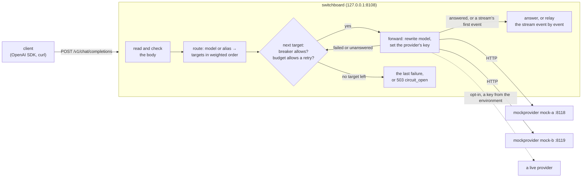

# Switchboard

An OpenAI-compatible LLM gateway in Go. Clients point an OpenAI SDK (or curl) at Switchboard instead of at a
provider; it decides which provider serves the requested model, forwards the request, and returns the answer in
the shape the OpenAI API uses. Over five days it gains what a gateway in front of several providers is for:
routing by weights and aliases, fallback with retry budgets and circuit breakers, streaming, per-key rate limits,
response caching, and token and cost accounting, each measured against local mock providers that simulate latency
and errors.

**Status: day 2 of 5.** Day 1 built the request path: strict request reading, routing by model, forwarding with the
provider's key, and a fixed mapping of every provider answer and failure to what the client gets, with a
deterministic mock provider, a graceful shutdown, a demo of the real binaries and a check with the official OpenAI
Python SDK. Day 2 puts weighted targets and aliases behind each model, falls back across them (never resending to a
provider that may already have done the work), bounds the extra load with a retry budget, skips failing providers
with a circuit breaker each, and streams: server-sent events relayed one at a time, with fallback until the first
event and an error event after it. Day 3 adds client keys, rate limits, caching and cost accounting. See
[DESIGN.md](DESIGN.md) for the specification and the plan.

## Architecture



| Package | What it does |
|---|---|
| `internal/jsonstrict` | Accepts a body only if every JSON parser reads it the same way; returns its top-level members, values byte for byte. |
| `internal/openai` | The request fields the gateway acts on, the rewrite of `model`, OpenAI's error shape, JSON 404s and 405s. |
| `internal/config` | The JSON configuration, read strictly; provider keys only from environment variables; models with aliases and weighted targets. |
| `internal/route` | The order one request tries a model's targets in: by weight, standbys last. |
| `internal/budget` | The retry budget: retries as a share of requests over the last 10 seconds. |
| `internal/breaker` | A circuit breaker per provider: closed, open, half-open with one probe; results kept to their generation. |
| `internal/gateway` | The handler: check, route, try each target (the fallback loop), map; the SSE relay (`stream.go`). |
| `internal/mock` | A mock provider: latency, errors, hangs and cut-offs, plain or streamed, deterministic given a seed. |
| `cmd/switchboard` | `serve`, `check`, `version`; graceful shutdown. |
| `cmd/mockprovider` | The mock provider as a server. |

## Quick start

Go 1.27 and curl. `make demo` builds everything, starts two mock providers and the gateway, sends nine requests
through it with curl (and eleven more with the OpenAI Python SDK, if it is installed), checks each answer, and stops
everything:

```bash
make demo
```

```
ok    the models                         200
ok    fast, through mock-a               200
ok    smart, through mock-b              200
ok    an unknown model                   404
ok    streaming                          200
ok    a model given twice                400
ok    a form post                        415
ok    sdk: the models                     ['fast', 'gpt-4o-mini', 'smart', 'mock-small']
...
ok    sdk: streaming                      15 chunks, 12 words, length
ok    sdk: a bad stream request           400 n
ok    smart, with mock-b down            200
ok    a stream that breaks               200, curl exit 18
ok    sdk: a stream that breaks           APIError upstream_unavailable after 20 chunks
all checks passed
```

"smart, with mock-b down" is the fallback: mock-b is stopped, and `smart`'s standby target on mock-a answers. For
"a stream that breaks", mock-b comes back with `-cut-rate 1`, so every answer breaks off part-way; the stream has
started, so the client gets an error event and a cut transfer rather than a 502, and the SDK raises the event as an
`APIError`.

To run it by hand, in three terminals:

```bash
go run ./cmd/mockprovider -addr 127.0.0.1:8118 -name mock-a
```

```bash
go run ./cmd/mockprovider -addr 127.0.0.1:8119 -name mock-b
```

```bash
go run ./cmd/switchboard serve -config configs/local.json
```

Then:

```bash
curl -s http://127.0.0.1:8108/v1/chat/completions -H 'Content-Type: application/json' \
  -d '{"model":"fast","messages":[{"role":"user","content":"What does a gateway do?"}]}'
```

Streamed, event by event (`-N` stops curl buffering):

```bash
curl -sN http://127.0.0.1:8108/v1/chat/completions -H 'Content-Type: application/json' \
  -d '{"model":"smart","stream":true,"messages":[{"role":"user","content":"What does a gateway do?"}]}'
```

Or with the OpenAI Python SDK (`scripts/sdk_check.py` does more of this, and `make demo` runs it when `.venv` has
the SDK: `python3.11 -m venv .venv && .venv/bin/pip install -r scripts/requirements-sdk.txt`):

```python
from openai import OpenAI

client = OpenAI(base_url="http://127.0.0.1:8108/v1", api_key="placeholder")  # client keys come on day 3
reply = client.chat.completions.create(model="fast", messages=[{"role": "user", "content": "Hello"}])
print(reply.choices[0].message.content)  # This is mock-a answering as mock-small. You said: "Hello". ...
```

`make check` runs what CI runs (gofmt, vet, `go test -race`). `go run ./cmd/switchboard check -config FILE`
loads a configuration and prints its routes.

## The API (days 1 and 2)

| Method and path | What it does |
|---|---|
| `POST /v1/chat/completions` | Forwards a chat completion to one of the model's targets, falling back to the others; with `stream: true`, relays the answer as server-sent events. |
| `GET /v1/models` | Every name the gateway answers to (each model's, then its aliases), in OpenAI's list shape, `owned_by` `switchboard`. |
| `GET /v1/models/{model}` | One of them (404 `model_not_found` otherwise); SDKs call it to check a model exists. Names may hold slashes. |
| `GET /livez` | 200 while the process runs, whatever the `Host` (load balancers probe by address). |
| `GET /readyz` | 200 while serving; 503 during a stop's `drain_delay`, while everything else is still served. Any `Host`. |

Every error from the API's endpoints, the gateway's own included, has OpenAI's error shape, so SDKs raise their
usual exceptions (the health endpoints answer in plain text):

```json
{"error": {"message": "the model \"gpt-9\" is not served here; GET /v1/models lists the ones that are", "type": "invalid_request_error", "param": "model", "code": "model_not_found"}}
```

Before forwarding, the gateway refuses: a `Host` header that isn't one of `allowed_hosts` (403; by default only
the loopback names, against DNS rebinding), a content type other than `application/json` (415), a body over
`max_request_bytes` (413), a body with more than one meaning (a key given twice, invalid UTF-8, data after the
object: 400), a missing or malformed `model`, `messages` or `stream` (400), and an unknown model (404). Everything
else in the request (`temperature`, `tools`, `response_format`, parameters that don't exist yet) passes through
byte for byte (top-level keys are written again from what they decode to). Only `model` is rewritten, to the
provider's name for the model.

What the client gets for each provider outcome:

| The provider... | The client gets |
|---|---|
| answers 200 with a JSON object | 200 and the body, byte for byte |
| answers 400, 413, 422 or 429 with a JSON object | the same status and body (429 keeps `Retry-After`) |
| answers 401 or 403 | 502 `upstream_auth`: the gateway's key was refused, not the client's |
| answers anything else (5xx, 404, a redirect, a 200 that isn't JSON) or too much | 502 `upstream_error` |
| can't be reached, or breaks off | 502 `upstream_unavailable` |
| is slower than its `timeout` | 504 `upstream_timeout` |

If the client goes away, the provider's request is cancelled too. Each response carries `X-Request-Id` (also on
the request to the provider and in the log line), `X-Switchboard-Provider` (whose answer it is) and
`X-Switchboard-Attempts`.

**Fallback (day 2).** The table is what one attempt gives. A request tries the model's targets in weighted order
(standbys of weight 0 last), at most `max_attempts` of them, each target once, and each attempt ends in one of three
outcomes:

| Outcome | When | Next |
|---|---|---|
| answered | a completion; 400, 413, 422; an answer over the limit; the gateway stopping | the client gets it |
| failed (the provider didn't do the work) | 429, 5xx, 401/403, 404, a redirect, another 4xx; or it never got the whole request | any other target |
| unanswered (it may have done the work) | it got the request, then timed out, broke off, or answered 200 without JSON | other providers only |

Every retry needs the retry budget's say-so (in any 10 s, at most 0.2 retries per request plus 1 a second, by
default), and every attempt the provider's circuit breaker's (5 failures in a row open it for 10 s, then one probe).
When nothing more may be tried, the client gets the last attempt's answer with only its own headers; when every
target's breaker is open, 503 `circuit_open` with `Retry-After`.

**Streaming (day 2).** Nothing is written until the provider's first data event, so a stream that fails before it
falls back like any request. The first event commits: 200, `text/event-stream`, and every event as it comes, flushed
one at a time. A stream that breaks after that (ended before `data: [DONE]`, no progress for the provider's timeout,
too large, the gateway stopping) gets one last event in OpenAI's error shape, which the OpenAI SDK raises as an
`APIError`, and the connection is dropped. The provider's `timeout` is the longest wait for its next sign of
progress: the whole answer, or a stream's next event.

## Results (day 1)

Measured on an Apple M3 (8 cores), macOS 26.6.2, Go 1.27.1, **on battery** (99%, Low Power Mode off), other
applications open, load average 3.3 to 4.1, at commit `92f8214`. Medians of 6 runs, ranges in brackets. The
provider is the mock with no simulated latency, on loopback, and the requests are synthetic, so these are the cost
of the HTTP hops and of the gateway's own work, not of any model.

```bash
make bench | tee run/bench.txt
python3 scripts/bench_medians.py < run/bench.txt
```

**What the gateway adds to a request** (`BenchmarkOverhead`, one request at a time, 20,000 a run):

| Request | Straight to the mock: p50 / p99 / mean | Through the gateway: p50 / p99 / mean | Added at p50 |
|---|---|---|---|
| one message, 79 bytes | 39 / 94 / 40.9 µs | 81 / 183 / 85.0 µs | 42 µs |
| 20 messages, 3,997 bytes | 86 / 214.5 / 90.0 µs | 170 / 338.5 / 179.7 µs | 84 µs |

The gateway's own work on the body, parsing, checking and rewriting it (`BenchmarkParseAndRewrite`), is 2.1 µs and 53
allocations for the short request, and 35.0 µs and 397 allocations (38.9 KB) for the conversation. So of the 84 µs
added to the conversation, about 35 are parsing; the rest, and nearly all of the short request's 42 µs, is the
second HTTP hop. Against a real provider, which takes hundreds of milliseconds to seconds, both are under a tenth of
a millisecond. The allocation-heavy parse is the part worth making faster; day 4's load test will show whether it
matters under concurrency.

**Keeping connections to the provider** (`BenchmarkPool`, 32 requests in flight at once, 3,000 a run):

| The gateway's transport | Provider connections opened per request | Time per request | Requests a second |
|---|---|---|---|
| Go's default: 2 idle per host | 0.475 [0.466, 0.505] | 33.9 µs [32.3, 39.3] | about 29,500 |
| Switchboard's: 256 idle per host | 0.0102 [0.0087, 0.0107] | 23.3 µs [22.8, 23.6] | about 42,800 |

With Go's default, about every other request opens a new connection (and leaves a socket in TIME_WAIT for 30 s on
macOS, out of 16,384 ephemeral ports); with 256 kept idle, the gateway opens about 31 connections in 3,000 requests,
roughly one per request in flight, once. That is 45% more requests a second. `TestTheGatewayKeepsItsProviderConnections`
pins the behaviour: after 32 requests at once, the next 32 open 0 connections (30 with Go's default). Over HTTP/2,
which the gateway uses for https providers, one connection carries many requests and the difference shrinks.

**Fuzzing:** `FuzzParseObjectAgreesWithItsOwnOutput` ran 2,355,061 inputs in 21 s with no failure (`go test -run
'^$' -fuzz FuzzParseObject -fuzztime 20s ./internal/jsonstrict`, at `7016e51`); `FuzzRewriteKeepsTheMeaning` ran
1,044,560 inputs in 30 s with no failure (`-fuzztime 30s`, at `60c3a8e`, after a 60 s run whose count wasn't kept).

**Compatibility:** `make demo` passes its eight curl checks and the eight checks of the official OpenAI Python SDK
(openai 3.35.1) here and in CI.

## Results (day 2)

Measured on the same Apple M3 (8 cores), macOS 26.6.2, Go 1.27.1, **on battery** (57% to 56%, Low Power Mode off),
other applications open, load average 2.4 to 3.0, at commit `25743b6`, 16:15 to 16:17. Medians of 6 runs, ranges in
brackets. The providers are the mock with no simulated latency, or test servers that refuse or hang, on loopback; the
requests are synthetic.

```bash
make bench > run/bench-day2.txt
python3 scripts/bench_medians.py < run/bench-day2.txt
```

**What day 2 costs a request that needs no fallback.** Day 1's `BenchmarkOverhead` again, now through the attempt
loop (route, budget, breaker): through the gateway 83 µs at p50 [83, 84] for the 79-byte request and 172 µs [171,
172] for the 4 KB conversation, against 39 and 87 µs straight to the mock: 44 and 85 µs added, against day 1's 42
and 84. The parts on their own, per call: `route.Order` 19.7 ns for one target and 114.5 ns (4 allocations) for
three and a standby; the budget's `Request` and `Retry` together 101 ns (no allocation); a closed breaker's `Allow`
and `Success` 42 ns (1 allocation).

**Streaming** (`BenchmarkStream`, a 32-word answer: 34 chunks and `[DONE]`, one stream at a time, 5,000 a run):

| | First event, p50 | Whole stream, p50 / p99 |
|---|---|---|
| straight to the mock | 40 µs [40, 40] | 145 µs [144, 146] / 285 µs [256, 772] |
| through the gateway | 84 µs [84, 85] | 195 µs [194, 195] / 408 µs [400, 439] |

The gateway adds 44 µs to the first event (the second hop, the parse, and reading the provider's first event before
committing) and 6 µs more to the other 34 events together. With no latency the mock writes its events in a burst, so
this is the relay's own cost, not a model's pace (`TestAStreamIsRelayedEventByEventAsItArrives` checks the pace).

**A dead provider, with and without breakers** (`BenchmarkDeadProvider`: a model whose first target is down and
whose standby answers; the dead one either refuses connections or accepts them and never answers, until its 10 ms
timeout; one request at a time, 500 a run; breakers at 5 failures and a 10 s cooldown, which no run lasted long
enough to reach):

| The dead provider | Breakers off: p50 / p99 / mean | Breakers on: p50 / p99 / mean |
|---|---|---|
| refuses connections | 123 / 278.5 / 127.6 µs | 84 / 205 / 88.2 µs |
| hangs until its timeout | 13.3 ms / 15.9 ms / 13.2 ms | 88 µs / 12.0 ms / 212.9 µs |

With breakers off, every request first waits for the dead provider: a refused connection costs about 40 µs, a hang
the whole 10 ms timeout and then some (13.3 ms at p50, 3.3 ms more than the timeout and the standby's answer
account for; I haven't traced where those go). With breakers on, the first five requests pay that, and the rest go straight to the standby:
the p50 is the healthy path's, and the p99 is those first five of 500. Against a hanging provider the mean falls
62-fold, from 13.2 ms to 0.21 ms.

**Fuzzing:** `FuzzEventReaderAgreesWithTheReference` ran 5,455,590 inputs in 60 s with no failure after its first
run's find (`go test -run '^$' -fuzz FuzzEventReaderAgreesWithTheReference -fuzztime 60s ./internal/gateway`, at
`943569d`, with a review's tests running alongside).

**Compatibility:** `make demo` passes its nine curl checks and the eleven checks of the official OpenAI Python SDK
(openai 3.35.1), streaming and the SDK raising a broken stream's error event included, here and in CI.

## Configuration

`configs/local.json` routes three models (and an alias) to the two mocks; `smart` has a standby:

```json
{
  "listen": "127.0.0.1:8108",
  "shutdown_grace": "10s",
  "providers": [
    {"name": "mock-a", "base_url": "http://127.0.0.1:8118/v1", "timeout": "10s"},
    {"name": "mock-b", "base_url": "http://127.0.0.1:8119/v1", "timeout": "10s"}
  ],
  "models": [
    {"name": "fast", "aliases": ["gpt-4o-mini"], "provider": "mock-a", "upstream_model": "mock-small"},
    {"name": "smart", "targets": [
      {"provider": "mock-b", "upstream_model": "mock-large", "weight": 1},
      {"provider": "mock-a", "upstream_model": "mock-large", "weight": 0}
    ]},
    {"name": "mock-small", "provider": "mock-a"}
  ]
}
```

A model has either `provider` (and `upstream_model`, the model's own name by default) or `targets`, each a
`provider`, an `upstream_model` and a `weight` from 0 to 1000 (default 1; 0 is a standby); `aliases`; and
`max_attempts` (default: the number of targets). At the top level, `retry_budget` (`ratio` 0.2, `min_per_second` 1;
`{"ratio": 0, "min_per_second": 0}` turns fallback off) and `circuit_breaker` (`failures` 5, `cooldown` "10s";
`failures` 0 turns breakers off).

Other settings: `max_request_bytes` (default 4 MiB), `max_response_bytes` (16 MiB; both at most 1 GiB),
`drain_delay` (default 0: how long a stopping gateway keeps serving with `/readyz` at 503), `allowed_hosts` (default
the loopback names; `["*"]` for any), and per provider `timeout` (default 60 s) and `api_key_env`. **No key is ever in a file:** `api_key_env` names the environment variable that
holds it, and the gateway refuses to start if it is unset. A live provider is opt-in:
`configs/openai.example.json` routes `gpt-4o-mini` to OpenAI with the key from `OPENAI_API_KEY`. Tests and CI use
the mocks only and need no key.

The file is read strictly: a key given twice, a key in the wrong case, an unknown key or a null is an error that
names it, not a silent default.

## The mock provider

`mockprovider` answers like OpenAI's API with a sentence that names the provider and model and quotes the last
user message, padded to `-completion-tokens` words (it counts a word as a token). Its latency is `-ttft` plus
`-per-token` for each word, scaled by `-jitter`. It fails a fraction `-error-rate` of requests with
`-error-status`, never answers a fraction `-hang-rate`, and breaks a fraction `-cut-rate` of answers off part-way
(day 2). With `"stream": true` it streams OpenAI's chunks, a token's time apart, then `data: [DONE]` (and the usage
first, if `stream_options.include_usage` asks). Every fate comes from a PCG seeded with `-seed`, four draws per
request whatever the outcome, so a run is reproducible, and a higher error, hang or cut rate only turns answers into
failures, hangs or cuts.

## Tests

`make check` runs gofmt, `go vet` and `go test -race` over every package (131 test and fuzz functions, about 7 s);
CI runs the same on Ubuntu 24.04, then `make demo`'s script with the SDK checks as a second job.

| Package | What the tests pin down |
|---|---|
| `jsonstrict` | members in order and byte for byte; repeated keys at any depth (also after unescaping); invalid UTF-8; anything but one object; the depth limit; a fuzz test that every accepted body rebuilds to itself |
| `openai` | the acted-on fields and every way they can be wrong; keys equal to them only when case is ignored (including `ſ` for `s`), at the top level, in messages and in parts; the rewrite leaves every other byte alone; a fuzz test that a Go provider reads the forwarded body as the gateway did; the error envelope |
| `config` | the checked-in configs load; defaults (day 2's field by field); 89 kinds of mistake, each refused with its name (30 of them day 2's: targets, weights, aliases, `max_attempts`, the budget, the breaker); no key, nothing of a `base_url`, and no `api_key_env` that may be a pasted key, in any error |
| `route` | every point of a 3/1/2 weight layout picks its target, standbys last; 40,000 seeded draws put a 3:1 model's heavier target first within 5 standard deviations of 3/4 |
| `budget` | on a hand-moved clock: the ratio, the floor, expiry at exactly 10 s, a slot that comes round again, a slot nothing reuses, a clock stepped back, 0 and 0 turning fallback off, 8 goroutines allowing exactly 800 retries for 8,000 requests at 0.1 |
| `breaker` | failures in a row (a success resets them); the cooldown; one probe at a time, its success, failure and hand-back; results counting only in their generation (late successes and failures from before a change); a ticket reporting once; 16 goroutines opening it once |
| `mock` | exact answers and usage; `max_tokens` and `n`; validation; the key; latency lower bounds; jitter bounds; the same seed gives the same run, and a higher error, hang or cut rate only adds failures, hangs or cuts; `Close` drops held and later requests; an unreadable body is a 400; a stream is the plain answer chunk by chunk (with `n` = 2), its pace, its usage chunk, a cut stream with no `[DONE]`, a cut answer shorter than its `Content-Length` |
| `gateway` | a forward with only `model` rewritten and only the allowlisted headers; the `Host` allowlist (any spelling of an address, no `Host` at all, the health endpoints exempt, refusals logged); every refusal before forwarding, the request limit at exactly its boundary, a 408 for a slow body, a 503 for a body still arriving at the stop; every row of the mapping table with a misbehaving provider; the response limit at exactly its boundary; timeouts (no answer, a trickled body); unreachable and cut-off providers; a client that leaves or half-closes (never an empty 200); the shutdown 503; a forwarded request never resent; HTTP/2 to an https provider; the pool keeping its connections; the log line's facts and absences; 64 concurrent requests |
| `gateway`, day 2 | 19 kinds of failure, each falling back with its outcome or not falling back; the unanswered rule (a timeout skips the same provider's other target; a 500 doesn't); the last answer and only its headers; `max_attempts`; the budget off and at 0.5; open breakers skipped, then 503 with `Retry-After`; a 404 not tripping one; a probe the budget refuses handed back; weights; a client leaving or the stop ending the fallback; a stream byte for byte against the mock's own and flushed per event; 8 ways a stream fails before its first event, each falling back; errors before it mapped as usual (never an empty 200); the error event after it (a cut, a stall, the stop); the timeout between events; a slow client not taken for the provider's timeout; a client leaving mid-stream; the event reader's cases, and a fuzz test against a whole-input reference |
| `cmd/...` | serving, readiness and a clean stop; the drain (`/readyz` 503 while still answering); a request finishing within the grace; one still running after it getting a 503; a second signal ending the real binary at once; the server's timeouts; usage errors and exit codes |

Mutation checks, run by hand: 46 mechanisms removed or broken one at a time, and each made a test fail: 26 in the
gateway (the header allowlist, the redirect rule, the 401 rule, the content type, the `Host` check with its
allowance for no `Host`, its exact health exemption and its log, both limits at both edges, the timeouts, the pool,
never resending, waking a slow body at the stop...), 8 in the stop sequence and the signals, 3 in the
configuration's errors and host rules, 3 in parsing and the case rules, 6 in the mock. One is known to survive: the
signal channel's buffer of 2 rather than 1, a defence for an interleaving no test can force. Two more didn't count:
one didn't build, and reading one byte more than the response limit changes nothing (the size check still catches
it). The commit messages list them; the three reviews found the gaps in the first counts.

Day 2's mutation checks (`9e6cff7`'s message lists them): 18 mechanisms of the fallback, the router, the budget and
the breaker broken one at a time; 16 failed a test at once. The budget's expiry survived (only a reused slot was
tested) and is caught now; a "stop" flag for the shutdown survived because it was redundant, and was removed.

## Design decisions

- **Forward the client's bytes, not re-encoded structs.** Decoding into Go structs and encoding again drops every
  field the structs don't name; OpenAI adds parameters every few months. The gateway reads only what it acts on
  and rewrites only `model`.
- **Refuse what parsers disagree on.** The gateway routes on what it parsed, then the provider parses the same
  bytes. encoding/json keeps the last of two `model` keys and fills fields from keys in any case; another parser
  may keep the first or ignore case. So the gateway refuses a key given twice anywhere in the body, invalid UTF-8,
  and any key that equals one it reads (`model`, `messages`, `stream`; a message's `role` and `content`; a part's
  `type` and `text`) only when case is ignored. A fuzz test checks that, for every body accepted, a Go provider
  reads from the forwarded bytes the model, stream flag and roles the gateway acted on.
- **An allowlist, both ways.** Only `Content-Type`, `Accept`, `X-Request-Id` and the provider's key go upstream.
  Only the body, its status and `Retry-After` (on 429) come back. The client's key never reaches a provider, and the
  provider's rate-limit headers (about the gateway's account) never reach the client.
- **The provider's 401 is the gateway's problem.** Passing it on would tell an SDK user that their key is wrong. It
  becomes a 502.
- **`application/json` only, and only known hosts.** A web page can make a browser post a form or `text/plain`
  cross-origin without a preflight; a gateway on localhost that holds provider keys would spend them for any page
  its user visits. And a page whose domain is made to resolve to 127.0.0.1 (DNS rebinding) is same-origin, so it
  needs no preflight at all; its `Host` header is what gives it away, so only `allowed_hosts` are answered.
- **Loopback by default.** Until client keys exist (day 3), anyone who can reach the port can use the providers'
  keys.
- **Stop in steps.** `/readyz` turns 503 and the gateway keeps serving for `drain_delay` (so a load balancer can
  stop sending first); then requests get the grace to finish; the ones still running are then cancelled through the
  server's base context with a shutdown cause, which cancels their provider requests and lets each answer 503.
  `http.Server.Shutdown` alone returns at its deadline with handlers still running. A second Ctrl-C ends it at once
  (two identical signals sent back to back by a program can merge into one; DESIGN.md says why).
- **No dependencies.** The standard library covers days 1 and 2; Redis and Prometheus come with days 3 and 4.
- **Three outcomes, because a retry can cost money.** An error answer says the provider didn't do the work, so any
  target may be next; a timeout or a cut-off answer doesn't say that, so the provider that may have done it isn't
  sent the request again. "Retryable or not" alone can't express that.
- **A retry budget, not just a retry count.** Fallback absorbs a provider's occasional failures; while one is down,
  the budget stops fallback from multiplying the load on the rest (a retry storm).
- **A breaker per provider, with generations.** An outage or a revoked key is the provider's, whichever model is
  asked; a 404 (one unknown upstream model) isn't counted. A result counts only in the state its attempt was
  allowed in, so slow requests from before a change can't reopen or close the breaker.
- **A stream commits on its first event.** Until then the gateway has written nothing and can still fall back;
  after it, the status is out, so a break becomes an error event (which SDKs raise) and a dropped connection (so no
  client takes it for a complete answer), never a 502.

## Limitations (day 2)

- No client authentication, rate limits, caching or cost accounting (day 3); no metrics (day 4).
- The retry budget and the breakers live in one gateway process: replicas don't share them.
- No deadline across attempts: a request can wait up to `max_attempts` provider timeouts before its last answer
  (the client's own timeout bounds it; leaving cancels everything).
- A target is never retried within a request, even after a 429 with a short `Retry-After`; the client's SDK retries.
- After a stream's first event there is no fallback: the client gets an error event, not another provider's answer.
- A lone `\r` as an SSE line ending isn't recognised (OpenAI and the compatible servers use `\n`).
- Where the mock cuts an answer depends on the cut rate (the cut and its position share one draw).
- `/v1/chat/completions` only: no embeddings, legacy completions, files or assistants.
- The mock counts words, not tokens.
- A request arriving while the gateway stops can be reset rather than answered: a connection still waiting in the
  listener's queue when it closes is never served (seen in the mock's stop test). `drain_delay` with a load balancer
  in front is the cure.
- A provider's error answer larger than `max_response_bytes` becomes a 502 and loses its status (the log keeps it).

## License

MIT
