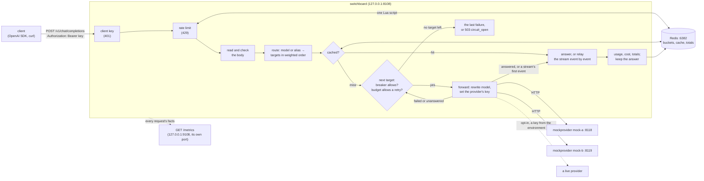

# Switchboard

An OpenAI-compatible LLM gateway in Go. Clients point an OpenAI SDK (or curl) at Switchboard instead of at a
provider; it decides which provider serves the requested model, forwards the request, and returns the answer in
the shape the OpenAI API uses. Over five days it gains what a gateway in front of several providers is for:
routing by weights and aliases, fallback with retry budgets and circuit breakers, streaming, per-key rate limits,
response caching, and token and cost accounting, each measured against local mock providers that simulate latency
and errors.

**Status: day 4 of 5.** Day 1 built the request path: strict request reading, routing by model, forwarding with the
provider's key, and a fixed mapping of every provider answer and failure to what the client gets, with a
deterministic mock provider, a graceful shutdown, a demo of the real binaries and a check with the official OpenAI
Python SDK. Day 2 puts weighted targets and aliases behind each model, falls back across them (never resending to a
provider that may already have done the work), bounds the extra load with a retry budget, skips failing providers
with a circuit breaker each, and streams: server-sent events relayed one at a time, with fallback until the first
event and an error event after it. Day 3 puts client keys in front (the file holds only their SHA-256), a token
bucket per client in Redis (one Lua script, Redis's clock, a 429 the OpenAI SDK waits out by itself), a response
cache per model (answers only, per client unless shared), and accounting: every completion's tokens from the
provider's own `usage` (for a stream whose client didn't ask, the gateway asks and takes it out again), priced in
integer picodollars, and daily totals per client. Day 4 adds Prometheus metrics on a port of their own (the log
line's facts as counters, the cost kept exact), a log level and format, a load generator with an open loop that
doesn't hide stalls, a load test against the mocks, and chaos runs: a provider killed, a provider hung, and Redis hung
and shut down, all under steady load (README "Results (day 4)"). See [DESIGN.md](DESIGN.md) for the specification and
the plan.

## Architecture



| Package | What it does |
|---|---|
| `internal/jsonstrict` | Accepts a body only if every JSON parser reads it the same way; returns its top-level members, values byte for byte. |
| `internal/openai` | The request fields the gateway acts on, the rewrite of `model`, OpenAI's error shape, JSON 404s and 405s. |
| `internal/config` | The JSON configuration, read strictly; provider keys only from environment variables; models with aliases and weighted targets. |
| `internal/route` | The order one request tries a model's targets in: by weight, standbys last. |
| `internal/budget` | The retry budget: retries as a share of requests over the last 10 seconds. |
| `internal/breaker` | A circuit breaker per provider: closed, open, half-open with one probe; results kept to their generation. |
| `internal/gateway` | The handler: check, route, try each target (the fallback loop), map; the SSE relay (`stream.go`); client keys and the rate-limit step (`clients.go`), the cache step (`caching.go`), accounting and taking a stream's usage back out (`accounting.go`); the Prometheus metrics, observed from each request's exchange (`metrics.go`, day 4). |
| `internal/ratelimit` | A token bucket per client in Redis, kept as GCRA's one number, in one Lua script (day 3). |
| `internal/cache` | Answers in Redis, keyed by the SHA-256 of everything that decides them (day 3). |
| `internal/usage` | A completion's usage, its cost in integer picodollars, and daily totals per client and model in Redis (day 3). |
| `internal/redistest` | Tests' Redis: the one `SWITCHBOARD_TEST_REDIS` names, under a prefix of each test's own. |
| `internal/load` | Load: a closed loop or an open one (latency from each request's due time), percentiles, a timeline (day 4). |
| `internal/mock` | A mock provider: latency, errors, hangs and cut-offs, plain or streamed, deterministic given a seed. |
| `cmd/switchboard` | `serve`, `check`, `keygen`, `usage`, `version`; graceful shutdown. |
| `cmd/mockprovider` | The mock provider as a server. |
| `cmd/loadgen` | The load generator's command line (day 4). |

## Quick start

Go 1.27, curl and Redis (`redis-server`; the demo uses the one on 127.0.0.1:6382 if one answers, and otherwise
starts one and stops it after). `make demo` builds everything, starts two mock providers and the gateway, sends
requests through it with curl (and with the OpenAI Python SDK, if it is installed), checks each answer, then runs the
gateway again with day 3's client keys, made for the run, and stops everything:

```bash
make demo
```

```
ok    the models                         200
ok    fast, through mock-a               200
ok    smart, through mock-b              200
ok    an unknown model                   404
ok    streaming                          200
ok    a model given twice                400
ok    a form post                        415
ok    sdk: the models                     ['fast', 'gpt-4o-mini', 'smart', 'mock-small']
...
ok    sdk: streaming                      15 chunks, 12 words, length
ok    sdk: a bad stream request           400 n
ok    smart, with mock-b down            200
ok    a stream that breaks               200, curl exit 18
ok    sdk: a stream that breaks           APIError upstream_unavailable after 20 chunks
...
ok    no key                             401
ok    a key it doesn't know              401
ok    alice                              200
ok    alice again, from the cache        200
ok    alice's third: over her limit      429
ok    bob, a miss                        200
ok    bob again, a hit                   200
ok    a stream, usage not asked          200
ok    sdk: a 429 the SDK waits out        answered 1.02 s later: the SDK read Retry-After and retried
ok    sdk: a 429 without retries          retry-after-ms 935
ok    sdk: a wrong key                    401 invalid_api_key
2026-10-20 (UTC), 4 client and model pairs
  client  model  completions  cache hits  prompt tokens  completion tokens  cost (USD)  unpriced  no usage
   alice   fast            1           1              5                 32  0.00001995         0         0
     bob   fast            1           1              5                  7  0.00000495         0         0
     bob  plain            1           0              5                 32  0.00001995         0         0
   carol  plain            2           0             10                  7   0.0000057         0         0
total cost 0.00005055 USD

ok    metrics: rate_limit_total{client="alice",result="allowed"} 2
ok    metrics: rate_limit_total{client="alice",result="refused"} 1
ok    metrics: cache_total{model="fast",result="hit"} 2
...
ok    no /metrics on the API's port      404
all checks passed
```

"smart, with mock-b down" is the fallback: mock-b is stopped, and `smart`'s standby target on mock-a answers. For
"a stream that breaks", mock-b comes back with `-cut-rate 1`, so every answer breaks off part-way; the stream has
started, so the client gets an error event and a cut transfer rather than a 502, and the SDK raises the event as an
`APIError`.

Day 3's part writes `run/day3.json` (gitignored) with three keys made by `switchboard keygen`: alice may send 2
requests at once and 60 a minute, so her third is a 429 (her second was a cache hit, which still counts); bob's
second identical request is a hit; and carol, with a burst of 1, sends two requests through the OpenAI SDK, whose
second gets a 429 that the SDK itself waits out (it reads `retry-after-ms`) before retrying: answered 1.02 s later,
with no retry code of the client's. The stream bob asks for without `include_usage` has no usage in it, yet is
counted, because the gateway asked for it and took it out again. `switchboard usage` prints the totals. Day 4's
checks read that gateway's metrics (served on 127.0.0.1:9108) and compare 8 series with the requests the demo sent.

To watch the metrics by hand, add `"metrics": {"listen": "127.0.0.1:9108"}` to the config and
`curl -s 127.0.0.1:9108/metrics | grep ^switchboard_`; to put load on it, `go run ./cmd/loadgen -n 2000 -c 8` (or
`-rate 100` for an open loop, `-timeline 1s` for a per-second view).

To run it by hand, in three terminals:

```bash
go run ./cmd/mockprovider -addr 127.0.0.1:8118 -name mock-a
```

```bash
go run ./cmd/mockprovider -addr 127.0.0.1:8119 -name mock-b
```

```bash
go run ./cmd/switchboard serve -config configs/local.json
```

Then:

```bash
curl -s http://127.0.0.1:8108/v1/chat/completions -H 'Content-Type: application/json' \
  -d '{"model":"fast","messages":[{"role":"user","content":"What does a gateway do?"}]}'
```

Streamed, event by event (`-N` stops curl buffering):

```bash
curl -sN http://127.0.0.1:8108/v1/chat/completions -H 'Content-Type: application/json' \
  -d '{"model":"smart","stream":true,"messages":[{"role":"user","content":"What does a gateway do?"}]}'
```

Or with the OpenAI Python SDK (`scripts/sdk_check.py` does more of this, and `make demo` runs it when `.venv` has
the SDK: `python3.11 -m venv .venv && .venv/bin/pip install -r scripts/requirements-sdk.txt`):

```python
from openai import OpenAI

client = OpenAI(base_url="http://127.0.0.1:8108/v1", api_key="placeholder")  # configs/local.json asks for no key
reply = client.chat.completions.create(model="fast", messages=[{"role": "user", "content": "Hello"}])
print(reply.choices[0].message.content)  # This is mock-a answering as mock-small. You said: "Hello". ...
```

With client keys (day 3): make a key, put its hash in a client's entry (`configs/clients.example.json` has the shape;
its two hashes are of keys nobody has), start Redis, and give the SDK the key:

```bash
go run ./cmd/switchboard keygen
```

```
key        sb-<43 random characters: give this to the client; it is printed once and kept nowhere>
key_sha256 <64 hex digits: put this in the client's key_sha256>
```

```bash
redis-server --port 6382 --save "" --appendonly no
```

```bash
go run ./cmd/switchboard usage -config configs/clients.example.json
```

`make check` runs what CI runs (gofmt, vet, `go test -race`, starting the test Redis on 6382 if none answers;
`make redis-stop` stops it). `go run ./cmd/switchboard check -config FILE` loads a configuration and prints its
routes, clients, caches and prices.

## The API (days 1 to 3)

| Method and path | What it does |
|---|---|
| `POST /v1/chat/completions` | Forwards a chat completion to one of the model's targets, falling back to the others; with `stream: true`, relays the answer as server-sent events. |
| `GET /v1/models` | Every name the gateway answers to (each model's, then its aliases), in OpenAI's list shape, `owned_by` `switchboard`. |
| `GET /v1/models/{model}` | One of them (404 `model_not_found` otherwise); SDKs call it to check a model exists. Names may hold slashes. |
| `GET /livez` | 200 while the process runs, whatever the `Host` (load balancers probe by address). |
| `GET /readyz` | 200 while serving; 503 during a stop's `drain_delay`, while everything else is still served. Any `Host`. |

Every error from the API's endpoints, the gateway's own included, has OpenAI's error shape, so SDKs raise their
usual exceptions (the health endpoints answer in plain text):

```json
{"error": {"message": "the model \"gpt-9\" is not served here; GET /v1/models lists the ones that are", "type": "invalid_request_error", "param": "model", "code": "model_not_found"}}
```

Before forwarding, the gateway refuses: a `Host` header that isn't one of `allowed_hosts` (403; by default only
the loopback names, against DNS rebinding), a content type other than `application/json` (415), a body over
`max_request_bytes` (413), a body with more than one meaning (a key given twice, invalid UTF-8, data after the
object: 400), a missing or malformed `model`, `messages` or `stream` (400), and an unknown model (404). Everything
else in the request (`temperature`, `tools`, `response_format`, parameters that don't exist yet) passes through
byte for byte (top-level keys are written again from what they decode to). Only `model` is rewritten, to the
provider's name for the model.

What the client gets for each provider outcome:

| The provider... | The client gets |
|---|---|
| answers 200 with a JSON object | 200 and the body, byte for byte |
| answers 400, 413, 422 or 429 with a JSON object | the same status and body (429 keeps `Retry-After`) |
| answers 401 or 403 | 502 `upstream_auth`: the gateway's key was refused, not the client's |
| answers anything else (5xx, 404, a redirect, a 200 that isn't JSON) or too much | 502 `upstream_error` |
| can't be reached, or breaks off | 502 `upstream_unavailable` |
| is slower than its `timeout` | 504 `upstream_timeout` |

If the client goes away, the provider's request is cancelled too. Each chat completion's response carries
`X-Request-Id` (also on the request to the provider and in the log line); once the model is known, also
`X-Switchboard-Attempts`, and `X-Switchboard-Provider` (whose answer it is) when a provider answered (not on a
refusal before routing, nor on the `circuit_open` 503).

**Fallback (day 2).** The table is what one attempt gives. A request tries the model's targets in weighted order
(standbys of weight 0 last), at most `max_attempts` of them, each target once, and each attempt ends in one of three
outcomes:

| Outcome | When | Next |
|---|---|---|
| answered | a completion; 400, 413, 422; an answer over the limit; the gateway stopping | the client gets it |
| failed (the provider didn't do the work) | 429, 500, 503 and other 5xx, 401/403, 404, a redirect, another 4xx; or it never got the whole request | any other target |
| unanswered (it may have done the work) | it got the request, then timed out, broke off, answered 200 without JSON, or 502, 504 or 524 (its own front end lost its back end) | other providers only |

Every retry needs the retry budget's say-so (in any 10 s, at most 0.2 retries per request plus 1 a second, by
default), and every attempt the provider's circuit breaker's (5 failures in a row open it for 10 s, then one probe).
When nothing more may be tried, the client gets the last attempt's answer with only its own headers; when every
target's breaker is open, 503 `circuit_open` with `Retry-After`.

**Streaming (day 2).** Nothing is written until the provider's first data event, which must be a chunk (a JSON
object, not `[DONE]`), so a stream that fails before it falls back like any request. The first event commits: 200, `text/event-stream`, and every event as it comes, flushed
one at a time. A stream that breaks after that (ended before `data: [DONE]`, no progress for the provider's timeout,
too large, the gateway stopping) gets one last event in OpenAI's error shape, which the OpenAI SDK raises as an
`APIError`, and the connection is dropped. The provider's `timeout` is the longest wait for its next sign of
progress: the whole answer, or a stream's next data event (pings don't count, and the time the gateway spends
writing to a slow client doesn't either).

**Client keys and rate limits (day 3).** With `clients` in the file, every path but `/livez` and `/readyz` needs
`Authorization: Bearer <key>` (what an OpenAI SDK sends as its `api_key`); without one it is 401 `missing_api_key`,
with a key nobody has 401 `invalid_api_key` (unknown paths too, so nothing is learnt without a key). A client with a
`rate_limit` takes a request from its token bucket in Redis before its body is read; every answer then carries
`x-ratelimit-limit-requests`, `x-ratelimit-remaining-requests` and `x-ratelimit-reset-requests`, and an empty bucket
is 429 `rate_limit_exceeded` with `Retry-After` and `retry-after-ms`. The bucket counts requests, not the gateway's
attempts. When Redis can't answer within its `timeout`, the request goes on unlimited (or is 503 with `on_error:
refuse`).

**Caching (day 3).** A model with a `cache` keeps its answers (a 200 with a completion, a stream that ended with
`[DONE]`; never an error or a broken stream) in Redis for its `ttl`, per client unless `shared`. An identical request
(the same body for the same model, whitespace aside, an alias being its model) gets the kept answer byte for byte,
with `X-Switchboard-Cache: hit` and `X-Switchboard-Attempts: 0`, and no provider is asked; otherwise `miss`.
`Cache-Control: no-cache` skips the lookup and keeps the new answer (`refresh`); `no-store` does neither (`bypass`).

**Accounting (day 3).** Every completion's `usage`, as the provider reported it, is logged with its cost at the
`prices` given for its provider and upstream model (`prompt_tokens`, `completion_tokens`, `cost_usd`), and added to
the client's totals for the day in Redis, which `switchboard usage` prints. A stream has a usage only if
`stream_options.include_usage` asks; for a client that didn't ask, the gateway asks and takes the usage out of the
stream again, so the client gets the stream it asked for.

## Results (day 1)

Measured on an Apple M3 (8 cores), macOS 26.6.2, Go 1.27.1, **on battery** (99%, Low Power Mode off), other
applications open, load average 3.3 to 4.1, at commit `92f8214`. Medians of 6 runs, ranges in brackets. The
provider is the mock with no simulated latency, on loopback, and the requests are synthetic, so these are the cost
of the HTTP hops and of the gateway's own work, not of any model.

```bash
make bench | tee run/bench.txt
python3 scripts/bench_medians.py < run/bench.txt
```

**What the gateway adds to a request** (`BenchmarkOverhead`, one request at a time, 20,000 a run):

| Request | Straight to the mock: p50 / p99 / mean | Through the gateway: p50 / p99 / mean | Added at p50 |
|---|---|---|---|
| one message, 79 bytes | 39 / 94 / 40.9 µs | 81 / 183 / 85.0 µs | 42 µs |
| 20 messages, 3,997 bytes | 86 / 214.5 / 90.0 µs | 170 / 338.5 / 179.7 µs | 84 µs |

The gateway's own work on the body, parsing, checking and rewriting it (`BenchmarkParseAndRewrite`), is 2.1 µs and 53
allocations for the short request, and 35.0 µs and 397 allocations (38.9 KB) for the conversation. So of the 84 µs
added to the conversation, about 35 are parsing; the rest, and nearly all of the short request's 42 µs, is the
second HTTP hop. Against a real provider, which takes hundreds of milliseconds to seconds, both are under a tenth of
a millisecond. The allocation-heavy parse is the part worth making faster; day 4's load test will show whether it
matters under concurrency.

**Keeping connections to the provider** (`BenchmarkPool`, 32 requests in flight at once, 3,000 a run):

| The gateway's transport | Provider connections opened per request | Time per request | Requests a second |
|---|---|---|---|
| Go's default: 2 idle per host | 0.475 [0.466, 0.505] | 33.9 µs [32.3, 39.3] | about 29,500 |
| Switchboard's: 256 idle per host | 0.0102 [0.0087, 0.0107] | 23.3 µs [22.8, 23.6] | about 42,800 |

With Go's default, about every other request opens a new connection (and leaves a socket in TIME_WAIT for 30 s on
macOS, out of 16,384 ephemeral ports); with 256 kept idle, the gateway opens about 31 connections in 3,000 requests,
roughly one per request in flight, once. That is 45% more requests a second. `TestTheGatewayKeepsItsProviderConnections`
pins the behaviour: after 32 requests at once, the next 32 open 0 connections (30 with Go's default). Over HTTP/2,
which the gateway uses for https providers, one connection carries many requests and the difference shrinks.

**Fuzzing:** `FuzzParseObjectAgreesWithItsOwnOutput` ran 2,355,061 inputs in 21 s with no failure (`go test -run
'^$' -fuzz FuzzParseObject -fuzztime 20s ./internal/jsonstrict`, at `7016e51`); `FuzzRewriteKeepsTheMeaning` ran
1,044,560 inputs in 30 s with no failure (`-fuzztime 30s`, at `60c3a8e`, after a 60 s run whose count wasn't kept).

**Compatibility:** `make demo` passes its eight curl checks and the eight checks of the official OpenAI Python SDK
(openai 3.35.1) here and in CI.

## Results (day 2)

Measured on the same Apple M3 (8 cores), macOS 26.6.2, Go 1.27.1, **on battery** (57% to 56%, Low Power Mode off),
other applications open, load average 2.4 to 3.0, at commit `25743b6`, 16:15 to 16:17. Medians of 6 runs, ranges in
brackets. The providers are the mock with no simulated latency, or test servers that refuse or hang, on loopback; the
requests are synthetic.

```bash
make bench > run/bench-day2.txt
python3 scripts/bench_medians.py < run/bench-day2.txt
```

**What day 2 costs a request that needs no fallback.** Day 1's `BenchmarkOverhead` again, now through the attempt
loop (route, budget, breaker): through the gateway 83 µs at p50 [83, 84] for the 79-byte request and 172 µs [171,
172] for the 4 KB conversation, against 39 and 87 µs straight to the mock: 44 and 85 µs added, against day 1's 42
and 84. The parts on their own, per call: `route.Order` 19.7 ns for one target and 114.5 ns (4 allocations) for
three and a standby; the budget's `Request` and `Retry` together 101 ns (no allocation); a closed breaker's `Allow`
and `Success` 42 ns (1 allocation).

**Streaming** (`BenchmarkStream`, a 32-word answer: 34 chunks and `[DONE]`, one stream at a time, 5,000 a run):

| | First event, p50 | Whole stream, p50 / p99 |
|---|---|---|
| straight to the mock | 40 µs [40, 40] | 145 µs [144, 146] / 285 µs [256, 772] |
| through the gateway | 84 µs [84, 85] | 195 µs [194, 195] / 408 µs [400, 439] |

The gateway adds 44 µs to the first event (the second hop, the parse, and reading the provider's first event before
committing) and 6 µs more to the other 34 events together. With no latency the mock writes its events in a burst, so
this is the relay's own cost, not a model's pace (`TestAStreamIsRelayedEventByEventAsItArrives` checks the pace).

**A dead provider, with and without breakers** (`BenchmarkDeadProvider`: a model whose first target is down and
whose standby answers; the dead one either refuses connections or accepts them and never answers, until its 10 ms
timeout; one request at a time, 500 a run; breakers at 5 failures and a 10 s cooldown, which no run lasted long
enough to reach):

| The dead provider | Breakers off: p50 / p99 / mean | Breakers on: p50 / p99 / mean |
|---|---|---|
| refuses connections | 123 / 278.5 / 127.6 µs | 84 / 205 / 88.2 µs |
| hangs until its timeout | 13.3 ms / 15.9 ms / 13.2 ms | 88 µs / 12.0 ms / 212.9 µs |

With breakers off, every request first waits for the dead provider: a refused connection costs about 40 µs, a hang
the whole 10 ms timeout and then some (13.3 ms at p50, 3.3 ms more than the timeout and the standby's answer
account for; I haven't traced where those go). With breakers on, the first five requests pay that, and the rest go straight to the standby:
the p50 is the healthy path's, and the p99 is those first five of 500. Against a hanging provider the mean falls
62-fold, from 13.2 ms to 0.21 ms.

**Fuzzing:** `FuzzEventReaderAgreesWithTheReference` ran 5,455,590 inputs in 60 s with no failure after its first
run's find (`go test -run '^$' -fuzz FuzzEventReaderAgreesWithTheReference -fuzztime 60s ./internal/gateway`, at
`943569d`, with a review's tests running alongside).

**Compatibility:** `make demo` passes its nine curl checks and the eleven checks of the official OpenAI Python SDK
(openai 3.35.1), streaming and the SDK raising a broken stream's error event included, here and in CI.

## Results (day 3)

Measured on the same Apple M3 (8 cores), macOS 26.6.2, Go 1.27.1, **on battery** (62%, Low Power Mode off), other
applications open, load average 3.9 to 4.2, at commit `1a08237`, with no review agent running. Redis 8.8.0 on
loopback (the one `make test` starts, nothing kept on disk). Medians of 6 runs, ranges in brackets; requests are
synthetic and the mock has no simulated latency, so these are the HTTP hops, the gateway's own work and its Redis
round trips.

```bash
go test -run '^$' -bench Overhead -benchtime 20000x -count 6 ./internal/gateway > run/bench-day3.txt
SWITCHBOARD_TEST_REDIS=127.0.0.1:6382 go test -run '^$' -bench Day3 -benchtime 5000x -count 6 ./internal/gateway >> run/bench-day3.txt
go test -run '^$' -bench Unasked -benchtime 1000000x -count 6 ./internal/gateway >> run/bench-day3.txt
SWITCHBOARD_TEST_REDIS=127.0.0.1:6382 go test -run '^$' -bench Take -benchtime 20000x -count 6 ./internal/ratelimit >> run/bench-day3.txt
python3 scripts/bench_medians.py < run/bench-day3.txt
```

**What day 3 adds to a request** (`BenchmarkDay3`, the small request one at a time, 5,000 a run):

| Setup | p50 | p99 | mean | Redis round trips |
|---|---|---|---|---|
| day 2's path (no key, no Redis) | 87.5 µs [87, 88] | 184 µs | 91.0 µs | 0 |
| a client key | 88 µs [88, 89] | 190.5 µs | 91.8 µs | 0 |
| the key and the totals | 187 µs [187, 188] | 303 µs | 190.8 µs | 1 (the MULTI) |
| the key, a rate limit and the totals | 285 µs [285, 286] | 403.5 µs | 289.5 µs | 2 (the script, the MULTI) |
| a cache that always misses | 373 µs [373, 374] | 504 µs | 378.1 µs | 3 (GET, MULTI, SET) |
| a cache that always hits | 227.5 µs [227, 228] | 286.5 µs | 229.9 µs | 2 (GET, MULTI); no provider |

- A client key costs about 0.5 µs (a SHA-256 and a map lookup). Each Redis round trip costs 95 to 99 µs on this
  Mac's loopback (the differences between the rows): one rate-limit check alone (`BenchmarkTake`, an EVALSHA) is 88.9 µs [88.7, 89.0], and redis-benchmark's
  own PING with one client has a p50 of 79 µs here (`redis-benchmark -p 6382 -n 20000 -c 1 -q -t ping_mbulk`, 15:53).
  So day 3's cost is its round trips, made one after another: about 200 µs for a rate-limited, accounted request.
  Batching the totals in the background (one round trip less per request) is day 4's to weigh.
- A cache hit is 227.5 µs, against the provider's whole latency: next to the mock's default (200 ms to the first
  token and 5 ms a token, about 360 ms for 32 tokens) or any real model, the hit is three orders of magnitude faster;
  next to this benchmark's no-latency mock it is slower, because it makes two round trips where the mock makes none.
- Taking the usage out of a chunk (`BenchmarkUnasked`, OpenAI's `"usage": null` on a 178-byte chunk): 2.73 µs [2.73,
  2.74] and 76 allocations by parsing the chunk and writing it again, so a 34-event stream whose client didn't ask
  for usage paid about 93 µs of CPU, 15 times day 2's whole relay (6 µs). A fast path for OpenAI's own shape (the
  chunk ends with `,"usage":null}`, cut out of the bytes after `json.Valid`) made it 414 ns [414, 431] and 1
  allocation (`run/bench-day3-unasked-fast.txt`, the code of `ff16d42`, 16:28; the 1-minute load average was
  22.9 from a fuzz run just ended, but the unchanged case, 103.7 ns against 103.4, says the run itself was quiet).
  A chunk with no usage in it passes in 0.10 µs. `FuzzUnaskedsFastPathAgreesWithTheParse` checks the cut against the
  parse: 3,146,813 inputs in 46 s, no difference.
- The same run's day-1 overhead (`BenchmarkOverhead`): 87 µs through the gateway against 40 µs straight to the mock
  for the small request (47 µs added; 42 on day 1, 44 on day 2), 175 against 87 µs for the 4 KB one.
- The OpenAI Python SDK and the 429 (the demo): carol, with a burst of 1 at 60 a minute, sends two requests at once;
  the second is answered 1.02 s later, the SDK having read `retry-after-ms` and retried by itself (1.02, 1.02 and
  1.01 s in three demo runs).

## Results (day 4)

Measured on the same Apple M3 (8 cores), macOS 26.6.2, Go 1.27.1, Redis 8.8.0 on loopback, **on AC power** (Low Power
Mode off), other applications open, load average 2.7 to 4.8, no agent running, all at `e4c1912`: the load test from
19:35 to 19:37, the chaos runs from 19:38 to 19:40, the benchmarks at 19:41. loadgen, the gateway and the mocks share
the machine's cores, so the throughput is the whole setup's on one laptop, a lower bound on the gateway's own.
Requests are synthetic; every number below is from these runs.

A first run on battery (19:00 to 19:07) gave the same picture, but the day-4 review then found three flaws in what it
measured: every p99.9 was one rank high (a float rounding in the percentile), loadgen re-dialled above 100 workers (the
transport's idle limit), and the chaos faults landed 0.85 s late on the timeline (the open loop's warmup ignored the
rate). These are the re-runs after the fixes.

```bash
make redis               # the Redis on 6382 the redis cases use
RUNS=3 scripts/load.sh   # each case 3 times; scripts/load_table.py prints the medians
scripts/chaos.sh         # three 40 s phases; the timelines and metric changes go to run/chaos/
go test -run '^$' -bench 'Observe|LogLine' -benchtime 200000x -count 6 ./internal/gateway > run/bench-day4.txt
python3 scripts/bench_medians.py < run/bench-day4.txt
```

**Load** (medians of 3 runs, the throughput's range in brackets; closed loops unless marked; every request got a 200):

| Case | requests/s | p50 | p90 | p99 | p99.9 |
|---|---|---|---|---|---|
| straight to the mock, 1 at a time | 21,900 [21,777, 22,055] | 0.043 ms | 0.050 ms | 0.102 ms | 0.199 ms |
| through the gateway, 1 at a time | 9,853 [9,811, 9,862] | 0.097 ms | 0.109 ms | 0.203 ms | 0.332 ms |
| the gateway with a key, a rate limit and the totals, 1 at a time | 3,329 [3,258, 3,351] | 0.294 ms | 0.312 ms | 0.480 ms | 0.848 ms |
| straight to the mock, 32 at a time | 77,744 [76,911, 82,270] | 0.285 ms | 0.892 ms | 1.935 ms | 3.166 ms |
| through the gateway, 32 at a time | 31,247 [30,846, 31,263] | 0.839 ms | 1.928 ms | 3.207 ms | 4.505 ms |
| the same with the log at warn | 33,241 [30,330, 33,409] | 0.776 ms | 1.803 ms | 3.077 ms | 4.452 ms |
| with the key, the rate limit and the totals, 32 at a time | 21,316 [20,829, 21,532] | 1.365 ms | 2.172 ms | 3.454 ms | 6.788 ms |
| a mock answering in ~360 ms, straight, open loop at 600/s | 586 | 360.808 ms | 361.223 ms | 363.813 ms | 372.063 ms |
| the same through the gateway | 586 | 360.980 ms | 361.559 ms | 362.504 ms | 366.429 ms |

- **The gateway adds 54 µs** to a request at a time (0.097 against 0.043 ms; the in-process `BenchmarkOverhead` said
  47 on day 3), and **0.2 ms at the median** to a provider that takes 360 ms, with about 216 requests in flight; its
  p99 and p99.9 were lower than straight to the mock in this run, so they are within the noise. (586 requests a
  second is 9,000 over the 15 s of sending plus the last answer's 360 ms.)
- **Each Redis round trip is about 98 µs** here: a key, a rate limit and the totals (two round trips) add 197 µs one
  at a time. That decided day 3's open question: the totals stay written before the handler returns. Batching them
  would save 98 µs of a request that spends hundreds of milliseconds at its provider, and lose the log line's word on
  whether they were written.
- **The log line is cheap**: with it, 31,247 requests a second; without (log at warn), 33,241, but the runs' ranges
  overlap (and the first run on battery had them the other way round, 30,527 and 30,075). Measured alone
  (`BenchmarkLogLine`, which includes the metrics): 2.09 µs and 11 allocations for an answered request, 3.07 µs for a
  fallback (its `tried` list); the metrics alone (`BenchmarkObserve`) 0.44 and 0.57 µs and 1 allocation. Against the
  54 µs the gateway adds, the line is 4% and the metrics 1%.
- **Counting is exact under load**: the Redis case's totals and the plain case's metrics each count 112,500
  completions (3 runs of 37,500 sent, warmups included), and `switchboard usage` priced 562,500 prompt and 3,600,000
  completion tokens at $0.15 and $0.60 a million at exactly $2.244375.
- **Why the slow case is an open loop**: with every answer taking the same time, a closed loop of 256 workers sends in
  waves of 256 at once, and its median then measures the queue within a wave: +5 ms through the gateway in a trial
  run (before the re-dial fix, which may account for part of it), against +0.2 ms at a steady rate.

**Chaos** (200 requests a second, 8,000 each after a 200-request warmup at the same rate, open loop; model `smart`
is mock-b with mock-a as its fallback; mocks answer in about 54 ms; the provider timeout 2 s; the default breaker (5
failures, 10 s) and budget (20% + 1 a second); timeline seconds count from the warmup's end):

| Phase | What happened to the dependency | Answered | p50 | p99 | max | What the metrics say |
|---|---|---|---|---|---|---|
| a provider killed | mock-b killed at 10 s (connections refused), started again at 25 s | 8,000 of 8,000 | 54.8 ms | 57.9 ms | 114 ms | 12 attempts lost (11 in flight, unanswered; 1 refused), each fell back; breaker opened 2 times; 4,010 skips |
| a provider hung | mock-b stopped (SIGSTOP) at 10 s, continued at 25 s | 7,989; 11 got 504 | 54.8 ms | 2,057 ms | 2,060 ms | 405 attempts lost (140 unanswered, 265 never fully delivered); the budget allowed 394 fallbacks and refused 11; breaker opened 2 times; 4,411 skips |
| Redis hung, then down | stopped at 10 s, continued at 20 s, shut down at 25 s, started at 32 s | 8,000 of 8,000 | 54.6 ms | 256 ms | 459 ms | about 3,510 requests without Redis: rate limit 3,511 and cache 3,510 `unavailable`, totals not written 3,493 |

- **A killed provider costs nothing visible**: the 11 requests in flight at the kill (due in the last 54 ms of second
  9, so they show in that second's row) and the one refused connection fall back at once, the breaker opens after
  five, and every later request skips mock-b until a probe 10 s later (which failed: opened again) and the next one
  at about 30 s, which found it back. Traffic returned 5 s after mock-b did: recovery waits for the probe.
- **A hung provider costs its timeout until the breaker hears**: the requests sent in the 2 s before five timeouts
  had come back each waited 2 s, then fell back (p50 2,056 ms in seconds 10 and 11, then 54 ms again):

  ```
      from    sent      ok  failed         p50         p99  X-Switchboard-Provider
      9.0s     200     200       0    54.732ms  2057.943ms  mock-a 9, mock-b 191
     10.0s     200     200       0  2055.969ms  2058.452ms  mock-a 200
     11.0s     200     189      11  2056.005ms  2058.845ms  mock-a 189, mock-b 11
     12.0s     200     200       0    54.170ms    57.385ms  mock-a 200
  ```

  Those ~400 fallbacks in 2 s were more than the budget's 20%: it refused 11 (6 in the battery run), which became the
  504s (`upstream_timeout`). That is the budget doing its job, capping the extra load a failure puts on the other
  provider; a shorter provider timeout is the lever that would have saved them. The probe 10 s after the breaker
  opened hung too (2 s, then opened again), so traffic returned only at about 34 s, 9 s after mock-b did. How the 405
  lost attempts split
  between "unanswered" and "never fully delivered" depends on which connections the pool had open: 140 and 265 here,
  328 and 77 in the battery run.
- **A shorter timeout is that lever, measured**: the hung phase again with the providers' timeout at 500 ms
  (`PHASES=provider-hung PROVIDER_TIMEOUT=500ms scripts/chaos.sh`, 20:01, at `df257d0`, on AC power): 8,000 of 8,000
  answered, p99 555 ms; 105 attempts lost, all fell back, and the budget refused none. The price is the timeout's
  meaning: for a plain request it bounds the whole answer, so 500 ms would cut off a real model writing a long one
  (DESIGN "Timeouts and shutdown"); it suits a fast model, or streams, where it bounds each next event.
- **A hung Redis costs 100 ms a step for about 1 s, then nothing**: four Redis steps (limit, lookup, totals, keeping)
  at their 100 ms timeout made p99 459 ms in second 10; then go-redis's own dial breaker took over. After `PoolSize`
  (80 here) dial errors in a row its pool fails every dial at once and re-dials in the background once a second
  (`internal/pool/pool.go`, `dialConn` and `tryDial`), and dials began to fail once the kernel's accept queue for the
  stopped Redis (128 here, `kern.ipc.somaxconn`) was full. Linux's default of 4096 would make that take longer. With
  `on_error: allow` (the default) every request was answered; the metrics counted each missed step.
- **What it found**: with the log at warn, the battery run's 3,529 requests without Redis (all answered 200) logged
  nothing, so the log showed no outage at all; a failed Redis step now makes the line WARN (`b123102`).

## Configuration

`configs/local.json` routes three models (and an alias) to the two mocks; `smart` has a standby:

```json
{
  "listen": "127.0.0.1:8108",
  "shutdown_grace": "10s",
  "providers": [
    {"name": "mock-a", "base_url": "http://127.0.0.1:8118/v1", "timeout": "10s"},
    {"name": "mock-b", "base_url": "http://127.0.0.1:8119/v1", "timeout": "10s"}
  ],
  "models": [
    {"name": "fast", "aliases": ["gpt-4o-mini"], "provider": "mock-a", "upstream_model": "mock-small"},
    {"name": "smart", "targets": [
      {"provider": "mock-b", "upstream_model": "mock-large", "weight": 1},
      {"provider": "mock-a", "upstream_model": "mock-large", "weight": 0}
    ]},
    {"name": "mock-small", "provider": "mock-a"}
  ]
}
```

A model has either `provider` (and `upstream_model`, the model's own name by default) or `targets`, each a
`provider`, an `upstream_model` and a `weight` from 0 to 1000 (default 1; 0 is a standby); `aliases`; and
`max_attempts` (default: the number of targets). At the top level, `retry_budget` (`ratio` 0.2, `min_per_second` 1;
`{"ratio": 0, "min_per_second": 0}` turns fallback off) and `circuit_breaker` (`failures` 5, `cooldown` "10s";
`failures` 0 turns breakers off).

Other settings: `max_request_bytes` (default 4 MiB), `max_response_bytes` (16 MiB; both at most 1 GiB),
`drain_delay` (default 0: how long a stopping gateway keeps serving with `/readyz` at 503), `allowed_hosts` (default
the loopback names; `["*"]` for any), and per provider `timeout` (default 60 s) and `api_key_env`. **No key is ever in a file:** `api_key_env` names the environment variable that
holds it, and the gateway refuses to start if it is unset. A live provider is opt-in:
`configs/openai.example.json` routes `gpt-4o-mini` to OpenAI with the key from `OPENAI_API_KEY`. Tests and CI use
the mocks only and need no key.

Day 3's settings: `redis` (`addr`; `prefix`, default `switchboard:`; `timeout`, default 100 ms; `on_error`,
`allow` (default) or `refuse`; `password_env`), `clients` (each `name`, `key_sha256` from `switchboard keygen`, and
an optional `rate_limit` of `requests_per_minute` and `burst`, by default a minute's requests), `prices` (per provider
and `upstream_model`, `input_per_million` and `output_per_million` in dollars, plain decimals of at most 6 places), a
model's `cache` (`ttl`, `shared`), and a provider's `stream_usage` (default true: may the gateway ask it for a
stream's usage). `configs/clients.example.json` has all of them:

```json
{
  "redis": {"addr": "127.0.0.1:6382", "timeout": "100ms", "on_error": "allow"},
  "clients": [
    {"name": "alice", "key_sha256": "5b57e588...", "rate_limit": {"requests_per_minute": 60, "burst": 10}},
    {"name": "bob", "key_sha256": "8874f418..."}
  ],
  "models": [
    {"name": "fast", "aliases": ["gpt-4o-mini"], "provider": "mock-a", "upstream_model": "mock-small",
      "cache": {"ttl": "10m"}}
  ],
  "prices": [
    {"provider": "mock-a", "upstream_model": "mock-small", "input_per_million": 0.15, "output_per_million": 0.6}
  ]
}
```

Day 4's: `metrics` (`listen`, a `host:port` other than the API's) and `log` (`level`: `info`, the default, `warn` or
`error`; `format`: `json`, the default, or `text`). `configs/clients.example.json` serves the metrics on 127.0.0.1:9108.

The file is read strictly: a key given twice, a key in the wrong case, an unknown key or a null is an error that
names it, not a silent default (161 kinds of mistake, 56 of them day 3's: a rate limit or a cache without Redis, two
clients with one key, a price with an exponent or seven places...; 16 day 4's, such as metrics on the API's port
or a port past 65535).

## The mock provider

`mockprovider` answers like OpenAI's API with a sentence that names the provider and model and quotes the last
user message, padded to `-completion-tokens` words (it counts a word as a token). Its latency is `-ttft` plus
`-per-token` for each word, scaled by `-jitter`. It fails a fraction `-error-rate` of requests with
`-error-status`, never answers a fraction `-hang-rate`, and breaks a fraction `-cut-rate` of answers off part-way
(day 2). With `"stream": true` it streams OpenAI's chunks, a token's time apart, then `data: [DONE]` (and the usage
first, if `stream_options.include_usage` asks). Every fate comes from a PCG seeded with `-seed`, four draws per
request whatever the outcome, so a run is reproducible, and a higher error, hang or cut rate only turns answers into
failures, hangs or cuts.

## Tests

`make check` runs gofmt, `go vet` and `go test -race` over every package (279 test and fuzz functions, 235 of them
before day 4; about 25 s, with the test Redis on 6382 started if none answers; coverage 96.9% across packages with
`go test -coverpkg=./...`, and on their own: gateway 98.3%, config 99.3%, load 97.5%, breaker 97.1%, usage 95.7%,
ratelimit 92.3%, loadgen 90.7%, cache 87.5% (its misses are errors `json.Compact` and `json.Marshal` can't return there). CI runs the same on Ubuntu 24.04 with
Redis 8 as a service container, then `make demo`'s script with the SDK checks (and its own Redis) as a second job.

| Package | What the tests pin down |
|---|---|
| `jsonstrict` | members in order and byte for byte; repeated keys at any depth (also after unescaping); invalid UTF-8; anything but one object; the depth limit; a fuzz test that every accepted body rebuilds to itself |
| `openai` | the acted-on fields and every way they can be wrong; keys equal to them only when case is ignored (including `ſ` for `s`), at the top level, in messages and in parts; the rewrite leaves every other byte alone; a fuzz test that a Go provider reads the forwarded body as the gateway did; the error envelope |
| `config` | the checked-in configs load; defaults (day 2's field by field); 89 kinds of mistake, each refused with its name (30 of them day 2's: targets, weights, aliases, `max_attempts`, the budget, the breaker); no key, nothing of a `base_url`, and no `api_key_env` that may be a pasted key, in any error |
| `route` | every point of a 3/1/2 weight layout picks its target, standbys last; 40,000 seeded draws put a 3:1 model's heavier target first within 5 standard deviations of 3/4 |
| `budget` | on a hand-moved clock: the ratio, the floor, expiry at exactly 10 s, a slot that comes round again, a slot nothing reuses, a clock stepped back, 0 and 0 turning fallback off, 8 goroutines allowing exactly 800 retries for 8,000 requests at 0.1 |
| `breaker` | failures in a row (a success resets them); the cooldown; one probe at a time, its success, failure and hand-back; results counting only in their generation (late successes and failures from before a change); a ticket reporting once; 16 goroutines opening it once |
| `mock` | exact answers and usage; `max_tokens` and `n`; validation; the key; latency lower bounds; jitter bounds; the same seed gives the same run, and a higher error, hang or cut rate only adds failures, hangs or cuts; `Close` drops held and later requests; an unreadable body is a 400; a stream is the plain answer chunk by chunk (with `n` = 2), its pace, its usage chunk, a cut stream with no `[DONE]`, a cut answer shorter than its `Content-Length` |
| `gateway` | a forward with only `model` rewritten and only the allowlisted headers; the `Host` allowlist (any spelling of an address, no `Host` at all, the health endpoints exempt, refusals logged); every refusal before forwarding, the request limit at exactly its boundary, a 408 for a slow body, a 503 for a body still arriving at the stop; every row of the mapping table with a misbehaving provider; the response limit at exactly its boundary; timeouts (no answer, a trickled body); unreachable and cut-off providers; a client that leaves or half-closes (never an empty 200); the shutdown 503; a forwarded request never resent; HTTP/2 to an https provider; the pool keeping its connections; the log line's facts and absences; 64 concurrent requests |
| `gateway`, day 2 | 21 kinds of failure, each falling back with its outcome or not falling back; the unanswered rule (a timeout skips the same provider's other target; a 500 doesn't); the last answer and only its headers; `max_attempts`; the budget off and at 0.5; open breakers skipped, then 503 with `Retry-After`; a 404 not tripping one; a probe the budget refuses handed back; weights; a client leaving or the stop ending the fallback; a stream byte for byte against the mock's own and flushed per event; 8 ways a stream fails before its first event, each falling back; errors before it mapped as usual (never an empty 200); the error event after it (a cut, a stall, the stop); the timeout between events; a slow client not taken for the provider's timeout; a client leaving mid-stream; the event reader's cases, and a fuzz test against a whole-input reference |
| `ratelimit` (day 3) | on a hand-moved clock: the burst then the wait, refills at the rate and no further, a rate of 0.5 a minute a second at a time, a clock going back, one bucket per client, expiry when full; 200 requests at once against a burst of 50 (exactly 50 pass); Redis's own clock; Redis down and Redis never answering |
| `usage` (day 3) | usage from answers and chunks (missing, negative, too large, fractional, quoted counts are no usage); costs exact to the picodollar and written exactly; totals per day, client and model (a model name with a colon, the next UTC day), their expiry; a prefix with a `*` read as itself |
| `cache` (day 3) | the key changes with the scope, the model, any byte of the request but whitespace, and parts can't run together; entries come back as they went (bytes of any kind), the size limit at its edge, unreadable entries are misses, the ttl |
| `gateway`, day 3 | every way to send no key or a wrong one (401 for unknown paths too; health exempt; never logged; never upstream); limits per client, their headers, the 429's `Retry-After` and `retry-after-ms`, refilled a second later; requests not attempts; the limit before the body; Redis down (allow and refuse) and silent (bounded by its timeout); usage and exact costs per answer and stream (asked for or not, an alias, unpriced, no usage); a stream with the usage taken out against the mock's own, event for event, and OpenAI's `"usage": null` chunks; errors and broken streams uncounted; a cache hit byte for byte, misses, per client unless shared, only answers kept, `no-cache` and `no-store`, a stream's hit, Redis down |
| `gateway`, day 4 | the metrics against the log's lines whatever the requests (one request per line by status and code, the attempts, tokens and cost), and exact values for fallback, a breaker opening and its skip, 404, 400, a stream, the budget refusing, rate limits, the cache per client, key and Host refusals, Redis down per step, a client leaving (499, `client_closed`); a cost exact over a million requests; the text format; the metrics handler's Host check and methods; an answer whose Redis steps failed logged at WARN, each step alone; a cache lookup's failure kept when the write works; a stream broken after its usage (uncounted tokens); the in-flight gauge during a request |
| `load`, `loadgen` (day 4) | an open loop counting a stall's wait in every request it delays and a closed loop not (25 slow requests against 1); the warmup unmeasured, and an open loop's at the rate, its end the timeline's 0 s; a connection kept per worker (200 workers); a run stopped part-way or before its first measured request; p99.9 of 1,000 as the 999th; the rate kept; errors by kind; a timeout; nearest-rank percentiles; the timeline by due time; the key from the environment; bad arguments |
| `cmd/...` | serving, readiness and a clean stop; the metrics on their own port (none on the API's, none of the API on theirs, a rebinding Host refused, closed after the stop), a busy metrics port, the log's level and format; the drain (`/readyz` 503 while still answering); a request finishing within the grace; one still running after it getting a 503; a second signal ending the real binary at once; the server's timeouts; usage errors and exit codes |

## Reviews and mutation checks

Every day's code was reviewed by background agents, one at a time, each in a worktree of a fixed commit, asked for a
correctness and docs-against-code review with every finding reproduced as a failing test. I reproduced each finding
here before fixing it; the tests are kept as `review_*_test.go` (by day: `review_`, `review_d2_`, `review_d3_`,
`review_d4_`, `review_d5_`, and `review2_` for a day's second review), each opening with the bug it found. Each day's
mutation checks (a mechanism removed or broken, then the tests run) were done by hand, from a copy of the file.

### Day 1

Three reviews, one agent at a time, each of only the code since the last (16, 21 and 8 minutes, at `07b8b14`,
`92f8214` and `670dd76`), reproduced 8, 4 and 1 defects, kept as `review_*_test.go` and `review2_*_test.go`. The
first: a handler returning without writing gave an empty `200 OK` (a malformed chunked body, a client half-closing
after its request); every `base_url` error quoted the URL, keys in it included; `max_response_bytes` at the largest
integer overflowed the read (every answer a 502); the mock's hangs moved with its error rate; `/readyz`'s 503 could
never be seen (the listener closed at once; hence `drain_delay`); and from its suspicions, DNS rebinding (a page's
`Host` got a 200 and reached the provider: hence `allowed_hosts`), a key ending in `\r`, a second Ctrl-C swallowed,
and a slow body at the stop cut off unanswered. The second found bugs in those fixes: the Host check refused an
HTTP/1.0 probe with no `Host` and `::1` spelt out; a key pasted into `api_key_env` was printed in its error; a second
signal sent right after the first was still lost. The third found that the same signal sent twice by a program merges
into one (the kernel keeps one pending flag per signal; documented, not fixable), and a latent HTTP/2 hazard (a read
deadline set after the handler returned), fixed. Their 19 mechanisms broken with every test passing (10, 5 and 4)
each fail a test now, but one (below).

**Mutation checks**, run by hand: 46 mechanisms removed or broken one at a time, and each made a test fail: 26 in the
gateway (the header allowlist, the redirect rule, the 401 rule, the content type, the `Host` check with its
allowance for no `Host`, its exact health exemption and its log, both limits at both edges, the timeouts, the pool,
never resending, waking a slow body at the stop...), 8 in the stop sequence and the signals, 3 in the
configuration's errors and host rules, 3 in parsing and the case rules, 6 in the mock. One is known to survive: the
signal channel's buffer of 2 rather than 1, a defence for an interleaving no test can force. Two more didn't count:
one didn't build, and reading one byte more than the response limit changes nothing (the size check still catches
it). The commit messages list them; the three reviews found the gaps in the first counts.

### Day 2

**Mutation checks** (the commit messages list them): 18 mechanisms of the fallback, the router, the budget and
the breaker broken one at a time, 16 caught at first (the budget's expiry is caught now; a redundant "stop" flag was
removed); 17 of the relay and the mock's stream, 15 caught at first (comments before the first event dropped, and a
clean end without `[DONE]`, are caught now). Then a review (one agent, 21 minutes, at `b3b5e1f`) reproduced four bugs
as failing tests, kept as `review_d2_*_test.go` (a slow client cut as the provider's timeout, which I had fixed
meanwhile; a streamed probe holding its breaker; a `[DONE]`-only stream as an answer; the mock checking
`stream_options` after its draw), and listed 24 one-line changes no test caught. Each was run as a mutant here
afterwards: all 24 fail a test now (`health_test.go` and others). A second review (one agent, at `ff95f4f`, of the
fixes only) found that the first fix for the streamed probe had reported every stream's start as a success, so breaks
after the first chunk never added up to an open breaker (now only a probe reports early), and that a stream
starting with a byte order mark, which the SSE grammar allows, was refused. Of its 10 one-line survivors, 8 fail a
test now; the check between attempts survives (no test can make a client leave exactly between two attempts), and so
does the same check before the first attempt, which is equivalent in practice.

### Day 3

205 test and fuzz functions at the start of the review, and more after it. A review (one agent, 17 minutes,
at `4134835`, the core of the day) reproduced four bugs, all in streams, kept as `review_d3_*_test.go`: a stream
with the provider's error event in it (what vLLM sends when its engine fails) was cached and counted, so the error
was served from the cache for its ttl; taking the usage out dropped whole chunks that only had `"usage": null`
(Azure's first chunk), and wrote every rewritten event as a lone data line, losing its `id:` and `event:` lines; and
a usage chunk as a stream's first data event committed a 200 of nothing but `[DONE]`. Its suspicions, each tested
before fixing, gave four more: a stop during a Redis call waited out a hung Redis's whole timeout, before the answer
(go-redis ends a command at its deadline, not at a cancel) and after it (the answer held in the buffer); a 200 whose
body is an error was cached; a rate so low it overflowed; and SCAN's duplicates. Its 14 one-line changes no test
caught: one went with the code it touched (the cache entry's unused usage), and the other 13 fail a test now, each
run here as a mutant after the tests were written. A second review (one agent, at `7ef9c60`, of the fixes only) found
two bugs in them, kept as `review2_d3_*_test.go`: an error event carrying a usage was taken for the usage chunk and
dropped (so a first event read as no answer, and a mid-stream error never reached the client), and a usage read
before the commit from an attempt that then failed was counted for the next attempt's answer. Its suspicions gave two
more fixes (a stop during the cache lookup logged as Redis's failure, then an attempt; a 200 that is an error still
counted) and its untested branches four tests. Two of its one-line survivors remain, neither testable here: a client
leaving during the rate limit (net/http notices only once the body is read, and the limit comes first), and a stop
during the cache write (it needs a Redis that answers reads and hangs on writes). SCAN's dedupe is tested with a fake
whose SCAN returns every key twice.

### Day 4

Three reviews, one agent at a time (11 minutes each, at `2b5b865`, `bf7a8e7` and `170029b`). The first reproduced
seven bugs, kept as `review_d4_*_test.go`: a cache write that worked erased the lookup's failure (no error in the
line, INFO, uncounted); a stream broken after its usage chunk was logged with tokens nothing counted (now
`uncounted` and `switchboard_uncounted_tokens_total`); three in `loadgen` that skewed the first measurements (every
p99.9 one rank high, from `99.9/100*1000` being `999.0000000000001`; only 100 idle connections in all, so it
re-dialled above 100 workers; an open loop's warmup sent as a burst, putting every chaos fault 0.85 s late); a
metrics listener on the API's port, which on macOS took the API's local traffic; and a run stopped during the warmup
reporting -292 years. Every measurement was re-run after the fixes. The second, of the fixes only, found two bugs in
them: ports compared as strings (`08108` still shadowed `:8108`), and a failed attempt's reported tokens lost when a
fallback answered (now on its `tried` entry and in the metric). The third reproduced none; its five surviving mutants
(where a failed attempt's tokens land) and a port past 65535 passing `check` are each caught now. Of all three
reviews' surviving mutants, every one fails a test now.

## Design decisions

- **Forward the client's bytes, not re-encoded structs.** Decoding into Go structs and encoding again drops every
  field the structs don't name; OpenAI adds parameters every few months. The gateway reads only what it acts on
  and rewrites only `model`.
- **Refuse what parsers disagree on.** The gateway routes on what it parsed, then the provider parses the same
  bytes. encoding/json keeps the last of two `model` keys and fills fields from keys in any case; another parser
  may keep the first or ignore case. So the gateway refuses a key given twice anywhere in the body, invalid UTF-8,
  and any key that equals one it reads (`model`, `messages`, `stream`; a message's `role` and `content`; a part's
  `type` and `text`) only when case is ignored. A fuzz test checks that, for every body accepted, a Go provider
  reads from the forwarded bytes the model, stream flag and roles the gateway acted on.
- **An allowlist, both ways.** Only `Content-Type`, `Accept`, `X-Request-Id` and the provider's key go upstream.
  Only the body, its status and `Retry-After` (on 429) come back. The client's key never reaches a provider, and the
  provider's rate-limit headers (about the gateway's account) never reach the client.
- **The provider's 401 is the gateway's problem.** Passing it on would tell an SDK user that their key is wrong. It
  becomes a 502.
- **`application/json` only, and only known hosts.** A web page can make a browser post a form or `text/plain`
  cross-origin without a preflight; a gateway on localhost that holds provider keys would spend them for any page
  its user visits. And a page whose domain is made to resolve to 127.0.0.1 (DNS rebinding) is same-origin, so it
  needs no preflight at all; its `Host` header is what gives it away, so only `allowed_hosts` are answered.
- **Loopback by default.** Until client keys exist (day 3), anyone who can reach the port can use the providers'
  keys.
- **Stop in steps.** `/readyz` turns 503 and the gateway keeps serving for `drain_delay` (so a load balancer can
  stop sending first); then requests get the grace to finish; the ones still running are then cancelled through the
  server's base context with a shutdown cause, which cancels their provider requests and lets each answer 503.
  `http.Server.Shutdown` alone returns at its deadline with handlers still running. A second Ctrl-C ends it at once
  (two identical signals sent back to back by a program can merge into one; DESIGN.md says why).
- **One dependency.** The standard library covered days 1 and 2; day 3 adds `github.com/redis/go-redis/v9` (v9.23.0),
  set to fail fast: no retries, one dial attempt, every command bounded by `redis.timeout`.
- **Three outcomes, because a retry can cost money.** An error answer says the provider didn't do the work, so any
  target may be next; a timeout or a cut-off answer doesn't say that, so the provider that may have done it isn't
  sent the request again. "Retryable or not" alone can't express that.
- **A retry budget, not just a retry count.** Fallback absorbs a provider's occasional failures; while one is down,
  the budget stops fallback from multiplying the load on the rest (a retry storm).
- **A breaker per provider, with generations.** An outage or a revoked key is the provider's, whichever model is
  asked; a 404 (one unknown upstream model) isn't counted. A result counts only in the state its attempt was
  allowed in, so slow requests from before a change can't reopen or close the breaker.
- **A stream commits on its first event.** Until then the gateway has written nothing and can still fall back;
  after it, the status is out, so a break becomes an error event (which SDKs raise) and a dropped connection (so no
  client takes it for a complete answer), never a 502.
- **Hashes of client keys in the file.** It can be checked in, and a copy of it grants nothing.
- **Limits in Redis, as GCRA.** One bucket per client whichever gateway its requests reach, updated by one Lua script
  (no two gateways take the last request), kept as one time in whole microseconds (a bucket of fractional tokens
  drifted in a test: 120 refills of 1/120 made less than one), on Redis's clock.
- **Fail open.** When Redis is down a request goes on unlimited by default: the limit guards a budget, and a Redis
  outage shouldn't become the gateway's. `on_error: refuse` for budgets that must hold.
- **Cache per client, answers only.** A shared cache tells one client what another asked, so sharing is opt-in per
  model; only completions and finished streams are kept, so a hit is never an error or half an answer.
- **The provider's own token counts.** For a stream whose client didn't ask for its usage, the gateway asks and takes
  it out again, rather than estimating tokens it has no tokenizer for.
- **Money in integer picodollars.** Exact sums, and bounds that make overflow impossible.

## Limitations (day 4)

- A hung provider costs its timeout to every request sent to it before its breaker hears of five timeouts (with a
  2 s timeout at 200 a second, about 400 requests; README "Results (day 4)"); a breaker that counts slow attempts
  before they end would cut that.
- Recovery waits for the breaker's next probe: up to a cooldown after a provider is back.
- The metrics are per process: Prometheus adds up replicas; a breaker's state is each replica's own.
- The load and chaos runs share one laptop with what they measure.
- loadgen's `-timeout` runs from a request's send, not its due time, so in an open loop a request that waited for a
  worker can be recorded slower than the timeout.
- A request whose cache lookup and write both fail logs only the write's error (the metric counts the step once).
- The retry budget and the breakers live in one gateway process: replicas don't share them (rate limits, the cache
  and the totals do, through Redis).
- Rate limits count requests, not tokens: a client's huge prompts spend tokens no request limit sees.
- The cache doesn't stop a stampede: identical requests at once all miss and all go upstream.
- A request makes up to four Redis round trips (the limit, the cache lookup, the totals, keeping a miss's answer),
  one after another; README "Results (day 3)" has their cost.
- A stream that breaks isn't counted (its provider may still bill the tokens it wrote), and neither are unanswered
  attempts before a fallback.
- A key can't be revoked without a restart: the clients are read at start.
- Taking a stream's usage out needs to read the chunk: one that isn't one JSON object to every parser (a key given
  twice, invalid UTF-8) is sent as it came, usage and all, and a `usage` key written with escapes (`"\u0075sage"`)
  isn't recognised, so it is neither taken out nor counted. No provider we know writes either.
- No deadline across attempts: a request can wait up to `max_attempts` provider timeouts before its last answer
  (the client's own timeout bounds it; leaving cancels everything).
- A target is never retried within a request, even after a 429 with a short `Retry-After`; the client's SDK retries.
- After a stream's first event there is no fallback: the client gets an error event, not another provider's answer.
- A lone `\r` as an SSE line ending isn't recognised (OpenAI and the compatible servers use `\n`).
- An HTTP/1.0 client can't see a broken stream's dropped connection (its bodies end when the connection does); the
  error event is its only sign.
- Where the mock cuts an answer depends on the cut rate (the cut and its position share one draw).
- `/v1/chat/completions` only: no embeddings, legacy completions, files or assistants.
- The mock counts words, not tokens.
- A request arriving while the gateway stops can be reset rather than answered: a connection still waiting in the
  listener's queue when it closes is never served (seen in the mock's stop test). `drain_delay` with a load balancer
  in front is the cure.
- A provider's error answer larger than `max_response_bytes` becomes a 502 and loses its status (the log keeps it).

## License

MIT
