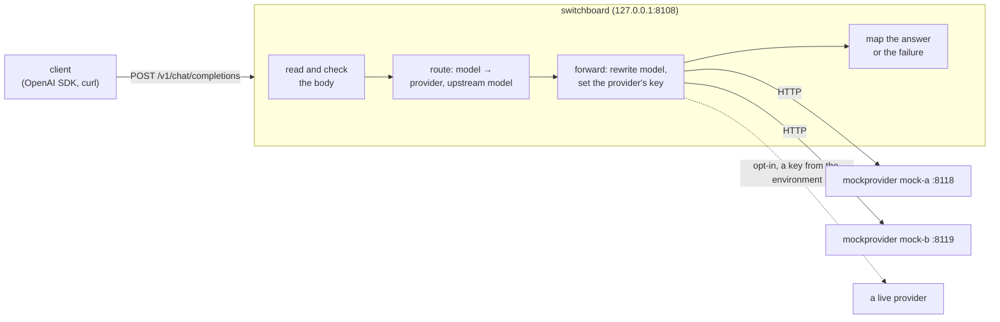

# Switchboard

An OpenAI-compatible LLM gateway in Go. Clients point an OpenAI SDK (or curl) at Switchboard instead of at a
provider; it decides which provider serves the requested model, forwards the request, and returns the answer in
the shape the OpenAI API uses. Over five days it gains what a gateway in front of several providers is for:
routing by weights and aliases, fallback with retry budgets and circuit breakers, streaming, per-key rate limits,
response caching, and token and cost accounting, each measured against local mock providers that simulate latency
and errors.

**Status: day 1 of 5.** The request path works end to end for non-streamed chat completions: strict request
reading, routing by model, forwarding with the provider's key, and a fixed mapping of every provider answer and
failure to what the client gets. There is a deterministic mock provider, a graceful shutdown, a demo that runs the
real binaries, and a check with the official OpenAI Python SDK. Day 2 adds routing across several targets, fallback,
circuit breakers and streaming. See [DESIGN.md](DESIGN.md) for the specification and the plan.

## Architecture



| Package | What it does |
|---|---|
| `internal/jsonstrict` | Accepts a body only if every JSON parser reads it the same way; returns its top-level members byte for byte. |
| `internal/openai` | The request fields the gateway acts on, the rewrite of `model`, OpenAI's error shape, JSON 404s and 405s. |
| `internal/config` | The JSON configuration, read strictly; provider keys only from environment variables. |
| `internal/gateway` | The handler: check, route, forward, map. |
| `internal/mock` | A mock provider: latency, errors and hangs, deterministic given a seed. |
| `cmd/switchboard` | `serve`, `check`, `version`; graceful shutdown. |
| `cmd/mockprovider` | The mock provider as a server. |

## Quick start

Go 1.27 and curl. `make demo` builds everything, starts two mock providers and the gateway, sends eight requests
through it, checks each answer, and stops everything:

```bash
make demo
```

```
ok    the models                         200
ok    fast, through mock-a               200
ok    smart, through mock-b              200
ok    an unknown model                   404
ok    streaming (day 2)                  400
ok    a model given twice                400
ok    a form post                        415
...
ok    smart, with mock-b down            502
all checks passed
```

To run it by hand, in three terminals:

```bash
go run ./cmd/mockprovider -addr 127.0.0.1:8118 -name mock-a
```

```bash
go run ./cmd/mockprovider -addr 127.0.0.1:8119 -name mock-b
```

```bash
go run ./cmd/switchboard serve -config configs/local.json
```

Then:

```bash
curl -s http://127.0.0.1:8108/v1/chat/completions -H 'Content-Type: application/json' \
  -d '{"model":"fast","messages":[{"role":"user","content":"What does a gateway do?"}]}'
```

Or with the OpenAI Python SDK (`scripts/sdk_check.py` does more of this, and `make demo` runs it when `.venv` has
the SDK: `python3.11 -m venv .venv && .venv/bin/pip install -r scripts/requirements-sdk.txt`):

```python
from openai import OpenAI

client = OpenAI(base_url="http://127.0.0.1:8108/v1", api_key="placeholder")  # client keys come on day 3
reply = client.chat.completions.create(model="fast", messages=[{"role": "user", "content": "Hello"}])
print(reply.choices[0].message.content)  # This is mock-a answering as mock-small. You said: "Hello". ...
```

`make check` runs what CI runs (gofmt, vet, `go test -race`). `go run ./cmd/switchboard check -config FILE`
loads a configuration and prints its routes.

## The API (day 1)

| Method and path | What it does |
|---|---|
| `POST /v1/chat/completions` | Forwards a chat completion to the model's provider. `stream: true` is refused with 400 until day 2. |
| `GET /v1/models` | The models this gateway serves, in OpenAI's list shape. |
| `GET /livez` | 200 while the process runs. |
| `GET /readyz` | 200 while serving; 503 before and during shutdown. |

Every error, the gateway's own included, has OpenAI's error shape, so SDKs raise their usual exceptions:

```json
{"error": {"message": "the model \"gpt-9\" is not served here; GET /v1/models lists the ones that are", "type": "invalid_request_error", "param": "model", "code": "model_not_found"}}
```

Before forwarding, the gateway refuses: a content type other than `application/json` (415), a body over
`max_request_bytes` (413), a body with more than one meaning (a key given twice, invalid UTF-8, data after the
object: 400), a missing or malformed `model`, `messages` or `stream` (400), and an unknown model (404). Everything
else in the request (`temperature`, `tools`, `response_format`, parameters that don't exist yet) passes through
byte for byte. Only `model` is rewritten, to the provider's name for the model.

What the client gets for each provider outcome:

| The provider... | The client gets |
|---|---|
| answers 200 with a JSON object | 200 and the body, byte for byte |
| answers 400, 413, 422 or 429 with a JSON object | the same status and body (429 keeps `Retry-After`) |
| answers 401 or 403 | 502 `upstream_auth`: the gateway's key was refused, not the client's |
| answers anything else (5xx, 404, a redirect, a 200 that isn't JSON) or too much | 502 `upstream_error` |
| can't be reached, or breaks off | 502 `upstream_unavailable` |
| is slower than its `timeout` | 504 `upstream_timeout` |

If the client goes away, the provider's request is cancelled too. Each response carries `X-Request-Id` (also on
the request to the provider and in the log line) and `X-Switchboard-Provider`.

## Configuration

`configs/local.json` routes three models to the two mocks:

```json
{
  "listen": "127.0.0.1:8108",
  "shutdown_grace": "10s",
  "providers": [
    {"name": "mock-a", "base_url": "http://127.0.0.1:8118/v1", "timeout": "10s"},
    {"name": "mock-b", "base_url": "http://127.0.0.1:8119/v1", "timeout": "10s"}
  ],
  "models": [
    {"name": "fast", "provider": "mock-a", "upstream_model": "mock-small"},
    {"name": "smart", "provider": "mock-b", "upstream_model": "mock-large"},
    {"name": "mock-small", "provider": "mock-a"}
  ]
}
```

Other settings: `max_request_bytes` (default 4 MiB), `max_response_bytes` (16 MiB), a provider's `timeout`
(default 60 s) and `api_key_env`. **No key is ever in a file:** `api_key_env` names the environment variable that
holds it, and the gateway refuses to start if it is unset. A live provider is opt-in:
`configs/openai.example.json` routes `gpt-4o-mini` to OpenAI with the key from `OPENAI_API_KEY`. Tests and CI use
the mocks only and need no key.

The file is read strictly: a key given twice, a key in the wrong case, an unknown key or a null is an error that
names it, not a silent default.

## The mock provider

`mockprovider` answers like OpenAI's API with a sentence that names the provider and model and quotes the last
user message, padded to `-completion-tokens` words (it counts a word as a token). Its latency is `-ttft` plus
`-per-token` for each word, scaled by `-jitter`. It fails a fraction `-error-rate` of requests with
`-error-status`, and never answers a fraction `-hang-rate`. Every fate comes from a PCG seeded with `-seed`, four
draws per request whatever the outcome, so a run is reproducible and a higher error rate only adds failures.

## Tests

`make check` runs gofmt, `go vet` and `go test -race` over every package; CI runs the same on Ubuntu 24.04, then
`make demo`'s script with the SDK checks as a second job.

| Package | What the tests pin down |
|---|---|
| `jsonstrict` | members in order and byte for byte; repeated keys at any depth (also after unescaping); invalid UTF-8; anything but one object; the depth limit; a fuzz test that every accepted body rebuilds to itself |
| `openai` | the acted-on fields and every way they can be wrong; keys equal to them only when case is ignored (including `ſ` for `s`), at the top level, in messages and in parts; the rewrite leaves every other byte alone; a fuzz test that a Go provider reads the forwarded body as the gateway did; the error envelope |
| `config` | the checked-in configs load; defaults; 38 kinds of mistake, each refused with its name; no key or URL password in any error |
| `mock` | exact answers and usage; `max_tokens` and `n`; validation; the key; latency lower bounds; jitter bounds; the same seed gives the same run and a higher error rate only adds failures; `Close` drops held requests |
| `gateway` | a forward with only `model` rewritten and only the allowlisted headers; every refusal before forwarding; every row of the mapping table with a misbehaving provider; the response limit at exactly its boundary; timeouts (no answer, a trickled body); unreachable and cut-off providers; a client that leaves; the shutdown 503; the log line's facts and absences; 64 concurrent requests |
| `cmd/...` | serving, readiness and a clean stop; a request finishing within the grace; one still running after it getting a 503; usage errors and exit codes |

Mutation checks, run by hand: 19 mechanisms removed or broken one at a time (14 in the gateway, 4 in the stop
sequence, 1 in the mock's draws), and each made a test fail. Two more didn't count: one didn't build, and reading
one byte more than the response limit changes nothing (the size check still catches it). The commit messages list
them.

## Design decisions

- **Forward the client's bytes, not re-encoded structs.** Decoding into Go structs and encoding again drops every
  field the structs don't name; OpenAI adds parameters every few months. The gateway reads only what it acts on
  and rewrites only `model`.
- **Refuse what parsers disagree on.** The gateway routes on what it parsed, then the provider parses the same
  bytes. encoding/json keeps the last of two `model` keys and fills fields from keys in any case; another parser
  may keep the first or ignore case. So the gateway refuses a key given twice anywhere in the body, invalid UTF-8,
  and any key that equals one it reads (`model`, `messages`, `stream`; a message's `role` and `content`; a part's
  `type` and `text`) only when case is ignored. A fuzz test checks that, for every body accepted, a Go provider
  reads from the forwarded bytes the model, stream flag and roles the gateway acted on.
- **An allowlist, both ways.** Only `Content-Type`, `Accept`, `X-Request-Id` and the provider's key go upstream.
  Only the body, its status and `Retry-After` (on 429) come back. The client's key never reaches a provider, and the
  provider's rate-limit headers (about the gateway's account) never reach the client.
- **The provider's 401 is the gateway's problem.** Passing it on would tell an SDK user that their key is wrong. It
  becomes a 502.
- **`application/json` only.** A web page can make a browser post a form or `text/plain` cross-origin without a
  preflight; a gateway on localhost that holds provider keys would spend them for any page its user visits.
- **Loopback by default.** Until client keys exist (day 3), anyone who can reach the port can use the providers'
  keys.
- **Stop in two steps.** Requests get the grace to finish; the ones still running are then cancelled through the
  server's base context with a shutdown cause, which cancels their provider requests and lets each answer 503.
  `http.Server.Shutdown` alone returns at its deadline with handlers still running.
- **No dependencies.** The standard library covers day 1; Redis and Prometheus come with days 3 and 4.

## Limitations (day 1)

- One provider per model: no fallback, retries or circuit breakers yet (day 2).
- No streaming: `stream: true` is refused (day 2).
- No client authentication, rate limits, caching or cost accounting (day 3); no metrics (day 4).
- `/v1/chat/completions` only: no embeddings, legacy completions, files or assistants.
- The mock counts words, not tokens.
- A request arriving while the gateway stops can be reset rather than answered: a connection still waiting in the
  listener's queue when it closes is never served (seen in the mock's stop test).

## License

MIT
